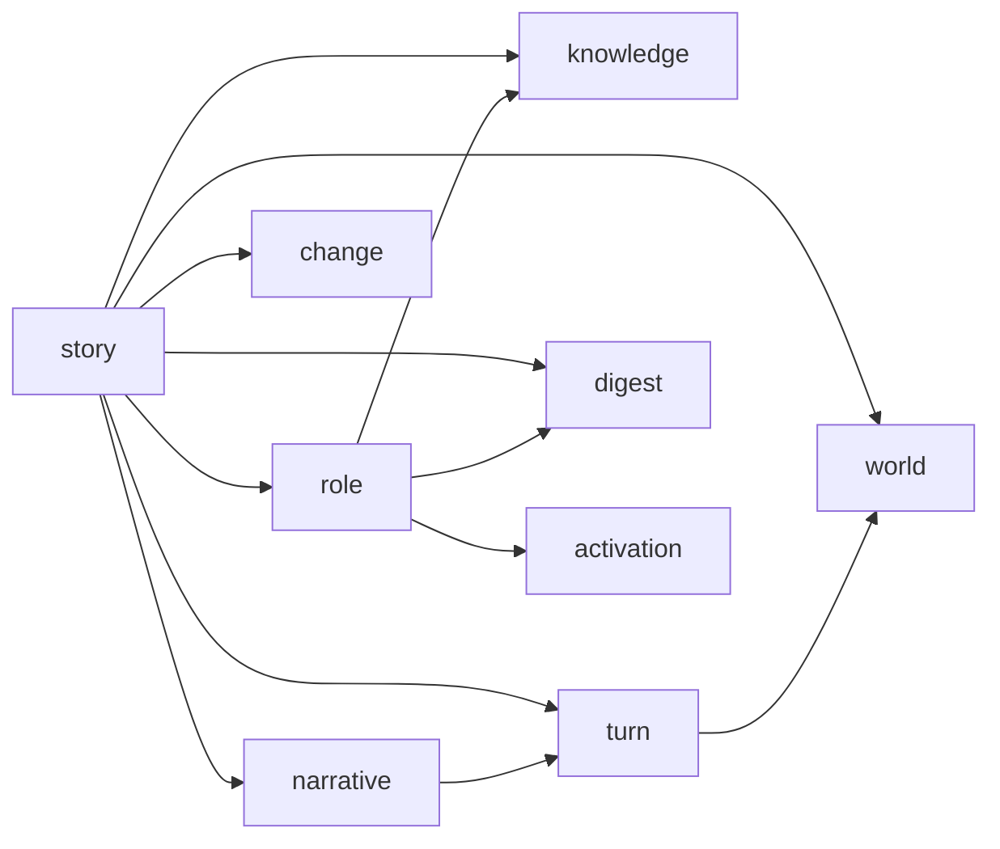

# aise-core 拆除 asset 模块 — Design

> **Date**: 2026-10-13
> **Author**: Opus (Claude)
> **Status**: Draft

---

## Context

### 现状

`aise-core` 的 `core` 层有一个独立的 `asset` 模块，集中承担"资产文档维护"职责：

| 文件 | 内容 |
|---|---|
| `crates/aise-core/src/core/asset/story_pack.rs` | `StoryPack`、`StoryPackSpec`、`StoryPackMeta`、`StoryPackProfile`、`PlayDefinition`，以及 `resolve_cast()` |
| `crates/aise-core/src/core/asset/character_card.rs` | `CharacterCard`、`CharacterCardSpec`、`CharacterMeta` |
| `crates/aise-core/src/core/asset/document.rs` | `from_json()`（含文档大小限制）、`digest()`、`pack_ref()`、`card_ref()` |
| `crates/aise-core/src/core/asset/validate.rs` | 字段长度、列表数量、条目数量等上限校验，以及可扮演角色的结构校验 |
| `crates/aise-core/src/core/asset/config.rs` | `AssetConfig`（8 个上限字段 + 嵌套 `NarrativeConfig`） |
| `crates/aise-core/src/core/asset/error.rs` | `AssetError` |

与之相关的类型分散在别处：`PackRef`、`StoryAssetSpec` 在 `core/story.rs`；`CharacterCardRef` 在 `core/role/actor.rs`；`NarrativeConfig` 在 `core/narrative/config.rs`。`AssetConfig` 一路透传到 `EngineConfig.asset_config`（`crates/aise-core/src/engine/config.rs:15`）、`AiseEngine.asset_config`（`crates/aise-core/src/engine/engine.rs:30`）和 `AiseFactory::create_story` 的参数（`crates/aise-core/src/engine/factory.rs:41`）。

### 问题

1. **职责错位**：aise 内部不再维护故事包、角色卡这些资产，但 core 里仍有一个以"资产"命名的模块，除了定义资产的数据契约，还承担了摄入策略：JSON 解析、文档大小限制和逐字段上限校验。摄入策略属于读入外部文档的调用方，不属于 core。
2. **归属不清**：`StoryPack` 是故事的定义数据，`CharacterCard` 是角色的定义数据，它们和对应的运行时类型（`StoryContext`、`RoleEntry`）被拆在两个模块里，读代码时要在 `asset`、`story`、`role` 之间来回跳。
3. **边界条件过早固化**：`AssetConfig` / `NarrativeConfig` 的上限散落在 asset 和 narrative 两处，与 Turn 运行时的上限（上下文、历史、记忆）没有统一模型。现在保留它们只会增加后续统一处理时的迁移成本。

### 为什么现在做

当前优先级是把代码架构和关键业务做好。先把资产类型按业务归属落位、删除文档维护与上限校验，后续统一设计边界条件时就不需要先拆一层旧结构。

### Constraints & assumptions

- 只改 `aise-core` 和 `aise-service`；旧 crate `crates/aise`（含 `domain/asset`）不在本次范围内。
- 资产 JSON 的数据形状不变：`examples/*.json` 不改，`spec` 版本标签、`meta` 字段保留。
- `BoundedText` 不在本次范围内。
- 硬重构，不保留兼容路径（`R-REFACTOR-01/02`）。
- 删除上限会违反 `R-ARCH-03`（无界扇出）和 `R-ARCH-04`（有界内存），按 Waiver Process 在代码中显式标记（见 Design §3）。

---

## Principles

1. **按业务归属组织**：资产类型跟着它所描述的业务实体走，故事包归 `story`，角色卡归 `role`。
2. **core 拥有数据契约，不负责摄入**：资产的 schema（字段、serde 属性、`spec` 版本标签）由 core 的类型定义，摘要计算也依赖这一序列化形状；读取、大小限制、解析错误包装等摄入策略归调用方。core 只接受类型化的 `StoryPack` / `CharacterCard`。
3. **只保留业务不变量**：core 校验的是"这个故事能不能玩"，例如可扮演角色是否存在、叙事图引用是否闭合；不校验"这个字段有多长"。
4. **边界条件推迟统一处理**：本次删除所有资产/叙事上限配置，不做局部替代；由此产生的 `R-ARCH-03` / `R-ARCH-04` 违反以 `// WAIVER:` 标记显式登记，后续统一设计落地时连同标记一起撤销。
5. **对外路径稳定**：`core/mod.rs` 继续平铺 re-export，`crate::core::StoryPack` 等路径不变，减少无关文件改动。

---

## Options

### Option A：保持现状

- **Idea**：保留 `core/asset`，只删除 `AssetConfig`。
- **Pros**：
  - 改动最小。
- **Cons**：
  - "core 维护资产"的结构表达不变，问题 1、2 都没解决。
  - `validate.rs` 去掉上限后只剩两条结构校验，`document.rs` 去掉大小限制后只剩一层 serde 调用，整个模块名不副实。
- **Risk**：后续统一边界条件时还要再拆一次。

### Option B：资产类型分散到业务模块，删除文档维护与上限校验（采用）

- **Idea**：删除 `core/asset`；故事包类型并入 `core/story`，角色卡类型并入 `core/role`；`from_json` 移出 core；删除 `AssetConfig`、`NarrativeConfig` 及全部上限校验；保留结构校验、`resolve_cast()`、`pack_ref()` / `card_ref()`。
- **Pros**：
  - 目录结构直接表达"core 只定义资产数据契约，不负责摄入"。
  - 每个业务模块同时持有定义数据和运行时数据，阅读路径短。
  - 删除 `validate.rs`、`config.rs`、`narrative/config.rs` 中的上限校验与配置及其测试，配置链路缩短。
- **Cons**：
  - 资产输入暂时没有上限保护，需要为 `R-ARCH-03` / `R-ARCH-04` 登记 waiver（见 Design §3、Risks）。
  - `aise-service` 需要新增 `serde_json` 依赖。
- **Risk**：过大的资产会直接进入 prompt 和存储，直到边界条件统一设计落地。

### Option C：新建独立的 asset crate

- **Idea**：把资产类型、解析和校验移到独立 crate，由 `aise-core` 依赖。
- **Pros**：
  - 资产文档维护有明确的独立归属。
- **Cons**：
  - 与"内部不再维护资产"的前提矛盾，等于换个地方继续维护。
  - `StoryPack` 依赖 `RoleBody`、`NarrativeGraph`、`FactBody` 等 core 类型，独立成 crate 会形成反向依赖或迫使这些类型也外移。
- **Risk**：crate 边界与业务边界不一致，后续重构成本更高。

### Choice

**采用 Option B。**

**Rationale**：Option A 只删配置不改结构，核心问题没解决；Option C 与前提矛盾且引入跨 crate 反向依赖。Option B 用暂时失去输入上限保护的代价，换来清晰的业务归属和更短的配置链路，而上限保护本来就计划统一重做。

---

## Design

### 1. Target structure

```text
crates/aise-core/src/core/
  story/
    mod.rs              模块声明与 re-export
    story_pack.rs       故事资产：StoryPack, StoryPackSpec, StoryPackMeta, StoryPackProfile,
                        PlayDefinition, PackRef, StoryAssetSpec
    story_context.rs    运行时：StoryContext, StorySummary
    story_instance.rs   运行时：StoryInstanceSpec, StoryInstanceInfo, StoryLifeCycle
    story_commit.rs     运行时：StoryCommit
    error.rs            StoryError
    tests/story_pack_tests.rs
  role/
    mod.rs
    role.rs             RoleBody, RoleEntry（不变）
    actor.rs            RoleActor（CharacterCardRef 移出）
    character.rs        CharacterProfile, DialogueExample（不变）
    character_card.rs   角色资产：CharacterCard, CharacterCardSpec, CharacterMeta, CharacterCardRef
    memory.rs           MemoryBody, MemoryEntry（不变）
    tests/character_card_tests.rs
  digest.rs             Sha256Digest 的规范化摘要计算
  tests/fixture.rs      由 asset_fixture.rs 改名

删除：
  core/asset/（整个目录，含 tests/）
  core/story.rs（拆分进 core/story/）
  core/narrative/config.rs
```

模块依赖方向：



`ids`、`bounded_text`、`error` 是所有模块共用的叶子，图中省略。

- `role` 不依赖 `story`。现有代码已满足这一方向：`StoryPack` 本就引用 `RoleBody`，`role` 内没有对 `story` 的引用。
- `story` 依赖 `turn`（`StoryCommit.turn`、`StoryContext.recent_turns`、`TurnNumber`），`turn` 只依赖 `ids` 和 `world`，不形成环。

### 2. Core types & responsibilities

| Type / Module | Responsibility | Out of scope |
|---|---|---|
| `StoryPack` | 故事定义数据；`validate()` 校验可扮演角色和叙事图结构；`resolve_cast()` 解析选角；`pack_ref()` 生成锁定引用（失败返回 `CoreError`） | JSON 解析、字段长度与数量上限 |
| `PackRef` / `StoryAssetSpec` | 故事包的锁定引用，以及交给 `PackStore` 的冻结资产集合（故事包 + 角色卡） | 存储实现 |
| `CharacterCard` | 角色卡定义数据；`card_ref()` 生成锁定引用（失败返回 `CoreError`） | JSON 解析、任何校验 |
| `CharacterCardRef` | 角色卡的锁定引用，供 `RoleActor::Card` 和 `PackStore` 使用 | — |
| `StoryContext` / `StorySummary` | 单个故事的运行时上下文与摘要 | — |
| `StoryInstanceSpec` / `StoryInstanceInfo` / `StoryLifeCycle` | 故事实例的创建参数、元信息、生命周期 | — |
| `StoryCommit` | 一轮 Turn 的提交内容 | — |
| `StoryError` | 故事定义与选角相关的业务错误 | 上限类错误、摘要计算失败 |
| `core/digest.rs` | `Sha256Digest` 的规范化摘要计算，供 `pack_ref()` / `card_ref()` 共用 | 文档解析 |
| `NarrativeGraph::validate()` | 叙事图结构校验：空的 all/any 条件、引用不存在的节点、同一语义条件定义冲突 | 节点数、约束数、语义条件数、嵌套深度上限 |

### 3. 删除与保留清单

**删除：**

| 对象 | 位置 | 理由 |
|---|---|---|
| `AssetConfig` | `core/asset/config.rs` | 边界条件配置，推迟统一处理 |
| `NarrativeConfig` | `core/narrative/config.rs` | 同上，且原本只通过 `AssetConfig` 使用 |
| `StoryPack::from_json` / `CharacterCard::from_json` / `parse_document` | `core/asset/document.rs` | 属于摄入策略，归调用方 |
| 全部长度/数量校验函数 | `core/asset/validate.rs` | 边界条件 |
| `CharacterCard::validate` | `core/asset/validate.rs` | 去掉上限后没有剩余检查项 |
| `AssetError` 的 `DocumentTooLarge`、`MalformedDocument`、`TextTooLong`、`TooManyItems`、`InvalidEntry` | `core/asset/error.rs` | 对应逻辑已删除 |
| `NarrativeError` 的 `TooManyNodes`、`TooManyConstraints`、`TooManySemanticConditions`、`ConditionTooDeep` | `core/narrative/error.rs` | 边界条件 |
| `EngineConfig.asset_config`、`AiseEngine.asset_config` | `engine/config.rs`、`engine/engine.rs` | 配置已删除 |

**保留（业务不变量）：**

- `StoryPack::validate()`：去掉参数，只做两项检查：`playable_roles` 不能为空（`NoPlayableRole`），且必须都是 `roles` 中的角色（`UnknownRole`）。包里有叙事图时再调用 `NarrativeGraph::validate()`。
- `StoryPack::resolve_cast()`：行为不变，错误类型改为 `StoryError`。
- `NarrativeGraph::validate()`：去掉参数，保留 `EmptyCondition`、`UnknownNode`、`SemanticCriterionConflict` 三项结构校验；`NarrativeCondition::validate` 不再携带深度参数。
- `pack_ref()` / `card_ref()` 和摘要计算：`PackStore` 按 `PackRef` / `CharacterCardRef` 定位资产，`StoryContext.pack_ref` 依赖它锁定版本，属于运行时业务。

**Waiver（`R-ARCH-03` / `R-ARCH-04`）：**

删除上限后，以下路径失去上界：

| 路径 | 原上限 | 影响 |
|---|---|---|
| `StoryPack.opening` 每个 Turn 拼入 prompt（`pipeline/common/pipeline_prompt.rs` 的 `load_story_opening`） | `max_opening_bytes` 16KB | 单 Turn prompt 大小 |
| 全局与节点 `constraints` 进入 plan / generate / validate / repair 的 prompt | `max_list_items` × `max_text_bytes`、`max_constraints_per_node` | 单 Turn prompt 大小 |
| `NarrativePlan::queries` 条数等于被监听的语义条件数 | `max_semantic_conditions` | extract 接入 LLM 判定后的每 Turn 扇出（`R-ARCH-03`） |
| `PackStore` 快照只按数量限制（`max_packs`、`max_character_cards`） | `max_document_bytes` 1MB 间接限制单个快照 | 常驻内存总量（`R-ARCH-04`） |

资产进入 core 的唯一入口是 `AiseFactory::freeze_story`，waiver 标记放在其调用 `spec.story_pack.validate()` 的位置，Phase 0 引入，Phase 1 原样保留：

```rust
// WAIVER: R-ARCH-03
// WAIVER: R-ARCH-04
spec.story_pack.validate()?;
```

后续边界条件统一设计落地时删除这两行标记。

### 4. 错误类型

`StoryError` 取代 `AssetError`，放在 `core/story/error.rs`，只承载故事业务错误：

| 变体 | 来源 |
|---|---|
| `NoPlayableRole` | `StoryPack::validate()` |
| `UnknownRole { field, role_id }` | `StoryPack::validate()`、`resolve_cast()` |
| `RoleNotPlayable { role_id }` | `resolve_cast()` |
| `Narrative(NarrativeError)` | `NarrativeGraph::validate()` |

`CoreError` 新增 `DigestFailed { subject, message }`，`subject` 标识是故事包还是角色卡。`pack_ref()` 和 `card_ref()` 都返回 `CoreError`。摘要失败是内部错误，不属于故事业务，不经过 `StoryError`；`StoryError` 也不提供 `From<CoreError>`，避免其他 `CoreError` 被 `?` 静默吸收成故事错误。

`EngineError::Asset { message }` 删除，新增两个携带源错误的变体：

| 变体 | 来源 |
|---|---|
| `Story(#[from] StoryError)` | 故事定义校验、选角 |
| `Core(#[from] CoreError)` | 摘要计算失败 |

调用方可以按变体区分调用方错误（如 `StoryError::RoleNotPlayable`）和内部错误（摘要失败）。`EngineError` 其余变体保持 `{ message }` 形式，不在本次范围内。

### 5. Key flows

**创建故事（`AiseEngine::create_story`）：**

1. 调用方（如 `aise-service`）用 `serde_json` 把外部文档反序列化为 `StoryPack` / `CharacterCard`，构造 `StoryCreationSpec`。结构与格式检查（`deny_unknown_fields`、`spec` 版本标签）由 serde 的 derive 完成。
2. `AiseFactory::create_story(store, spec)`，不再接收 `asset_config`。
3. `freeze_story` 调用 `spec.story_pack.validate()`（waiver 标记所在位置），失败返回 `EngineError::Story`。
4. `freeze_cast` 为每张角色卡计算 `card_ref()`，生成 `RoleActor::Card`，不再校验卡片；摘要失败返回 `EngineError::Core`。
5. `resolve_cast()` 校验玩家角色可扮演、选角角色存在，并用 `RoleActor::Default` 补齐未指定的角色。
6. `pack_ref()` 生成锁定引用，组装 `StoryAssetSpec` 交给 `PackStore::retain`，再组装 `StoryInstanceSpec` 交给 `StoryStore::create`。失败时释放已保留的资产，这部分行为不变。

**运行 Turn**：不受影响。pipeline 通过 `crate::core::*` 的平铺 re-export 访问类型，导入路径不变。

### 6. Key decisions

- **core 与资产文档的边界** → core 保留 schema（字段、serde 属性、`spec` 版本标签），摄入策略移出 → schema 是类型定义本身，摘要计算也依赖它，移出会迫使 core 再维护一套 DTO 转换；摄入策略（读取、大小限制、错误包装）随输入来源变化，归调用方。
- **`from_json` 放在哪里** → 移出 core，由调用方解析 → 属于摄入策略；serde derive 已经覆盖结构检查，`from_json` 去掉大小限制后只剩一层 `serde_json::from_str` 包装。
- **上限删除如何合规** → 以 `// WAIVER: R-ARCH-03` / `// WAIVER: R-ARCH-04` 标记在 `AiseFactory::freeze_story` → 资产进入 core 只有这一个入口，标记位置唯一、易于撤销；不在调用方加局部闸门，避免和后续统一的上限模型形成两套机制。
- **摘要失败的错误归属** → `pack_ref()` / `card_ref()` 返回 `CoreError`，由 `EngineError::Core` 承载 → 摘要失败是内部错误，混入 `StoryError` 会让角色卡错误被归类为故事错误，也会让 `StoryError` 通过 `From<CoreError>` 吸收无关错误。
- **`EngineError::Story` 的形式** → 携带 `StoryError` 源错误，而不是 `{ message }` → 本次本来就要改名，顺带保留类型，调用方可以区分调用方错误和内部错误。
- **`NarrativeConfig` 是否一起删** → 一起删，只保留结构校验 → 它和 `AssetConfig` 同属边界条件配置，原本也只经由 `AssetConfig` 使用。
- **摘要计算放在哪里** → `core/digest.rs` 给 `Sha256Digest` 提供规范化摘要计算 → `story` 和 `role` 都要用，放在任一业务模块都会产生横向依赖；`mod.rs` 按 `R-CODE-01` 不能放代码。
- **story 运行时类型的拆分粒度** → 拆成 `story_context.rs`、`story_instance.rs`、`story_commit.rs` → 按生命周期阶段（运行上下文、实例元信息、提交）划分，每个文件只承担一个职责。
- **`CharacterCardRef` 的位置** → 从 `actor.rs` 移到 `character_card.rs` → 引用和被引用的资产放在一起；`actor.rs` 只保留 `RoleActor`。
- **`spec` / `meta` 字段是否保留** → 保留 → 它们是数据形状的一部分，删除会牵连示例文件和 `PackRef.version`，与本次目标无关。

---

## Impact

- **Code**：
  - `crates/aise-core/src/core/`：删除 `asset/`、`story.rs`、`narrative/config.rs`；新增 `story/`、`digest.rs`、`role/character_card.rs`；修改 `mod.rs`、`role/actor.rs`、`role/mod.rs`、`narrative/narrative.rs`、`narrative/condition.rs`、`narrative/error.rs`、`narrative/mod.rs`、`error.rs`；`tests/asset_fixture.rs` 改名为 `tests/fixture.rs`。
  - `crates/aise-core/src/engine/`：`config.rs`、`engine.rs`、`factory.rs`（含 waiver 标记）、`error.rs`（`EngineError::Asset` 替换为 `Story(StoryError)`、`Core(CoreError)`）。
  - `crates/aise-core/src/persistence/`：`pack_store*.rs` 仅受类型路径影响；平铺 re-export 不变时无需改动。
  - `crates/aise-service/src/main.rs`：去掉 `AssetConfig`，改用 `serde_json::from_str`。
  - `crates/aise-service/Cargo.toml`：新增 `serde_json.workspace = true`。理由（`R-DEP-01`）：service 是应用层，负责读入外部资产文档。
- **Config**：`EngineConfig` 去掉 `asset_config` 字段，反序列化时如果配置里还带这个字段，会因为 `deny_unknown_fields` 报错。当前没有配置文件包含这个字段。
- **Data**：资产 JSON 形状不变；`PackRef` 摘要算法不变，已存储的引用保持有效。
- **External interface**：无。

### 测试迁移

| 原测试 | 处理 |
|---|---|
| `core/asset/tests/document_tests.rs` | 示例包导入、旧 v5 格式被拒（改为 `serde_json::from_str` 失败）、摘要稳定性、`pack_ref` 测试移到 `story/tests/story_pack_tests.rs`；`card_ref` 和示例卡导入测试移到 `role/tests/character_card_tests.rs`；文档过大、非法 JSON、上限校验测试删除 |
| `core/asset/tests/validate_tests.rs` | `valid_pack_passes_validation`、`empty_playable_roles_are_rejected`、`playable_role_must_be_defined`、`pack_with_valid_narrative_passes_validation`、`pack_with_invalid_narrative_is_rejected` 移到 `story_pack_tests.rs`；其余上限测试删除 |
| `core/asset/tests/story_pack_tests.rs` | 移到 `story/tests/story_pack_tests.rs`，错误类型改为 `StoryError` |
| `core/narrative/tests/narrative_tests.rs` | 删除 `condition_deeper_than_limit_is_rejected`、`too_many_nodes_are_rejected`、`too_many_semantic_conditions_are_rejected`、`too_many_constraints_on_a_node_are_rejected`；其余去掉 config 参数 |
| `engine/tests/factory_tests.rs` | 去掉 `AssetConfig` 参数；删除依赖上限配置触发失败的用例；`EngineError::Asset { .. }` 改为匹配具体变体 `EngineError::Story(StoryError::RoleNotPlayable { .. })` |
| `core/tests/asset_fixture.rs` | 改名为 `fixture.rs`，用 `serde_json::from_str` 构造测试数据 |

---

## Risks & mitigations

| Risk | Likelihood | Impact | Mitigation |
|---|---|---|---|
| 资产输入不再有上限，过大的故事包或角色卡直接进入 prompt 和存储，语义条件数决定每 Turn 查询扇出，违反 `R-ARCH-03` / `R-ARCH-04` | 中 | 中 | 在 `AiseFactory::freeze_story` 以 `// WAIVER:` 显式登记（Design §3）；后续边界条件统一设计覆盖资产输入、Turn 上下文、历史和记忆，落地时撤销 waiver |
| 叙事条件嵌套过深导致递归求值栈溢出 | 低 | 中 | core 自身不再提供保证，依赖调用方：经 `serde_json::from_str` 进入的数据受默认 128 层递归上限保护，换用其他反序列化器或代码直接构造超深条件树时由调用方负责；后续纳入边界条件统一设计 |
| 删除 `from_json` 后各调用方各自解析，错误信息不一致 | 低 | 低 | 目前只有 `aise-service` 一个调用方，使用 `anyhow::Context` 标注资产来源 |
| 拆分 `story.rs` 时遗漏 re-export，导致 pipeline / persistence 编译失败 | 低 | 低 | `core/mod.rs` 保持平铺 re-export 名单不变（只删 `AssetConfig`、`AssetError`、`NarrativeConfig`，新增 `StoryError`），以 `cargo build`、`cargo test`、`clippy` 全绿作为验收 |

---

## Roadmap

两个 Phase 各自独立可编译、可评审，且都不留双路径：Phase 0 只做语义删除，类型位置不动；Phase 1 只做搬迁和错误类型改名，不改逻辑。

- **Phase 0**：删除 `AssetConfig`、`NarrativeConfig`、`from_json` 和全部上限校验，engine / service 去掉 `asset_config` → spec [`doc/exec/core-asset-dissolution-spec/2026-10-13-core-asset-dissolution-spec-phase-0-opus.md`](../exec/core-asset-dissolution-spec/2026-10-13-core-asset-dissolution-spec-phase-0-opus.md)
- **Phase 1**（依赖 Phase 0）：资产类型迁入 `core/story/`、`core/role/`，拆分 `story.rs`，新增 `core/digest.rs` 与 `StoryError`，`EngineError::Asset` 替换为 `Story` / `Core`，删除 `core/asset/` → spec [`doc/exec/core-asset-dissolution-spec/2026-10-13-core-asset-dissolution-spec-phase-1-opus.md`](../exec/core-asset-dissolution-spec/2026-10-13-core-asset-dissolution-spec-phase-1-opus.md)
- **后续**：边界条件统一设计（资产输入、Turn 上下文、历史、记忆的上限模型，以及每 Turn 语义查询扇出），落地时撤销本次 `R-ARCH-03` / `R-ARCH-04` waiver；同时处理 `BoundedText`：其反序列化使用 `usize::MAX` 作为上限，名为"有界"实际无界 → 另立 design 文档（TBD）
