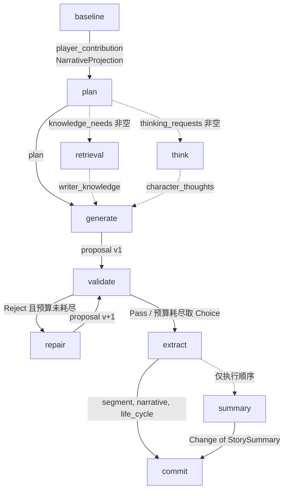

# Pipeline 框架与编排 — Design

> **Date**: 2026-10-13
> **Author**: Opus (Claude)
> **Status**: Draft
> **Prior doc**: [AISE 技术架构设计 v3.1](./2026-08-04-Architecture-gpt.md)、[Story 动态数据（StoryContext）](./2026-10-04-story-context-data-design-opus.md)

---

## Context

### 现状

`crates/aise-core/src/pipeline/` 已形成固定结构：

| 目录 | 内容 | 状态 |
|---|---|---|
| `common/` | `Pipeline` trait、`PipelineRunner`、`PipelineStage`、`PipelineError`、`PipelineConfig`、共享 prompt 辅助（`pipeline_prompt.rs`）、阶段级 trace（`pipeline_trace.rs`） | 已实现 |
| `runtime/` | `Runtime::run_turn`，固定编排全部阶段 | 已实现 |
| `baseline/` | 叙事投影 + 玩家输入解释 | 已实现 |
| `plan/` | 生成本轮故事目标 | 已实现（可选阶段信号仍为常量） |
| `generate/` | 生成故事段落 | 已实现 |
| `summary/` | 滚动摘要 | 已实现 |
| `commit/` | 组装 `StoryCommit` 并原子提交 | 已实现 |
| `extract/` | 叙事图推进 | 部分实现（语义判定为空） |
| `retrieval/`、`think/`、`validate/`、`repair/` | 只有 Input/Output 类型和透传实现 | 占位 |

### 问题

1. 代码规范（模块拆分、prompt 组织、trace 写法、错误映射）只体现在代码里，没有文档；后续四个占位 pipeline 和 extract 的补全需要一份可对照的约定。
2. 现行 [架构文档 v3.1](./2026-08-04-Architecture-gpt.md) 描述的是 `TurnExecutionPipeline` + `TurnExecutionContext` 的共享上下文模型（§6、§8），而代码已经改为“类型化 Input/Output + 只读 `StoryContext`”。两者不一致，`AGENTS.md` 的 `R-AISE-02` 也仍按旧模型表述。

### 为什么现在做

baseline、plan、generate、summary、commit 已经跑通一条完整的 Turn 链路，结构已稳定。现在固化框架约定，后续 pipeline 可以按同一模板落地。

### Constraints & assumptions

- 工作流拓扑固定，不支持运行时组合（架构 v3.1 §5）。
- 所有 LLM 调用经过注入的 `LlmGateway`（`R-CONC-04`）。
- `StoryContext` 只能由 Turn Commit 修改（StoryContext 设计 §Principles 2）。
- 本文只记录框架；各阶段的具体设计不在本文范围内。

---

## Principles

1. **类型化阶段契约**：每个 pipeline 用关联类型声明 `Input` / `Output`，阶段之间的数据依赖由编译器检查。
2. **Runtime 是唯一编排者**：pipeline 之间互不导入、互不调用；数据只经由 `Runtime` 从上一个 Output 搬到下一个 Input（`R-AISE-01`）。
3. **快照只读**：`StoryContext` 作为 `execute` 的独立参数只读传入，不进入 Input，不被序列化进阶段 trace。
4. **一个文件一个抽象层**：编排、prompt 渲染、LLM 调用、trace、纯领域计算分文件存放（`R-CODE-08`）。
5. **LLM 只提议，Commit 才写入**：除 commit 外，pipeline 不持有写能力；commit 不调用 LLM。
6. **观测随结构自动产生**：`PipelineRunner` 为每个阶段创建 Chain 观测，阶段内部再创建 Span，LLM 与 prompt 渲染各自挂在 Span 下。
7. **能不用结构化数据就不用**：LLM 的输入输出优先使用自由文本，最大限度让 LLM 发挥；只有代码必须据此分派、比较或校验的数据（如角色 ID、评分、语义条件结果、知识条目 ID）才使用结构化字段。
8. **任一阶段失败，本轮失败**：pipeline 不降级、不吞错；失败立即返回，本轮 Turn 失败。

---

## Options

### Option A：共享 `TurnExecutionContext`（架构 v3.1）

- **Idea**：所有 pipeline 签名为 `execute(&mut TurnExecutionContext, &Observation) -> Result<()>`，通过 Context 的阶段化方法读写，由 Phase 状态机约束顺序。
- **Pros**：
  - 签名统一，可以用同一个列表驱动执行。
  - 阶段产物集中，Repair 替换 Proposal 时可以统一清理下游数据。
- **Cons**：
  - 读写边界靠 Phase 状态机和方法约定在运行时保证，编译器无法检查“plan 不能读 validation 结果”。
  - Context 需要为每个阶段准备 `Option` 槽位和 setter，容易膨胀成 God Object。
  - trace 要逐阶段手写输入输出提取逻辑。
- **Risk**：Context 方法数随阶段线性增长，Phase 校验遗漏时出现静默的越权读写。

### Option B：类型化 Input/Output + Runtime 显式搬运（采用）

- **Idea**：`Pipeline` trait 带关联类型 `Input: Send + Serialize`、`Output: Send + Serialize`；`Runtime::run_turn` 用局部变量持有各阶段输出并组装下一阶段输入。
- **Pros**：
  - 每个阶段能读什么由 Input 字段决定，编译期可见。
  - `Serialize` 约束让 `PipelineRunner` 统一捕获阶段输入输出到 trace，无需逐阶段写提取代码。
  - 没有跨阶段可变状态，Turn 级数据随 `run_turn` 栈帧结束而释放（`R-AISE-03`）。
- **Cons**：
  - 贯穿多阶段的字段（如 `player_contribution`）需要在每个 Input/Output 中重复声明并透传。
  - `constraints` 等共享只读数据在 Runtime 中多次 `clone`。
- **Risk**：阶段数增加后 `run_turn` 变长；通过保持每段“构造 Input → `runner.run`”的单一模式控制复杂度。

### Option C：动态 Pipeline 列表

- **Idea**：`Vec<Box<dyn Pipeline>>` 按配置顺序执行。
- **Pros**：可配置。
- **Cons**：与固定工作流不变量冲突；关联类型无法放进同一个 trait object，最终会退化为 Option A。
- **Risk**：工作流可被配置改写，破坏 Validation/Commit 顺序保证。

### Choice

**采用 Option B。**

**Rationale**：用“透传字段和少量 clone”的代价，换来编译期的阶段边界、自动的 trace 捕获和无共享可变状态。Option A 的 Phase 状态机保证的事情，在 Option B 中由 Runtime 的顺序代码和类型系统直接保证。

---

## Design

### 1. Target structure

```text
crates/aise-core/src/pipeline/
  mod.rs                      模块声明；对外只导出 PipelineConfig、SummaryConfig、Runtime
  common/
    pipeline.rs               Pipeline trait、PipelineRunner、PipelineStage
    pipeline_trace.rs         阶段级 Chain 观测
    pipeline_prompt.rs        各阶段共享的前文/约束渲染辅助
    error.rs                  PipelineError
    config.rs                 PipelineConfig（聚合各阶段 *Config）
  runtime/runtime.rs          Runtime::new / run_turn
  {stage}/
    mod.rs                    只声明子模块并 pub(super) 导出 Input/Output/Pipeline
    {stage}.rs                Input、Output、{Stage}Pipeline、impl Pipeline
    {stage}_prompt.rs         prompt id、变量名常量、PromptVars 组装
    {stage}_llm.rs            对 LlmGateway::complete 的薄封装与结果映射
    {stage}_trace.rs          阶段内 Span 的 begin_* / finish_*
    {stage}_{domain}.rs       纯领域计算（如 baseline_narrative、extract_narrative）
    config.rs                 {Stage}Config（需要配置时）
    tests/{source}_tests.rs   单元测试（R-CODE-02）
```

### 2. 核心类型与职责

| Type / Module | Responsibility | Out of scope |
|---|---|---|
| `Pipeline` | `stage()` 返回稳定阶段标识；`execute(input, &StoryContext, &TurnControl, &dyn TurnEventSink, &Observation)` 执行一个阶段 | 决定下一个阶段 |
| `PipelineStage` | 十个阶段的有穷枚举，`as_str()` 作为 trace 名称和错误标签 | 动态阶段名 |
| `PipelineRunner` | 持有 `TurnControl`、`TurnEventSink`、`Trace`；`run()` 包裹阶段 Chain 观测 | 重试、降级 |
| `PipelineError` | `StageFailed { stage, message }`，fail-fast 返回给 Runtime | 区分错误类别（见 Risks） |
| `pipeline_prompt` | `story_summary`、`recent_story`、`turns_story`、`narrative_directions`、`story_constraints`、`load_story_opening` | 阶段特有变量 |
| `Runtime` | 构造全部 pipeline；`run_turn` 按固定顺序执行并组装 `CommitInput` | 生成内容、写存储 |
| `PipelineConfig` | 聚合阶段配置，当前只有 `summary: SummaryConfig` | 运行时状态（`R-CODE-06`） |

### 3. Turn 数据流



Runtime 中贯穿多个阶段的数据：

| 数据 | 产生 | 消费 |
|---|---|---|
| `PlayerContribution { raw, processed }` | baseline | plan → generate → validate ⇄ repair → extract → commit 逐级透传 |
| `NarrativeProjection.directions` | baseline | plan |
| `NarrativeProjection.constraints` | baseline | plan、generate、validate、repair |
| `NarrativeProjection.queries` | baseline | extract |
| proposal 文本 | generate / repair | validate、extract |
| `Change<StorySummary>` | summary | commit |

Runtime 位置：`crates/aise-core/src/pipeline/runtime/runtime.rs:64-191`。

### 4. 阶段模块规范

以 plan 为例的标准形态（`crates/aise-core/src/pipeline/plan/`）：

1. `PlanPipeline` 持有注入的 `Arc<LlmGateway>`、`Arc<Prompt>`、`Arc<Store>`，由 `Runtime::new` 构造；pipeline 不自行创建长生命周期服务。
2. `execute` 只做四件事：`*_trace::begin_*` → 调用私有编排方法 → `*_trace::finish_*` → 把结果映射为 Output。
3. 私有编排方法只做两步：`*_prompt::*` 渲染 → `*_llm::*` 调用。
4. `*_llm.rs` 只调用 `gateway.complete(LlmCompletionSpec { messages }, control, observation)` 并把 `content` 映射为领域类型。
5. 纯计算（不涉及 I/O、LLM）放在 `{stage}_{domain}.rs`，可以脱离 pipeline 单测。

### 5. Prompt 约定

- prompt id 形如 `{stage}.{action}`，例如 `plan.process_story_plan`，在 `crates/aise-core/assets/prompts/index.toml` 注册。
- 每个 prompt 三层，按 `PromptLayer::ORDERED` 渲染为三条消息：CSI（System，角色与规则）、RC（User，运行时数据）、FTI（System，最终任务与输出格式）。文件名为 `{csi|rc|fti}/{stage}-{action}.md.j2`。
- 变量名在 `{stage}_prompt.rs` 中以 `*_VAR` 常量声明；同一份 `PromptVars` 传给三层，Minijinja Strict 模式报告缺失变量。
- 前文规则统一由 `pipeline_prompt` 提供：有 summary 时用 summary + 最近轮次；无 summary 时才加载 Pack opening（`load_story_opening`，`common/pipeline_prompt.rs:43-57`）；`turns_story` 当前只拼接 `TurnStatus::Accepted` 的轮次（`common/pipeline_prompt.rs:17-24`）；`TurnStatus` 改为 `Pass` / `Choice` 后两者都是完整轮次，该过滤删除。
- RC 中的所有数据视为不可信数据；CSI 中声明 Runtime Data Boundary。

### 6. 观测结构

```text
Trace root
└── Chain "{stage}"                    PipelineRunner（input/output 自动捕获）
    └── Span "{sub_task}"              {stage}_trace.rs
        ├── prompt render observation  Prompt::render
        └── LLM generation             LlmGateway::complete
```

- Chain 失败时 `code = "pipeline_stage_failed"`、`failure_kind = "pipeline"`（`common/pipeline_trace.rs`）。
- 阶段 Span 失败时写入 `code`、`failure_kind`、`stage`；LLM 阶段当前统一为 `llm_error` / `llm`，commit 为 `commit_error` / `persistence`。

### 7. 错误与失败语义

- 任一阶段返回 `Err`，`run_turn` 通过 `?` 立即返回，不执行后续阶段和 commit，本轮 Turn 失败。
- 阶段内部不重试、不降级；LLM 结构化输出解析失败、引用了不存在的 ID、输出为空，都按阶段失败处理。
- LLM 层的限流、deadline、取消由 `LlmGateway` 处理。
- `PipelineError` 当前只携带字符串 message，不区分 LLM、存储、校验类错误。

### 8. Key decisions

- **阶段间如何交换数据** → 类型化 Input/Output，由 Runtime 搬运 → 编译期边界和自动 trace，见 Options。
- **`StoryContext` 放在哪里** → `execute` 独立参数 → 避免每阶段克隆和序列化整份快照。
- **可选阶段由谁决定** → Runtime 读取 plan 输出决定 → pipeline 不能改变拓扑。
- **Validate/Repair 循环由谁控制** → Runtime → pipeline 内不循环；预算由 Runtime 持有并在每次调用 repair 前消费（`R-AISE-06`）。
- **共享 prompt 片段放在哪里** → `common/pipeline_prompt.rs`，可见性 `pub(in crate::pipeline)` → 前文规则只有一份实现，各阶段一致。

---

## Impact

- **Code**：本文记录现状，不要求改动；Risks 中的问题另行跟进。
- **Config**：`PipelineConfig` 是阶段配置的唯一聚合点，新增阶段配置挂在其下。
- **Data**：无。
- **External interface**：无。

---

## Risks & mitigations

| Risk | Likelihood | Impact | Mitigation |
|---|---|---|---|
| `From<LlmError>` / `From<PromptError>` 固定把 stage 标为 `Baseline`（`common/error.rs:21-37`），其他阶段用 `?` 转换时错误标签错误；plan 已受影响（`plan/plan.rs:55-57`） | high | med | 删除这两个 `From`，各阶段显式 `map_err(PipelineError::new(stage, ..))` |
| Validate/Repair 循环没有预算检查（`runtime/runtime.rs:127-149`），`ValidatePipeline.validation_budget` 未被读取；validate 一旦持续判定需要修复、repair 不推进版本，循环不终止（`R-AISE-06`） | med（validate 落地后为 high） | high | 预算移到 Runtime，调用 repair 前消费；耗尽时提交 `Choice` |
| `PipelineError` 只有字符串，Engine 再包成 `EngineError::Turn { message }`，存储冲突、取消、LLM 超时无法区分（`R-OBS-01`） | med | med | 为 `PipelineError` 增加按失败类别区分的变体：`TBD` |
| 一个 Turn 内多次 `get_pack`（baseline 两次，plan、generate、summary、extract 各一次） | high | low | 当前 PackStore 为进程内存储，成本低；若改为数据库实现，由 Runtime 在 Turn 开始时加载一次并传入：`TBD` |
| 阶段 Span 把 prompt 渲染失败、存储失败也记为 `llm_error` | high | low | 各 `*_trace.rs` 按错误来源区分 code：`TBD` |
| 架构 v3.1 与代码模型不一致 | high | med | 附录 A 列出差异，统一并入架构 2.0 |

---

## Appendix

### A. 与架构文档 v3.1 的差异（并入架构 2.0）

| 位置 | v3.1 | 现行代码 |
|---|---|---|
| §6 Pipeline 接口 | `TurnExecutionPipeline::execute(&mut TurnExecutionContext, &Observation) -> Result<()>` | `Pipeline::execute(Input, &StoryContext, &TurnControl, &dyn TurnEventSink, &Observation) -> Result<Output>` |
| §8 TurnExecutionContext | Phase 状态机 + 私有槽位 + 阶段化 setter | 不存在；Runtime 局部变量持有阶段输出 |
| §5 工作流 | 八步，Initializer 为第一步 | 无 Initializer；Engine 加载 `StoryContext` 后进入 baseline；新增 extract、summary 两个阶段 |
| §13 Validation 决策 | `Pass / Repair / Reject`，Reject 失败 | 目标为 `Pass / Reject / Choice`：每版只判 `Pass` 或 `Reject`（需修复），预算耗尽时提交 `Choice`，Turn 不失败 |
| §12 Story Proposal | Proposal 含结构化事件和状态变更 DTO | proposal 只有正文；状态变更由 extract 从最终正文中提取 |
| `AGENTS.md` `R-AISE-02` | 以 `TurnExecutionPipeline` / `TurnExecutionContext` 表述 | 已改为 `Pipeline` + 类型化 Input/Output 表述（2026-10-13） |
