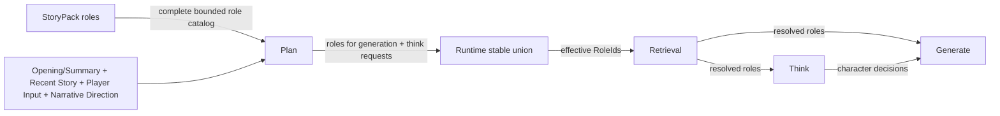

# Character Think Pipeline — Design

> **Date**: 2026-10-14
> **Author**: GPT-5.6
> **Status**: Accepted
> **Prior doc**: [Pipeline 框架与编排](./2026-10-13-pipeline-framework-design-opus.md)

---

## Context

`aise-core` 已采用类型化 Pipeline 和 `Runtime::run_turn` 固定编排，但 Character Think 尚未实现。当前 `ThinkPipeline` 只回传输入文本（`crates/aise-core/src/pipeline/think/think.rs:7-34`），`PlanOutput::requires_character_thinking` 固定返回 `false`（`crates/aise-core/src/pipeline/plan/plan.rs:24-38`），Think 的输出也没有进入 Generate。

角色定义位于 `StoryPack.roles`。`RoleBody` 包含稳定 `RoleId` 对应的名字、alias、backstory、retrieval hint、默认 profile 和 seed memories（`crates/aise-core/src/core/role/role.rs:8-21`）。`StoryContext` 当前只保存 `cast: BTreeMap<RoleId, RoleActor>`，不保存 `RoleBody` 或运行时 `RoleEntry.memories`（`crates/aise-core/src/core/story/story_context.rs:16-26`）。Character Card 由 `RoleActor::Card` 引用并存放在 `PackStore`。

现有 Baseline 只激活 Fact 和 Rumor（`crates/aise-core/src/pipeline/baseline/baseline.rs:18-23`）；Plan Prompt 没有角色目录，因此 Planner 无法可靠地产生 Character Think 的目标 `RoleId`。现有 Retrieval 也只按 FactId 和 RumorId 读取完整条目（`crates/aise-core/src/pipeline/retrieval/retrieval.rs:10-18`）。

角色不需要复用知识的 Activation 模型。若 Baseline 先按名字和 alias 激活角色，而 Planner 随后仍要看到其他角色的 ID、名字、alias 和 retrieval hint，Activation 既没有减少 Planner 的候选范围，也会产生一套额外的相关性规则。Character Think 落地前，需要建立“完整角色目录 → Planner 选择 → Retrieval 完整召回”链路，并让多个角色的 Think 调用有界并发执行。

### Constraints & assumptions

- `Runtime::run_turn` 是唯一 Turn 编排者；Pipeline 之间不互相调用。
- 角色不经过 Baseline Activation；Plan 从当前 Story Pack 构造角色目录。
- 角色目录包含全部角色的 `RoleId`、名字、alias 和 retrieval hint，不包含 backstory、profile 或 memories。
- “全部角色”由 Story Pack 资产级硬上限保证；Plan 不通过运行时截断制造不可见角色。
- Planner 只能返回 Prompt 中实际提供的 `RoleId`。
- Retrieval 对选中角色返回有效完整数据；各下游 Pipeline 自行投影所需字段。
- 当前只使用 `RoleBody.seed_memories`，不引入运行时角色记忆。
- `RoleActor::Card` 只用 `CharacterCard.profile` 替换 `RoleBody.default_profile`；角色名字、alias、backstory、retrieval hint 和 seed memories 仍来自 `RoleBody`。
- Planner 直接从故事正文判断角色的叙事相关性和是否在场，不增加 presence、location、角色状态或其他从故事文本提取的结构化数据。
- 玩家角色可以进入 Generate 的角色资料集合，但不能成为 Character Think 的目标。
- Character Decision 只在当前 Turn 内存在，不提交为世界事实。

---

## Principles

1. **完整目录，按需召回**：Planner 看到全部且有界的角色目录；只有被选择的角色才由 Retrieval 组装完整数据。
2. **稳定身份优先**：名字和 alias 帮助 Planner 理解故事中的角色指代，Pipeline 间始终使用 `RoleId`。
3. **一次召回，多种投影**：Retrieval 返回一个完整角色数据包，Think 和 Generate 根据职责选择字段，不让 Planner 控制字段粒度。
4. **角色认知隔离**：Think 只读取目标角色可用的数据；Generator 可以读取作者侧角色资料，但不能把作者知识自动赋予角色。
5. **故事正文优先**：能从当前故事文本判断的信息交给 LLM 直接理解，不额外抽取结构化 presence 或角色状态；结构化字段只承载阶段分派所必需的 RoleId 和请求契约。
6. **有界执行**：角色目录、召回数量、单角色上下文、Think 请求数和并发数都有明确上限。

---

## Options

### Option A：Baseline 名称激活 + Planner 补选

- **Idea**：Baseline 按名字和 alias 从故事文本激活角色；Planner 优先看到激活角色，再从其余角色候选中补选。
- **Pros**：
  - 可以沿用 Fact/Rumor 的 Activation 形态。
  - 显式提及的角色可以优先进入候选窗口。
- **Cons**：
  - Planner 为了补选仍需看到未激活角色目录，Activation 没有实质减少输入。
  - 名字匹配与 Planner 的语义选择形成两套相关性规则。
  - 稳定截断会让未进入候选窗口的角色永久不可选。
- **Risk**：Baseline 的匹配结果被误解为权威的场景 presence，但它只能说明文本命中。

### Option B：Planner 完整角色目录 + Retrieval 按需召回

- **Idea**：Plan 从当前 Story Pack 构造全部角色的轻量目录，由同一次 Plan LLM 调用选择 Generate 所需角色和 Character Think 请求；Runtime 合并两者的 RoleId 后交给 Retrieval。
- **Pros**：
  - 只有一套基于完整故事上下文的角色相关性判断。
  - 不会因为候选排序或名称未命中而遗漏可选角色。
  - 目录只含身份和 retrieval hint，完整资料仍按需加载。
  - Think 和 Generate 可以从同一权威角色数据包构造不同上下文。
- **Cons**：
  - Story Pack 必须限制角色目录的总规模。
  - Plan 输出同时包含故事目标、知识召回、角色召回和 Think 请求，结构化契约更复杂。
- **Risk**：大型角色目录增加 Plan Prompt 的 token 和注意力成本。

### Option C：把全部角色完整数据交给 Planner

- **Idea**：Plan 直接读取所有角色的 backstory、profile 和 seed memories，并在规划时决定如何使用。
- **Pros**：
  - Planner 选择角色时拥有最多信息。
  - 后续不需要单独按 RoleId 召回角色资料。
- **Cons**：
  - 未被使用的私有资料也进入 Prompt，成本随角色资料总量增长。
  - Retrieval 失去按需加载和统一合并 Pack/Card 的职责。
  - Planner 更容易受到无关 backstory 和 memory 干扰。
- **Risk**：Prompt 成本和角色知识泄漏随 Story Pack 增长而失控。

### Choice

**Adopt option B.**

**Rationale**：Planner 已经读取当前 Story Pack，并拥有判断角色叙事相关性所需的故事正文。直接提供完整轻量目录可以删除冗余的 Role Activation，同时把完整数据解析和业务投影继续留给 Retrieval、Think 和 Generate。角色目录规模由资产校验约束，不使用会隐藏角色的运行时截断。

---

## Design

### 1. Target structure

### 2. Core types & responsibilities

| Type / Module | Responsibility | Out of scope |
|---|---|---|
| `RoleCatalogEntry` | 向 Planner 提供 `RoleId`、名字、alias 和 retrieval hint | backstory、profile、memories、故事状态 |
| `CharacterThinkRequest` | 指定目标 `RoleId` 和有界 Thinking Focus | 角色资料、模型输出 |
| `PlanOutput` | 输出故事目标、知识召回 ID、Generate 所需角色 ID 和 Character Think 请求 | 加载 Store、合并 RoleId、执行 Think |
| `ResolvedRole` | Retrieval 为一个 RoleId 组装的有效完整角色数据包 | 决定具体 Pipeline 使用哪些字段 |
| `CharacterDecision` | 绑定目标 RoleId 的即时决定和可选台词建议 | 世界事实、持久化状态 |
| `RetrievalPipeline` | 批量解析 Fact、Rumor 和选中角色，统一处理 Pack/Card 错误 | Prompt 投影、角色决策 |
| `ThinkPipeline` | 从 `ResolvedRole` 构造角色隔离上下文并有界并发生成决定 | 角色检索、故事写作 |
| `GeneratePipeline` | 从 `ResolvedRole` 和 Character Decision 构造作者上下文并生成故事 | 修改角色决定、提交状态 |

### 3. Complete role catalog

Plan 已经加载 `StoryPack`，因此直接从全部 `StoryPack.roles` 构造轻量角色目录。每项仅包含：

- `role_id`；
- `name`；
- 全部 alias；
- `retrieval_hint`。

目录保持稳定 RoleId 顺序，不包含 backstory、profile、seed memories、Card 内容或从故事正文抽取出的状态。名字、alias 和 retrieval hint 是已有角色资产，不代表新建结构化故事状态。

“完整目录”必须同时满足“有界目录”。Story Pack 资产校验对角色数量、单角色 alias 数量和角色目录总字节设置硬上限；超过上限的 Pack 无法进入运行时。Plan 不截断合法 Pack 的角色目录，因为任意截断都会使被丢弃角色无法被 Planner 选择。

### 4. Planner selection

Plan Prompt 同时提供角色目录和以下原始叙事上下文：

- 有 Story Summary 时使用 Summary，否则使用 Opening；
- Recent Story；
- 当前 Player Contribution；
- 当前 Narrative Directions。

Planner 直接从这些故事文本判断角色是否在场、是否与下一段相关以及是否需要独立思考。系统不为这些判断额外维护 presence、location、当前情绪或其他结构化角色状态。

Planner 决定两个问题：

- 哪些角色的完整数据需要提供给 Generator，输出为 `roles_for_generation`；
- 哪些非玩家角色需要执行 Character Think，以及每个角色的 Thinking Focus。

所有返回的 RoleId 必须属于本次角色目录。`roles_for_generation` 内 RoleId 不得重复；Character Think 请求按 RoleId 唯一、数量有界且 Thinking Focus 非空有界。玩家角色可以出现在 `roles_for_generation`，但出现在 Character Think 请求中时 Plan 阶段失败。

Planner 不决定字段粒度，也不需要在两个字段中重复返回 Think 目标。Runtime 对 `roles_for_generation` 与全部 Think 目标执行稳定并集和去重，得到唯一的有效角色召回集合。

### 5. Full role retrieval

Retrieval 按 RoleId 从当前 Story Pack 和 Cast 解析 `ResolvedRole`：

1. `RoleBody.name`、alias、backstory、retrieval hint 和 seed memories 始终来自 Story Pack。
2. `RoleActor::Default` 使用 `RoleBody.default_profile`。
3. `RoleActor::Card` 从 PackStore 读取 Card，并仅使用 `CharacterCard.profile` 替换 default profile。
4. Card 不替换角色名字和叙事身份。
5. 缺失 RoleId、Cast 绑定或 Card 是可诊断的一致性错误，整个 Retrieval 阶段失败。
6. 多个请求引用同一 RoleId 时只解析一次。

“完整角色数据”表示选中角色的完整有效资源，而不是把所有角色加载到 Turn 输出。当前版本的 memories 仅包含 seed memories；运行时新增、更新和淘汰角色记忆不属于本设计。

角色数量、单角色 seed memory 数量与总字节必须受配置或资产校验限制。Pipeline 对 Prompt 的投影还要执行自己的 token/字节预算；完整召回不等于完整注入 Prompt。

### 6. Pipeline-specific projections

#### Think

每个 Think 请求只接收目标角色自己的 `ResolvedRole`，不能读取同轮召回的其他角色私有资料。Think 从目标 `ResolvedRole` 中使用：

- 稳定 RoleId、名字和 alias；
- 有效 profile；
- backstory；
- 与 Thinking Focus 相关且有界的 seed memories；
- Story Continuity、Player Contribution 和 Narrative Direction 中该角色可用的信息。

一次 LLM 调用只处理一个角色。模型输出只包含非空 `decision` 和可选 `suggested_utterance`，RoleId 由引擎从请求绑定，模型不返回身份。

多个 Character Think 请求有界并发执行：

- 单 Turn 请求总数有上限；
- Think 阶段有独立最大并发数；
- 全局并发仍由 `LlmGateway` 统一限制；
- 输出恢复为原请求顺序；
- 任一调用失败则 Think 阶段失败；
- 不产生部分 Character Decision 集合供 Generate 降级使用。

#### Generate

Generate 从召回的 `ResolvedRole` 中使用：

- 名字、alias 和有效 profile；
- 与本轮写作相关的 backstory；
- 必要的 seed memories；
- 对应 Character Decision。

Generate 拥有作者视角，但必须保持角色知识边界。某个角色的 seed memory 可以帮助作者保持一致性，不代表其他角色自动知道该信息。

Think 与 Generate 分别拥有投影和预算逻辑，不由 Planner 指定 `full`、`compact`、字段列表或 token 数量。

### 7. Runtime data flow

1. Runtime 执行 Baseline，得到 Player Contribution、Narrative Projection 和 Activated Knowledge；Baseline 不处理角色。
2. Plan 加载 Story Pack，构造包含全部角色的有界目录，并与原始叙事上下文一起提供给 Planner。
3. Planner 返回 `roles_for_generation` 与 Character Think 请求。
4. Runtime 对 `roles_for_generation` 和所有 Think 目标执行稳定并集，去重后执行一次 Retrieval。
5. Runtime 从 Retrieval 输出中为每个 Think 请求找到对应 `ResolvedRole`。
6. Think 对多个角色执行有界并发调用，并按请求顺序返回 Character Decisions。
7. Runtime 把有效角色召回集合和 Character Decisions 显式放入 GenerateInput。
8. Character Decisions 随 `run_turn` 栈帧结束释放，不进入 Commit。

### 8. Observability

- Plan 记录角色目录条目数、目录总字节、Generate 选择数、Think 请求数和稳定并集后的有效角色数。
- Retrieval 记录有效请求角色数、Default/Card 数量和解析失败类别。
- Think 为每个角色创建同一 Think Stage Observation 下的子 Observation，并使用结构化 `role_id` 字段。
- 日志和 metadata 不记录完整 backstory、memory、decision 或 suggested utterance 正文。
- Pipeline 输入输出 trace 捕获必须服从内容捕获策略，避免默认暴露完整角色私有数据。

### 9. Key decisions

- **是否维护“谁在现场”** → 否 → Planner 直接从故事正文判断叙事相关性；场景 presence 不做结构化提取。
- **角色是否经过 Baseline Activation** → 否 → Planner 已看到全部有界角色目录，名字匹配不会减少输入或提高可见性。
- **Planner 看到哪些角色信息** → 全部角色的 RoleId、名字、alias 和 retrieval hint → 足以识别角色且不提前加载私有正文。
- **如何保证全部角色可见且输入有界** → Story Pack 资产校验硬性限制角色目录规模 → Plan 不做会制造盲区的运行时截断。
- **Think 目标是否必须重复进入 Generate 角色列表** → 否 → Runtime 计算稳定并集，避免 LLM 输出重复且可能矛盾的数据。
- **玩家角色是否允许 Think** → 否 → 保持玩家代理权；玩家角色仍可作为 Generate 所需角色被召回。
- **是否允许 Planner 决定召回粒度** → 否 → Planner 决定目标和 Thinking Focus，各 Pipeline 固定自己的投影。
- **完整角色数据由谁组装** → Retrieval → Pack/Card 合并规则集中、可观测且只执行一次。
- **Card 是否替换角色名字** → 否 → Card 只覆盖 profile，RoleBody 保持角色身份与叙事资料。
- **当前是否支持运行时角色记忆** → 否 → 只使用 seed memories，避免为 Character Think 同时引入未设计的角色状态持久化。
- **是否拆分额外角色选择 LLM 调用** → 否 → 故事目标、角色相关性和 Think 需求相互耦合，当前保持单次 Plan 调用并通过有界契约和评测验证质量。
- **多角色 Think 如何执行** → 有界并发、稳定输出、阶段级 fail-fast → 控制延迟和资源，同时不引入部分降级路径。

---

## Impact

- **Code**：
  - `core` 增加 Character Think Request、Resolved Role 和 Character Decision 领域类型。
  - `core/story` 为角色数量、单角色 alias 数量和角色目录总字节增加 Story Pack 资产校验。
  - `pipeline/plan` 增加完整角色目录、`roles_for_generation`、Think 请求契约和输出校验。
  - `pipeline/retrieval` 增加 RoleBody/Cast/Card 的批量解析。
  - `pipeline/think` 实现角色 Prompt、LLM 调用、有界并发和输出校验。
  - `pipeline/generate` 接收召回角色与 Character Decisions。
  - `pipeline/runtime` 计算 Generate 角色与 Think 目标的稳定并集并维持固定拓扑。
- **Config**：Plan 增加 Generate 角色选择数和 Think 请求数上限；Think 增加并发、输入、输出和字段预算。
- **Prompt**：Plan 增加完整角色目录、`roles_for_generation` 和 Character Think requests；新增 Think 三层 Prompt；Generate 增加相关角色与 Character Decisions。
- **Data**：Story Pack 格式不变；只读取现有 name、alias、retrieval、default profile 和 seed memories，但资产校验新增角色目录规模限制。
- **External interface**：无；新增对象均为 Turn 内部数据。

---

## Risks & mitigations

| Risk | Likelihood | Impact | Mitigation |
|---|---|---|---|
| 完整角色目录增加 Plan Prompt 成本和注意力负担 | Medium | Medium | Story Pack 资产级目录上限；观测目录字节和 token；以角色选择评测验证上限 |
| Plan 同时输出故事目标、知识召回、角色召回和 Think 请求导致选择质量下降 | Medium | High | 严格有界输出；建立覆盖显式角色、隐含相关角色、空选择和多角色场景的评测集；有实证退化后再设计独立选择阶段 |
| Planner 根据故事正文误判角色是否在场 | Medium | Medium | 保持 Story Continuity 完整可见并通过生成评测发现误选；不把推断结果伪装为权威结构化状态 |
| Planner 为玩家角色请求 Think | Low | High | Plan 输出校验拒绝 `StoryContext.player`，不依赖 Prompt 自律 |
| Think 目标未显式重复出现在 Generate 角色列表 | Medium | Medium | Runtime 对两组 RoleId 做稳定并集，不要求 LLM 重复输出 |
| 完整角色召回复制过多 seed memories | Medium | Medium | 限制角色数、每角色 memory 数和总字节；Prompt 投影再次执行预算 |
| Card 与 RoleBody 合并结果不一致 | Low | High | Retrieval 集中实现唯一规则：Card 只替换 profile |
| 多角色并发放大单 Turn LLM 压力 | Medium | High | Think 局部并发上限、请求总数上限和 Gateway 全局 limiter 三层约束 |
| Generator 因读取角色 memory 造成跨角色知识泄漏 | Medium | High | Prompt 明确作者/角色边界，并测试角色不能使用其他角色私有 memory |
| 完整角色输入输出被 trace 捕获 | Medium | High | 使用内容捕获策略与结构化指标，不默认记录私有正文 |

---

## Roadmap

- **Phase 0**：Story Pack 角色目录边界、Plan 完整角色目录和角色召回契约。
- **Phase 1**：Retrieval 有效角色组装及 Default/Card 合并。
- **Phase 2**：Character Think Prompt、结构化输出和有界并发。
- **Phase 3**：Generate 角色投影与 Character Decision 消费。

---

## Appendix

### Terminology

| Term | Meaning |
|---|---|
| Role Catalog Entry | Planner 可选择的 RoleId、名字、alias 和 retrieval hint 条目 |
| Roles for Generation | Planner 判断下一段生成需要完整资料的角色 ID |
| Effective Role Set | Runtime 对 Roles for Generation 和全部 Think 目标执行稳定并集后的召回集合 |
| Resolved Role | Retrieval 合并 RoleBody、Cast 和可选 Card profile 后得到的完整有效角色数据 |
| Character Decision | 目标角色本轮即时意图和可选台词建议 |

### Explicit non-goals

- 不设计场景 presence 或角色 location 状态。
- 不从故事正文抽取结构化角色状态；相关性和是否在场由 Planner 直接阅读故事文本判断。
- 不对角色执行 Baseline Activation，也不使用 `RoleBody.activation`。
- 不设计未注册临时角色的独立 Character Think。
- 不设计运行时角色记忆的新增、更新、淘汰或持久化。
- 不允许 Planner 自定义角色字段或 token 粒度。
- 不增加独立的角色选择 LLM 调用。
- 不把 Character Decision 提交为世界事实。
