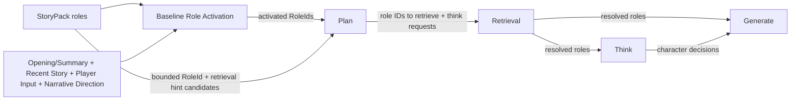

# Character Think Pipeline — Design

> **Date**: 2026-10-14
> **Author**: GPT-5.6
> **Status**: Draft
> **Prior doc**: [Pipeline 框架与编排](./2026-10-13-pipeline-framework-design-opus.md)

---

## Context

`aise-core` 已采用类型化 Pipeline 和 `Runtime::run_turn` 固定编排，但 Character Think 尚未实现。当前 `ThinkPipeline` 只回传输入文本（`crates/aise-core/src/pipeline/think/think.rs:7-34`），`PlanOutput::requires_character_thinking` 固定返回 `false`（`crates/aise-core/src/pipeline/plan/plan.rs:24-38`），Think 的输出也没有进入 Generate。

角色定义位于 `StoryPack.roles`。`RoleBody` 包含稳定 `RoleId` 对应的名字、alias、backstory、retrieval hint、默认 profile 和 seed memories（`crates/aise-core/src/core/role/role.rs:8-21`）。`StoryContext` 当前只保存 `cast: BTreeMap<RoleId, RoleActor>`，不保存 `RoleBody` 或运行时 `RoleEntry.memories`（`crates/aise-core/src/core/story/story_context.rs:16-26`）。Character Card 由 `RoleActor::Card` 引用并存放在 `PackStore`。

现有 Baseline 只激活 Fact 和 Rumor（`crates/aise-core/src/pipeline/baseline/baseline.rs:18-23`）；Plan Prompt 没有角色候选，因此 Planner 无法可靠地产生 Character Think 的目标 `RoleId`。现有 Retrieval 也只按 FactId 和 RumorId 读取完整条目（`crates/aise-core/src/pipeline/retrieval/retrieval.rs:10-18`）。

Character Think 落地前，需要先建立角色版的“Activation → Planner 选择 → Retrieval 完整召回”链路，并让多个角色的 Think 调用有界并发执行。

### Constraints & assumptions

- `Runtime::run_turn` 是唯一 Turn 编排者；Pipeline 之间不互相调用。
- Role Activation 只以角色名字和 alias 做文本匹配，不使用 `RoleBody.activation`。
- Activation 扫描故事开端或摘要、最近故事、玩家输入和 Narrative Direction。
- Planner 只能返回 Prompt 中实际提供的 `RoleId`。
- Planner 看到的角色 retrieval hint 列表有配置上限，已激活角色优先，其余角色按稳定顺序补足。
- Retrieval 对选中角色返回有效完整数据；各下游 Pipeline 自行投影所需字段。
- 当前只使用 `RoleBody.seed_memories`，不引入运行时角色记忆。
- `RoleActor::Card` 只用 `CharacterCard.profile` 替换 `RoleBody.default_profile`；角色名字、alias、backstory、retrieval hint 和 seed memories 仍来自 `RoleBody`。
- Character Decision 只在当前 Turn 内存在，不提交为世界事实。

---

## Principles

1. **轻量发现，完整召回**：Baseline 和 Planner 只交换有界角色引用；只有被选择的角色才由 Retrieval 组装完整数据。
2. **稳定身份优先**：名字和 alias 仅用于匹配，Pipeline 间始终使用 `RoleId`。
3. **一次召回，多种投影**：Retrieval 返回一个完整角色数据包，Think 和 Generate 根据职责选择字段，不让 Planner 控制字段粒度。
4. **角色认知隔离**：Think 只读取目标角色可用的数据；Generator 可以读取作者侧角色资料，但不能把作者知识自动赋予角色。
5. **有界执行**：角色候选、召回数量、单角色上下文、Think 请求数和并发数都有明确上限。

---

## Options

### Option A：Baseline 直接激活完整角色数据

- **Idea**：Baseline 对全部角色执行 Activation，并把命中的完整 `RoleBody`、Card profile 和 seed memories传给 Plan 与后续阶段。
- **Pros**：
  - 后续阶段不需要再次读取角色资源。
  - 数据流直观。
- **Cons**：
  - Planner 不需要的 backstory、profile 和 memories 会扩大输入与 Turn 数据。
  - Activation 命中即加载完整 Card 和 memories，I/O、复制和 trace 成本过高。
  - 未激活但 Planner 可能需要的角色无法通过 retrieval hint 被选择。
- **Risk**：Baseline 逐渐承担角色解析和下游上下文构造，破坏阶段职责。

### Option B：Activation 引用 + Planner 候选 + Retrieval 完整召回

- **Idea**：Baseline 只输出激活的 `RoleId`；Plan 直接接收 Baseline 已激活角色；同时从有界的未激活角色 retrieval hint 候选中，根据故事需要选择额外角色交给 Retrieval 完整召回。
- **Pros**：
  - 与现有 Fact/Rumor 的 Activation 和 Retrieval 模式一致。
  - Planner 输入保持轻量，同时能选择未激活但仍在候选窗口中的角色。
  - 完整角色数据只为实际消费者加载。
  - Think 和 Generate 可以从同一权威角色数据包构造不同上下文。
- **Cons**：
  - Plan 和 Retrieval 契约需要扩展角色字段。
  - 候选上限可能截断低优先级角色。
- **Risk**：如果稳定排序缺少相关性，未激活角色可能长期落在候选窗口之外。

### Option C：各 Pipeline 自行从 Store 加载角色

- **Idea**：Plan、Think 和 Generate 分别加载 Pack/Card 并组装各自角色上下文。
- **Pros**：
  - 每个阶段只实现自己需要的投影。
  - Retrieval 无需增加角色输出。
- **Cons**：
  - 同一 Turn 重复加载、解析和合并角色。
  - Card 覆盖规则、缺失角色错误和容量限制容易出现多套实现。
  - 角色召回不再是统一可观测的阶段。
- **Risk**：不同 Pipeline 对同一角色得到不一致的有效数据。

### Choice

**Adopt option B.**

**Rationale**：它保留类型化阶段边界，把相关性发现、LLM 选择、完整数据解析和业务投影分配给各自阶段。代价是扩展 Plan/Retrieval 契约，但避免了 Baseline 过载和下游重复加载。

---

## Design

### 1. Target structure

### 2. Core types & responsibilities

| Type / Module | Responsibility | Out of scope |
|---|---|---|
| `ActivatedRoles` | 保存 Baseline 通过名字或 alias 命中的有界 `RoleId` 列表 | 完整角色资料、LLM 决策 |
| `RoleRetrievalCandidate` | 向 Planner 提供 `RoleId` 和 retrieval hint，并标识激活优先级 | backstory、profile、memories |
| `CharacterThinkRequest` | 指定目标 `RoleId` 和有界 Thinking Focus | 角色资料、模型输出 |
| `PlanOutput` | 输出故事目标、知识召回 ID、角色召回 ID和 Character Think 请求 | 加载 Store、执行 Think |
| `ResolvedRole` | Retrieval 为一个 RoleId 组装的有效完整角色数据包 | 决定具体 Pipeline 使用哪些字段 |
| `CharacterDecision` | 绑定目标 RoleId 的即时决定和可选台词建议 | 世界事实、持久化状态 |
| `RetrievalPipeline` | 批量解析 Fact、Rumor 和选中角色，统一处理 Pack/Card 错误 | Prompt 投影、角色决策 |
| `ThinkPipeline` | 从 `ResolvedRole` 构造角色隔离上下文并有界并发生成决定 | 角色检索、故事写作 |
| `GeneratePipeline` | 从 `ResolvedRole` 和 Character Decision 构造作者上下文并生成故事 | 修改角色决定、提交状态 |

### 3. Role Activation

1. Baseline 从 `StoryPack.roles` 构造角色候选。
2. 每个角色使用 `RoleBody.name` 和全部 alias 作为匹配词，稳定身份始终是 Map 中的 `RoleId`。
3. 扫描缓冲区包含以下文本：
   - 有 Story Summary 时使用 Summary，否则使用 Opening；
   - Recent Story；
   - 当前 Player Contribution；
   - 当前 Narrative Directions。
4. 名字或 alias 命中即激活对应 RoleId；同名或 alias 冲突时保留所有命中的 RoleId，不做模糊消歧。
5. 结果按确定性规则排序并受独立角色 Activation 数量预算约束。
6. Baseline 只输出 RoleId，不复制完整角色数据。

角色 Activation 与 Knowledge Activation 使用独立结果类型和预算，避免角色与 Fact/Rumor 竞争同一个 `max_activated_entries`。

### 4. Planner 角色候选与选择

Plan 已经加载 `StoryPack`，因此可以从全部 `StoryPack.roles` 构造轻量候选。候选仅包含：

- `role_id`；
- `retrieval_hint`；
- 是否由 Baseline 激活。

候选列表采用以下规则：

1. 已激活角色排在最前。
2. 其余角色按稳定 RoleId 顺序排列。
3. 列表按配置的角色候选上限截断。
4. 如果已激活角色数量超过候选上限，Plan 只获得上限允许的确定性前缀，并记录截断指标。
5. Planner 返回的角色 ID 必须存在于实际提供的候选集合。

Planner 决定两个问题：

- 哪些角色完整数据需要提供给 Generator；
- 哪些角色需要执行 Character Think，以及每个角色的 Thinking Focus。

Planner 不决定字段粒度。所有 Character Think 目标自动加入角色召回集合，Runtime 在进入 Retrieval 前对角色 ID 去重。

### 5. Full role retrieval

Retrieval 按 RoleId 从当前 Story Pack 和 Cast 解析 `ResolvedRole`：

1. `RoleBody.name`、alias、backstory、retrieval hint 和 seed memories 始终来自 Story Pack。
2. `RoleActor::Default` 使用 `RoleBody.default_profile`。
3. `RoleActor::Card` 从 PackStore 读取 Card，并仅使用 `CharacterCard.profile` 替换 default profile。
4. Card 不替换角色名字和叙事身份。
5. 缺失 RoleId、Cast 绑定或 Card 是可诊断的一致性错误，整个 Retrieval 阶段失败。
6. 多个请求引用同一 RoleId 时只解析一次。

“完整角色数据”表示选中角色的完整有效资源，而不是把所有角色加载到 Turn 输出。当前版本的 memories 仅包含 seed memories；运行时新增、更新和淘汰角色记忆不属于本设计。

角色数量、单角色 seed memory 数量与总字节必须受配置或资产校验限制。Pipeline 对 Prompt 的投影还要执行自己的 token/字节预算；完整召回不等于完整注入 Prompt。

### 6. Pipeline-specific projections

#### Think

Think 从目标 `ResolvedRole` 中使用：

- 稳定 RoleId、名字和 alias；
- 有效 profile；
- backstory；
- 与 Thinking Focus 相关且有界的 seed memories；
- Story Continuity、Player Contribution 和 Narrative Direction 中该角色可用的信息。

一次 LLM 调用只处理一个角色。模型输出只包含非空 `decision` 和可选 `suggested_utterance`，RoleId 由引擎从请求绑定，模型不返回身份。

多个 Character Think 请求有界并发执行：

- 单 Turn 请求总数有上限；
- Think 阶段有独立最大并发数；
- 全局并发仍由 `LlmGateway` 统一限制；
- 输出恢复为原请求顺序；
- 任一调用失败则 Think 阶段失败；
- 不产生部分 Character Decision 集合供 Generate 降级使用。

#### Generate

Generate 从召回的 `ResolvedRole` 中使用：

- 名字、alias 和有效 profile；
- 与本轮写作相关的 backstory；
- 必要的 seed memories；
- 对应 Character Decision。

Generate 拥有作者视角，但必须保持角色知识边界。某个角色的 seed memory 可以帮助作者保持一致性，不代表其他角色自动知道该信息。

Think 与 Generate 分别拥有投影和预算逻辑，不由 Planner 指定 `full`、`compact`、字段列表或 token 数量。

### 7. Runtime data flow

1. Runtime 执行 Baseline，得到 Player Contribution、Narrative Projection、Activated Knowledge 和 Activated RoleIds。
2. Runtime 把 Activated RoleIds 传给 Plan；Plan 加载 Story Pack 并构造有界角色候选。
3. Planner 返回角色召回 ID 与 Character Think 请求。
4. Runtime 合并显式角色召回 ID和所有 Think 目标，去重后执行一次 Retrieval。
5. Runtime 从 Retrieval 输出中为每个 Think 请求找到对应 `ResolvedRole`。
6. Think 对多个角色执行有界并发调用，并按请求顺序返回 Character Decisions。
7. Runtime 把召回角色和 Character Decisions 显式放入 GenerateInput。
8. Character Decisions 随 `run_turn` 栈帧结束释放，不进入 Commit。

### 8. Observability

- Baseline Role Activation 单独记录候选总数、激活数、命中来源、预算淘汰数和耗时。
- Plan 记录角色候选总数、提供数、截断数、选中召回数和 Think 请求数。
- Retrieval 记录请求角色数、去重角色数、Default/Card 数量和解析失败类别。
- Think 为每个角色创建同一 Think Stage Observation 下的子 Observation，并使用结构化 `role_id` 字段。
- 日志和 metadata 不记录完整 backstory、memory、decision 或 suggested utterance 正文。
- Pipeline 输入输出 trace 捕获必须服从内容捕获策略，避免默认暴露完整角色私有数据。

### 9. Key decisions

- **是否维护“谁在现场”** → 否 → 当前目标是发现本轮相关角色，名字/alias Activation 已足够；场景 presence 不属于本设计。
- **Role Activation 是否使用 `RoleBody.activation`** → 否 → 角色只由名字和 alias 文本命中。
- **是否把全部角色完整数据交给 Planner** → 否 → Planner 只看有界的 RoleId 和 retrieval hint。
- **是否允许 Planner 决定召回粒度** → 否 → Planner 决定目标和 Thinking Focus，各 Pipeline 固定自己的投影。
- **完整角色数据由谁组装** → Retrieval → Pack/Card 合并规则集中、可观测且只执行一次。
- **Card 是否替换角色名字** → 否 → Card 只覆盖 profile，RoleBody 保持角色身份与叙事资料。
- **当前是否支持运行时角色记忆** → 否 → 只使用 seed memories，避免为 Character Think 同时引入未设计的角色状态持久化。
- **多角色 Think 如何执行** → 有界并发、稳定输出、阶段级 fail-fast → 控制延迟和资源，同时不引入部分降级路径。

---

## Impact

- **Code**：
  - `core` 增加 Activated Role、Character Think Request、Resolved Role 和 Character Decision 领域类型。
  - `pipeline/baseline` 增加角色 Activation 与观测。
  - `pipeline/plan` 增加角色候选、角色召回和 Think 请求契约。
  - `pipeline/retrieval` 增加 RoleBody/Cast/Card 的批量解析。
  - `pipeline/think` 实现角色 Prompt、LLM 调用、有界并发和输出校验。
  - `pipeline/generate` 接收召回角色与 Character Decisions。
  - `pipeline/runtime` 搬运新输出并维持固定拓扑。
- **Config**：Baseline 增加角色 Activation 上限；Plan 增加角色候选上限和 Think 请求上限；Think 增加并发、输入、输出和字段预算。
- **Prompt**：Plan 增加角色 retrieval candidates 和 Character Think requests；新增 Think 三层 Prompt；Generate 增加相关角色与 Character Decisions。
- **Data**：Story Pack 格式不变；只读取现有 name、alias、retrieval、default profile 和 seed memories。
- **External interface**：无；新增对象均为 Turn 内部数据。

---

## Risks & mitigations

| Risk | Likelihood | Impact | Mitigation |
|---|---|---|---|
| 未直接提到名字的相关角色不会被 Activation 命中 | Medium | Medium | Planner 仍可从激活优先的有界 retrieval hint 候选中选择 |
| 大型 Story Pack 的低排序角色无法进入候选窗口 | Medium | Medium | 记录截断指标；后续可单独设计候选检索，不在本设计引入语义搜索 |
| 同名或 alias 冲突导致多个角色同时激活 | Low | Medium | 保留全部稳定 RoleId，由 Planner 基于 retrieval hint 选择，不做名字到 ID 的猜测 |
| 完整角色召回复制过多 seed memories | Medium | Medium | 限制角色数、每角色 memory 数和总字节；Prompt 投影再次执行预算 |
| Card 与 RoleBody 合并结果不一致 | Low | High | Retrieval 集中实现唯一规则：Card 只替换 profile |
| 多角色并发放大单 Turn LLM 压力 | Medium | High | Think 局部并发上限、请求总数上限和 Gateway 全局 limiter 三层约束 |
| Generator 因读取角色 memory 造成跨角色知识泄漏 | Medium | High | Prompt 明确作者/角色边界，并测试角色不能使用其他角色私有 memory |
| 完整角色输入输出被 trace 捕获 | Medium | High | 使用内容捕获策略与结构化指标，不默认记录私有正文 |

---

## Roadmap

- **Phase 0**：Role Activation、Plan 角色候选和角色召回契约。
- **Phase 1**：Retrieval 有效角色组装及 Default/Card 合并。
- **Phase 2**：Character Think Prompt、结构化输出和有界并发。
- **Phase 3**：Generate 角色投影与 Character Decision 消费。

---

## Appendix

### Terminology

| Term | Meaning |
|---|---|
| Activated Role | Baseline 通过名字或 alias 在本轮文本中命中的 RoleId |
| Role Retrieval Candidate | Planner 可选择的有界 RoleId + retrieval hint 条目 |
| Resolved Role | Retrieval 合并 RoleBody、Cast 和可选 Card profile 后得到的完整有效角色数据 |
| Character Decision | 目标角色本轮即时意图和可选台词建议 |

### Explicit non-goals

- 不设计场景 presence 或角色 location 状态。
- 不使用 `RoleBody.activation` 做角色激活。
- 不设计未注册临时角色的独立 Character Think。
- 不设计运行时角色记忆的新增、更新、淘汰或持久化。
- 不允许 Planner 自定义角色字段或 token 粒度。
- 不把 Character Decision 提交为世界事实。
