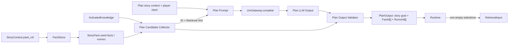

# Plan 阶段知识召回选择 — Design

> **Date**: 2026-10-14
> **Author**: GPT-5.6 Sol
> **Status**: Accepted
> **Prior docs**: [Pipeline 框架与编排](./2026-10-13-pipeline-framework-design-opus.md)、[Context Preparation and Retrieval](./2026-08-08-context-preparation-retrieval-design-gpt.md)

---

## Context

当前 Turn 在 `baseline` 阶段对 Story Pack 的 `seed_facts` 和 `seed_rumors` 执行确定性激活，产出 `ActivatedKnowledge`；`plan` 随后把其中的正文作为 Known Facts 和 Rumors 传给 LLM。激活阶段只返回命中项，不提供尚未激活知识的索引。`crates/aise-core/src/pipeline/baseline/baseline_knowledge.rs:37-43`、`crates/aise-core/src/pipeline/plan/plan_prompt.rs:43-51`

当前 `PlanPipeline` 只让 LLM 返回自由文本故事目标。`PlanOutput` 已开始加入 `facts_to_retrieve` 与 `rumors_to_retrieve`，但现有 LLM 契约、Prompt、校验和 Runtime 数据流尚未生成这两个字段；`requires_retrieval` 仍固定返回 `false`，Retrieval 阶段也只有字符串透传占位实现。`crates/aise-core/src/pipeline/plan/plan.rs:20-32`、`crates/aise-core/src/pipeline/retrieval/retrieval.rs:7-34`

Story Pack 已为每个 Fact 和 Rumor 保存稳定 ID、正文、激活规则和 `RetrievalHint`。`RetrievalHint` 是有界、非空的知识摘要，适合在不暴露完整正文的前提下告诉 Planner 某条知识可供召回。`crates/aise-core/src/core/knowledge/fact.rs:7-12`、`crates/aise-core/src/core/knowledge/rumor.rs:7-12`、`crates/aise-core/src/core/knowledge/hint.rs:6-35`

本设计补齐以下闭环：

1. Plan 从 Story Pack 构建尚未激活的 Fact/Rumor 候选索引，每项只含 ID 与 Retrieval Hint。
2. 同一次 Plan LLM 调用同时生成故事目标和两组待召回 ID。
3. Plan 对 LLM 输出做确定性校验后，把 ID 列表交给 Runtime。
4. Runtime 仅在至少一个列表非空时执行 Retrieval，并把 ID 作为类型化输入传入。

旧 `crates/aise` 实现只作为行为参考。 maintained crate 不依赖 frozen reference crate，也不复制其 Writer/Character 多受众 Context Gap 模型；当前 aise-core 只设计 Writer 在下一阶段按精确知识 ID 召回的最小契约。

### Constraints & assumptions

- `Runtime::run_turn` 仍是唯一 Turn 编排者；Plan 和 Retrieval 不互相调用。
- 候选权威来源是当前 `StoryContext.pack_ref` 指向的 Story Pack，而不是 `PlanInput.knowledge`。
- `PlanInput.knowledge` 继续作为已激活正文参与故事目标规划，但其中的 ID 必须从召回候选列表排除，避免重复召回。
- 当前 aise-core 只有 Story Pack Seed Fact/Rumor 权威来源；运行时动态知识不在本设计范围内。
- 候选只暴露 ID 与 Retrieval Hint，不向 Plan Prompt 重复发送未激活知识正文、激活规则或来源元数据。
- 候选数量、LLM 输出数量和 Prompt 大小必须有硬上限；超限候选按稳定顺序截断，并通过 warning log 与 trace 显式呈现。
- Plan 保持单次 LLM 调用，不增加隐藏的二次规划、重试或降级路径。
- LLM 输出非法 ID、重复 ID、格式错误或越界数量时，Plan 阶段失败并产生可诊断错误。

---

## Principles

1. **候选索引与已知正文分离**：`ActivatedKnowledge` 表示当前已提供给 Planner 的知识正文；Retrieval Candidate 表示尚未提供、可由 Planner 请求的知识索引。
2. **LLM 只做语义选择**：LLM 根据故事上下文和玩家输入挑选 ID；候选构建、边界校验、去重和阶段分派由确定性代码负责。
3. **精确 ID 跨阶段传递**：Plan 输出和 Retrieval 输入只传 `FactId` / `RumorId`，不传 Hint 副本，不使用自由文本查询。
4. **稳定且可观测的截断**：所有合格候选先按稳定 ID 顺序排列，再按配置上限截断；截断不终止 Turn，但必须留下 warning log 与 trace 元数据。
5. **固定拓扑与有界生命周期**：候选索引和解析映射只存在于 Plan 调用栈，选择结果只存在于当前 Turn 的 Runtime 栈。
6. **单一配置权威**：Plan 候选上限由 `PlanConfig` 定义，经 `PipelineConfig` 聚合并由 Runtime 注入。

---

## Options

### Option A：把全部未激活知识正文传给 Plan

- **Idea**：Plan Prompt 直接包含所有尚未激活 Fact/Rumor 的 ID、Hint 和正文，由 LLM选择需要的条目。
- **Pros**:
  - LLM 可以直接阅读知识内容，选择依据最充分。
  - Retrieval 阶段只剩数据搬运。
- **Cons**:
  - Prompt 大小随 Story Pack 知识正文线性增长。
  - 未选择的知识正文仍已进入 Planner Context，Retrieval 阶段失去隔离和按需加载意义。
  - Fact 与 Rumor 正文可能干扰当前故事目标，增加注意力漂移。
- **Risk**：大 Story Pack 的成本和延迟不可预测，并违反 Context 有界原则。

### Option B：ID + Retrieval Hint 候选索引，LLM 返回精确 ID

- **Idea**：确定性代码构建两组有界候选，每项只含 ID 与 Hint；Plan LLM 在生成故事目标的同一次调用中返回 Fact ID 和 Rumor ID 列表。
- **Pros**:
  - Prompt 成本由 Hint 上限和候选数量上限共同约束。
  - LLM 保留结合故事上下文进行语义判断的能力。
  - Retrieval 阶段可以按精确 ID 加载正文，结果稳定且容易校验。
  - Fact 与 Rumor 类型边界明确，不需要自由文本查询或检索 Provider。
- **Cons**:
  - Hint 质量直接影响 LLM 选择质量。
  - Story Pack 候选数超过配置时，稳定截断会让尾部条目在本次 Turn 不可见。
- **Risk**：作者写出的 Hint 过于模糊，或相关条目落在截断范围外时，Planner 可能漏选知识。

### Option C：Plan 生成自由文本检索请求

- **Idea**：不向 LLM 提供候选索引；LLM 输出自由文本知识缺口，Retrieval 再进行关键词、BM25 或向量召回。
- **Pros**:
  - 不需要把 Story Pack 知识索引放进 Prompt。
  - 能表达 Story Pack 中没有精确对应项的抽象知识需求。
- **Cons**:
  - 当前 aise-core 没有文本检索 Provider、排名融合或零结果语义。
  - 自由文本请求不能保证映射到稳定 Fact/Rumor ID。
  - 会把本次精确选择需求扩大为完整的检索基础设施设计。
- **Risk**：第一版行为不稳定、难以诊断，并可能引入未受预算约束的扫描。

### Choice

**Adopt option B.**

**Rationale**：该方案直接利用现有稳定 ID 和有界 Retrieval Hint，在单次 Plan 调用中完成语义选择，同时把候选边界、输出合法性和 Retrieval 分派保留在确定性代码中。它比传正文更有界，比自由文本检索更稳定。Story Pack 超过候选上限时采用稳定截断，以保证 Turn 可继续执行；warning log 和 trace 负责暴露知识可见范围收窄。若真实数据长期触发截断，应另行设计确定性预筛选。

---

## Design

### 1. Target structure



Plan 阶段内部按以下职责拆分：

```text
pipeline/plan/
  plan.rs                 阶段输入输出与顶层编排
  plan_candidates.rs      纯候选收集、排除、排序与截断
  plan_prompt.rs          候选索引和故事上下文的 Prompt 投影
  plan_llm.rs             单次 LLM 调用与结构化结果解析
  plan_output.rs          LLM DTO 的子集、重复和类型校验
  plan_trace.rs           候选数量、选择数量与失败结果观测
  config.rs               PlanConfig
```

`plan_candidates.rs`、`plan_output.rs` 是 Plan 私有实现，不被 Retrieval 导入。跨阶段共享的只有 `FactId`、`RumorId` 和 Runtime 显式组装的类型化字段。

### 2. Core types & responsibilities

| Type / Module | Responsibility | Out of scope |
|---|---|---|
| `PlanConfig` | 定义每种知识最多可提供给 LLM 的候选数和故事目标字节上限 | Retrieval 结果预算、LLM Provider 参数 |
| Plan Candidate | Plan 私有 Prompt 投影项，包含一种知识的稳定 ID 与 Retrieval Hint | 知识正文、激活规则、检索结果 |
| Plan Candidate Collector | 从 Story Pack 收集 Seed Fact/Rumor，排除已激活 ID，稳定排序并按上限截断 | 调用 LLM、决定相关性、加载 Retrieval 正文 |
| Plan LLM DTO | 接收 `story_goal`、`facts_to_retrieve`、`rumors_to_retrieve` 三个结构化字段 | 直接成为可信阶段输出 |
| Plan Output Validator | 校验 ID 属于对应候选集合、无重复、数量有界，并转换为领域 ID | 猜测或修复非法 LLM 输出 |
| `PlanOutput` | 保存故事目标及两组已验证的精确 ID；从列表是否非空推导可选阶段信号 | 保存 Hint、知识正文或执行召回 |
| `Runtime` | 根据 `PlanOutput` 决定是否运行 Retrieval，并组装 `RetrievalInput` | 修改选择结果或调用 Plan 内部逻辑 |
| `RetrievalPipeline` | 按已验证 ID 从同一 Pack 引用解析知识正文 | 重新判断哪些 ID 相关 |

目标数据形态如下：

```text
Plan Prompt Candidate
  fact:  { id: FactId,  retrieval_hint: RetrievalHint }
  rumor: { id: RumorId, retrieval_hint: RetrievalHint }

Plan LLM Output
  story_goal
  facts_to_retrieve:  FactId[]
  rumors_to_retrieve: RumorId[]

PlanOutput
  story_goal: BoundedText
  facts_to_retrieve:  FactId[]
  rumors_to_retrieve: RumorId[]
```

当前 `RetrievalFactEntry` / `RetrievalRumorEntry` 把 Hint 与 ID 一起放进 `PlanOutput`，会让 Prompt 投影数据泄漏到跨阶段契约。目标设计不保留这种形态：Hint 只服务 Plan 选择，Retrieval 只需要稳定 ID。`RetrievalFacts` / `RetrievalRumors` 若无其他使用方，应在实现时一并删除，避免新旧契约并存。

### 3. Candidate construction

候选收集按以下顺序执行：

1. Plan 通过已注入的 `Store` 和 `StoryContext.pack_ref` 读取当前 Story Pack。
2. 分别建立 `ActivatedKnowledge.facts` 与 `ActivatedKnowledge.rumors` 的 ID 集合。
3. 遍历 `seed_facts` 和 `seed_rumors`，排除对应已激活 ID。
4. 对每个剩余条目投影 ID 与 `body.retrieval`；正文和 `body.activation` 不进入候选。
5. 保持 Story Pack `BTreeMap` 的稳定 ID 顺序，形成 Fact 和 Rumor 两个独立列表。
6. 分别记录截断前总数，并按 `PlanConfig.max_retrieval_candidates_per_kind` 对稳定顺序列表取前 N 项。
7. 任一列表发生截断时，以结构化字段打印一条 warning log，并把截断前数量、提供数量、丢弃数量与截断标记写入 Plan trace。
8. 截断是非致命行为；Plan 使用截断后的列表继续渲染 Prompt 和调用 LLM。

这里的“排除 Activated Knowledge”只作用于召回候选索引。已激活 Fact/Rumor 的正文仍通过现有 Known Facts/Rumors Prompt 区域提供给 Planner，使故事目标保持知识一致性。

`max_retrieval_candidates_per_kind` 同时约束 Fact 候选和 Rumor 候选，因此 Plan Prompt 最多包含两倍该值的知识索引项。默认值为 `32`。配置为 `0` 时两个候选列表均为空；若存在合格候选，按正常截断规则记录 warning 与 trace。

`max_story_goal_bytes` 约束结构化 LLM 输出中的 `story_goal`，默认值为 `512`，用于把原始字符串转换为 `BoundedText`；它不影响候选或 Retrieval 预算。

### 4. Prompt and LLM output contract

RC 层在现有故事上下文后新增两个数据区：

```text
Retrievable Facts
  - id
    retrieval_hint

Retrievable Rumors
  - id
    retrieval_hint
```

空列表不渲染对应区。所有 ID 和 Hint 使用确定性数据编码，继续视为不可信 Runtime Data。

FTI 层把任务从“只返回故事目标文本”改为“返回一个严格 JSON 对象”：

```json
{
  "story_goal": "string",
  "facts_to_retrieve": ["fact-id"],
  "rumors_to_retrieve": ["rumor-id"]
}
```

LLM 规则：

1. `story_goal` 保持现有语义：描述下一段的单一、直接故事目标。
2. 只选择为了规划目标后的生成阶段确实需要读取正文的候选。
3. 已在 Known Facts/Rumors 中提供的知识不得再次请求。
4. Fact ID 只能来自 Retrievable Facts，Rumor ID 只能来自 Retrievable Rumors。
5. 没有额外知识需求时返回空数组。
6. 不返回 Hint、理由、自由文本查询或候选外 ID。

当前 `LlmCompletionSpec` 只支持消息，不支持 Provider 级 JSON Schema。第一版由 Prompt 约束 JSON，并在 `plan_llm.rs` 中严格反序列化；DTO 拒绝未知字段。结构化输出能力若未来进入 `LlmGateway`，Plan 可迁移到统一契约，但本设计不为它增加旁路 Provider 调用。

### 5. Output validation

LLM 返回后依次执行：

1. 严格解析唯一 JSON 对象，拒绝对象外文本、缺字段和未知字段。
2. 按现有故事目标边界把 `story_goal` 转为 `BoundedText`。
3. 把字符串 ID 转为 `FactId` / `RumorId`。
4. 检查每个 ID 属于本次实际发送给 LLM 的同类候选集合。
5. 检查同一列表中没有重复 ID。
6. 检查两个列表分别不超过候选配置上限。
7. 保留 LLM 返回顺序，形成 `PlanOutput`。

不自动删除重复项、不忽略未知 ID、不把 Fact ID 转入 Rumor 列表，也不在解析失败后退回“只生成故事目标”的旧路径。任何违规都返回可诊断的 `PipelineError`，本 Turn fail-fast。

### 6. Runtime and Retrieval handoff

`PlanOutput::requires_retrieval` 从以下条件推导：

```text
facts_to_retrieve is not empty
OR
rumors_to_retrieve is not empty
```

Runtime 在条件为真时构造包含两个 ID Slice 的 `RetrievalInput`。它不传 Hint，因为 Hint 不是 Retrieval 执行参数；Retrieval 使用 `StoryContext.pack_ref` 从 Store 解析对应正文。

Plan 与 Retrieval 不共享阶段私有类型，也不互相导入。Runtime 是唯一同时知道二者契约并搬运数据的模块，符合固定阶段拓扑和单向依赖约束。

Retrieval 必须把“已验证但在 Pack 中解析不到 ID”视为一致性错误，而不是静默跳过。正常情况下该错误只可能来自 Pack 引用不一致或存储损坏，因为 Plan 和 Retrieval 使用同一只读 `StoryContext.pack_ref`。

### 7. Config ownership

配置结构为：

```text
EngineConfig
  pipeline_config
    baseline: BaselineConfig
    plan: PlanConfig
      max_retrieval_candidates_per_kind
      max_story_goal_bytes
      ... role-planning limits owned by the Character Think design
    summary: SummaryConfig
```

`PlanConfig` 位于 `pipeline/plan/config.rs`，由 `PipelineConfig` 聚合，在 `Runtime::new` 构造 `PlanPipeline` 时按值注入。Plan Pipeline 不读取 Engine Config，也不在 Prompt 或候选收集器中复制默认值。

该上限约束“提供给 LLM 的完整候选集合”，不是 Retrieval 最终正文的 token 预算。Retrieval 结果预算属于 Retrieval 阶段自己的未来配置，两者不能复用同一字段。

### 8. Observability

Plan 阶段观测至少记录以下结构化字段：

- Story Pack 中 Fact/Rumor 总数。
- 因已激活而排除的 Fact/Rumor 数。
- 实际提供给 LLM 的 Fact/Rumor 候选数。
- LLM 选择的 Fact/Rumor 数。
- 每类候选是否发生截断及被截断数量。
- 输出校验失败的稳定错误码。

候选截断使用 warning 而不是错误，不改变 Plan observation 的成功状态。错误路径区分 JSON 格式错误、未知 ID、知识种类不匹配、重复 ID 和故事目标非法。日志消息不插值 ID；需要诊断具体 ID 时使用结构化错误字段，并遵循现有 Trace 内容捕获策略。

### 9. Key flows

#### Successful planning with retrieval

1. Plan 加载当前 Story Pack，并从全部 Seed Fact/Rumor 中排除 Activated Knowledge ID。
2. 候选收集器按稳定 ID 顺序截断两个列表，并在发生截断时写 warning 与 trace 元数据。
3. Prompt 同时编码故事上下文、玩家输入、已激活正文和 ID + Hint 候选索引。
4. LLM 返回故事目标及两组精确 ID。
5. Plan 校验结构、ID 子集、知识种类、重复和数量，生成 `PlanOutput`。
6. Runtime 发现至少一个列表非空，运行 Retrieval。
7. Retrieval 按 ID 解析正文，供后续 Generate 使用。

#### Successful planning without retrieval

1. Plan 仍提供完整、有界候选索引。
2. LLM 判断已知上下文足够，返回两个空数组。
3. `requires_retrieval` 返回 `false`。
4. Runtime 跳过 Retrieval，直接推进后续固定拓扑。

#### Candidate truncation

1. 候选收集器在排除已激活项后发现某类候选超过配置上限。
2. 候选收集器保留稳定 ID 顺序中的前 N 项，并计算丢弃数量。
3. Plan 打印包含知识种类、总数、提供数、丢弃数和上限的结构化 warning。
4. Plan trace 保存同一组计数与截断标记，但 observation 状态保持成功。
5. Plan 使用截断后的候选继续调用 LLM；本 Turn 不因截断失败。

### 10. Key decisions

- **候选从哪里来**：当前 Story Pack 的全部 Seed Fact/Rumor减去 Activated Knowledge ID → 保证权威来源完整且不重复请求已提供正文。
- **候选向 LLM 暴露什么**：稳定 ID + Retrieval Hint → 控制 Prompt 大小并避免提前泄漏正文。
- **是否把 Hint 放进 `PlanOutput`**：不放 → Hint 只用于 Plan 选择，Retrieval 用 ID 解析权威数据。
- **LLM 调用次数**：一次 → 故事目标与召回选择基于完全相同的上下文，避免额外延迟和隐藏编排。
- **候选超限如何处理**：按稳定 ID 顺序截断并记录 warning + trace → 保持 Prompt 有界和 Turn 可用，同时让知识盲区可诊断。
- **非法 LLM 输出如何处理**：严格拒绝 → 不猜测、不修复、不兼容旧的纯文本输出。
- **可选 Retrieval 由谁决定**：Runtime 根据已验证 ID 列表是否为空决定 → Plan 不调用后续阶段。
- **配置放在哪里**：`PlanConfig` 并聚合到 `PipelineConfig` → 设置归属唯一，运行时状态与配置分离。

---

## Impact

- **Code**:
  - `pipeline/plan/` 增加 `config.rs`、候选收集和输出校验模块；调整 `plan.rs`、`plan_prompt.rs`、`plan_llm.rs`、`plan_trace.rs` 及测试。
  - `pipeline/common/config.rs` 聚合 `PlanConfig`。
  - `pipeline/runtime/runtime.rs` 注入 Plan 配置，并把两组 ID 搬运到 Retrieval。
  - `pipeline/retrieval/retrieval.rs` 把字符串占位输入改为 Fact/Rumor ID 列表。
  - `core/knowledge/retrieval.rs` 删除或重塑不再需要的 Hint-bearing Plan Output 类型，避免与 ID-only 契约并存。
  - `pipeline/mod.rs` 对外重导出 `PlanConfig`，供根配置反序列化。
- **Config**:
  - `EngineConfig.pipeline_config.plan.max_retrieval_candidates_per_kind` 成为带默认值配置；默认值为 `32`。
  - `EngineConfig.pipeline_config.plan.max_story_goal_bytes` 约束故事目标；默认值为 `512`。
  - Plan CSI/RC/FTI Prompt 改为候选索引输入和严格 JSON 输出。
- **Data**:
  - Story Pack Schema 和持久化格式不变，复用现有 `FactId`、`RumorId` 与 `RetrievalHint`。
  - 不新增跨 Turn 缓存、索引表或数据库迁移。
- **External interface**:
  - HTTP、WebSocket、Turn Request 和事件接口不变。
  - LLM Prompt/Response 内部契约发生不兼容变更；旧纯文本 Plan 输出路径在同一变更中删除。

---

## Risks & mitigations

| Risk | Likelihood | Impact | Mitigation |
|---|---|---|---|
| 稳定截断使 ID 排序靠后的相关条目不可见 | Medium | High | warning 与 trace 暴露截断频率和数量；根据真实数据调整上限；长期超限时设计确定性预筛选 |
| Retrieval Hint 过于模糊导致漏选 | Medium | Medium | 保持 Hint 非空和字节上限校验；在内容工具链中增加 Hint 质量检查；通过选择数和后续零召回指标诊断 |
| LLM 返回候选外或错误种类 ID | Medium | Medium | 使用每类候选集合做严格子集校验，拒绝跨类 ID |
| JSON Prompt 约束不足，模型返回额外文本 | Medium | Medium | 严格反序列化并 fail-fast；后续统一接入 Gateway 结构化输出能力 |
| Activated ID 未排除，Retrieval 重复加载正文 | Low | Medium | 分 Fact/Rumor 建立排除集合，并对“已激活项不进入候选”编写边界测试 |
| Plan 与 Retrieval 读取到不同 Pack | Low | High | 两阶段都只使用同一 `StoryContext.pack_ref`；解析缺失视为一致性错误 |
| 候选 Hint 增加 Prompt token 消耗 | Medium | Medium | 使用每类候选硬上限和 `RetrievalHint::MAX_BYTES`；观测候选数与 Prompt token |
| 新旧 Retrieval 类型并存造成契约歧义 | Medium | High | 一次性切换到 ID-only Output/Input，并删除旧 Hint-bearing 跨阶段类型和测试 |

---

## Roadmap

- **Phase 0 — Contracts and config**：落地 ID-only Plan/Retrieval 契约、`PlanConfig` 与旧 Retrieval 类型清理。
- **Phase 1 — Plan selection**：实现候选收集、稳定截断、warning/trace、Prompt、结构化输出和校验。
- **Phase 2 — Retrieval and generation**：按 Fact/Rumor ID 解析正文，并把结果接入 Generate Input。
- **Phase 3 — Verification and cleanup**：补齐 Runtime 路由、端到端测试、格式与 lint 验证，并确认旧路径零残留。

---

## Appendix

### Required test matrix

| Area | Cases |
|---|---|
| Candidate collection | 全部未激活项；排除已激活 Fact；排除已激活 Rumor；空 Pack；稳定 ID 顺序；Fact/Rumor 独立截断；上限为零 |
| Prompt projection | 两类候选均存在；单类为空；两类均为空；Hint 和 ID 正确转义；不包含未激活正文 |
| LLM output parsing | 合法 JSON；对象外文本；缺字段；未知字段；空故事目标；非法 ID |
| Output validation | 候选子集；未知 Fact；未知 Rumor；跨类 ID；重复 ID；空选择；保留返回顺序 |
| Runtime routing | 两列表均空时跳过；仅 Fact 时执行；仅 Rumor 时执行；两类均有时执行 |
| Consistency | Plan 选中的 ID 可由同一 PackRef 解析；缺失 ID 返回可诊断错误 |

### Explicit non-goals

- 不设计 BM25、Embedding、自由文本 Query 或多 Provider 排名。
- 不设计 Character 私有 Memory 或按角色隔离的知识受众。
- 不改变 Baseline 的确定性 Activation 算法。
- 不把所有未激活知识正文放进 Plan Prompt。
- 不为超限候选增加随机抽样或旧路径降级。
- 不在本设计中实现基于相关性、轮转或向量的候选预筛选。
