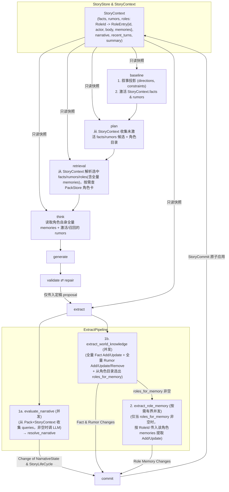

# Extract Pipeline 与动态知识存储 — Design

> **Date**: 2026-10-16
> **Author**: Gemini 4 Argon
> **Status**: Accepted
> **Prior doc**: [Pipeline 框架与编排](./2026-10-13-pipeline-framework-design-opus.md)、[Plan 阶段知识召回选择](./2026-10-14-plan-knowledge-retrieval-design-gpt.md)、[Character Think Pipeline](./2026-10-14-character-think-pipeline-design-gpt.md)

---

## Context

### 现状

`crates/aise-core` 的 Turn 工作流已跑通 `baseline → plan → retrieval → think → generate → validate ⇄ repair → extract → summary → commit` 固定拓扑（`crates/aise-core/src/pipeline/runtime/runtime.rs:109-217`），但 `extract` 阶段以及与之配套的动态知识与角色记忆存储仍处于半成品或占位状态：

1. **叙事语义条件未接入 LLM**：`ExtractPipeline::execute` 当前忽略 `ExtractInput` 中的字段，直接用空的 `BTreeMap::new()` 调用 `extract_narrative::resolve_narrative`（`crates/aise-core/src/pipeline/extract/extract.rs:42-61`）。任何依赖 `NarrativeCondition::Semantic` 的叙事节点迁移永远返回 `Truth::Unknown`（`crates/aise-core/src/core/narrative/condition.rs:92-94`）。此外，`ExtractInput` 还冗余携带了 `player_contribution`（非权威玩家意图，易误导状态提取）与跨阶段空传的 `queries`。
2. **`StoryContext` 与 `StoryStore` 未管理动态知识与角色记忆**：
   - `WorldState` 与 `WorldChange` 仍是无实际语义的空结构体（`crates/aise-core/src/core/world.rs:3-7`），`Runtime` 直接将空的 `WorldChange {}` 传给 `CommitInput`（`crates/aise-core/src/pipeline/runtime/runtime.rs:208`）。
   - `Core` 层虽然已定义了 `EntryOrigin::Turn(TurnNumber)`（`crates/aise-core/src/core/knowledge/origin.rs:5-8`）和携带冻结角色数据及运行时记忆的 `RoleEntry { id, actor, body, memories }`（`crates/aise-core/src/core/role/role.rs:20-25`），但 `StoryContext` 只保存了 `cast: BTreeMap<RoleId, RoleActor>` 和空的 `world_state: WorldState`（`crates/aise-core/src/core/story/story_context.rs:16-27`）。
   - 上游 `baseline`（知识激活）、`plan`（候选收集）、`retrieval`（按 ID 召回）和 `think`（角色记忆读取）全部直接读取 `StoryPack` 中的静态 `seed_facts`、`seed_rumors` 和 `RoleBody.seed_memories`，无法感知故事运行过程中新产生的客观事实、群体认知与角色记忆。

### 为什么现在做

`validate` 与 `repair` 阶段落定后，每一轮 Turn 都能稳定产出最终定稿的故事段落（`validation_result.proposal`）。此时补齐 `extract` 阶段以及 `StoryContext` / `StoryStore` 的动态知识与角色记忆管理，才能打通“本轮正文定稿 → 提取叙事证据与认知变化 → 原子提交更新 `StoryContext` → 下一轮 `baseline` / `plan` / `retrieval` / `think` 消费最新认知状态”的完整闭环。

### Constraints & assumptions

- `Runtime::run_turn` 是唯一编排者（`R-AISE-01`）；`extract` 不调用其他阶段，也不直接写存储。
- 只有 `commit` 阶段可以修改持久化状态，且 `commit` 阶段不调用 LLM（`R-AISE-05`）；所有状态变更必须在 `extract` 中完成生成与确定性校验。
- 遵循“能不用结构化数据就不用”原则（[Pipeline 框架设计 Principles 7](./2026-10-13-pipeline-framework-design-opus.md)）：不引入结构化场景位置（Scene）、角色属性 KV 表或数值化关系表；彻底删除空的 `WorldState` / `WorldChange` 概念，直接将 `facts`、`rumors` 和 `roles: BTreeMap<RoleId, RoleEntry>` 挂在 `StoryContext` 上。
- 三层认知模型的语义与变更策略严格固定：
  - **`Fact`（客观世界事实）**：故事世界已经发生或确立的客观真相，仅对作者侧（`plan`、`generate`、`validate`、`repair`）可见，对角色侧（`think`）不可见。`Fact` 是同一事实主题的持续演进记录，而不是不可变事件日志；例如“某地有一件法宝”在法宝被取走后可更新为“某地原有一件法宝，现已被取走”。为支持这种演进并减少重复条目，**向 `extract` 传入全量 `facts`（带 `FactId`），支持新增（Add）和保留历史语义的更新（Update），不支持删除（Remove）**。
  - **`Rumor`（群体认知）**：故事世界中公开流传、群体共同认为的“事实”或公共共识，对作者侧和所有角色的 `think` 均可见。随着新事件公开或真相揭露，群体认知会发生转变或消亡，因此**向 `extract` 传入全量 `rumors`（带 `RumorId`），支持新增（Add）、更新（Update）和删除（Remove）**。
  - **`Memory`（角色私有记忆）**：特定角色（`RoleId`）对重大事件的私密记忆与个体认知，仅对该角色自身的 `think` 及作者侧可见，跨角色严格隔离。当前按**“只生成重大事件记忆、全量加载”**实现；**支持新增（Add）和更新（Update）**。
- 硬重构（`R-REFACTOR-01/02`）：删除 `core/world.rs` 中的 `WorldState` / `WorldChange` 占位结构，直接替换为直白表达认知变更的类型。
- 本轮设计修订暂不确定累计条目、Prompt 字节、LLM 输出字节及并发上限的具体预算；这些容量与边界参数保留为 `TBD`，在实现验收前单独完成最终预算设计。

---

## Principles

1. **定稿故事正文是唯一权威来源，拒绝平行状态表与未遂意图**：`ExtractInput` 只接收本轮定稿的 `proposal: &'a str`（配合 `StoryContext` 中的前文与状态）；绝不传入 `player_contribution`（避免将玩家未遂的尝试误提为事实），也不抽取场景、位置、关系等平行 KV 状态表。
2. **三层认知差异化演进**：
   - `Fact` 全量传入，支持 `Add` / `Update`；`Update` 必须围绕同一事实主题保留旧状态的历史真实性并补充当前状态，不可改写为无关事实，也不可 `Remove`；
   - `Rumor` 全量传入，支持 `Add` / `Update` / `Remove`；
   - `Memory` 聚焦重大事件，支持 `Add` / `Update`。
3. **世界认知提取与角色记忆提取分层隔离**：先在提取世界级认知（`Fact` / `Rumor`）时从轻量角色目录中识别出本轮经历了重大事件、需要更新记忆的 `RoleId` 列表，再仅针对被选中的角色按需加载其私有 `memories` 提取记忆变更，降低无关角色的私有记忆污染全局提取上下文的风险。角色是否实际感知事件属于语义判断，由单角色 LLM Prompt 按角色视角约束，不引入代码层面的结构化感知模型或 `evidence` 字段。
4. **LLM 完整生成 `ActivationRule`**：向 LLM 明确说明 `ActivationRule` 的匹配、模式、递归与选择规则，由 LLM 在生成或更新 `Fact` / `Rumor` / `Memory` 时一并决策完整的 `ActivationRule` 数据。
5. **`StoryContext` 是运行时认知的唯一权威快照**：故事创建时由 `StoryPack` 的 Seed 数据初始化 `StoryContext` 的 `facts`、`rumors` 与 `roles`（`RoleEntry`），每轮通过 `StoryCommit` 原子应用变更，使上游阶段统一从 `StoryContext` 消费最新状态。

---

## Options

### 问题 1：`StoryContext` 状态组织与 `Fact` / `Rumor` 的提取策略

#### Option 1A：保留 `WorldState` / `WorldChange`，或 `Fact` 仅局部传入

- **Idea**：保留 `StoryContext.world_state` 包装层；或者在提取 `Fact` 时只传入本轮已激活的 `Fact`，不传全量历史 `Fact` 且只允许 `Add`。
- **Pros**：
  - 单次 Prompt 中 `Fact` 列表较短。
- **Cons**：
  - 若某条先前产生的 `Fact` 在本轮未激活，但本轮正文再次涉及或推进了该事实，LLM 因看不到已有 `Fact` 会重复新增雷同条目，或无法在同一条目上补充后续进展。
  - `WorldState` 包装层在没有其他世界状态字段时纯属冗余。
- **Risk**：跨轮次产生大量重复或碎片化的 `Fact` 条目。

#### Option 1B：移除 `WorldState` 包装，全量传入 `Fact`（`Add` / `Update`）与 `Rumor`（`Add` / `Update` / `Remove`）

- **Idea**：
  - 删除 `WorldState` / `WorldChange`；`StoryContext` 直接持有 `facts: BTreeMap<FactId, FactEntry>`、`rumors: BTreeMap<RumorId, RumorEntry>` 与 `roles: BTreeMap<RoleId, RoleEntry>`。
  - 提取世界认知时，将 `story_ctx.facts` 与 `story_ctx.rumors` 全量传入：`Fact` 允许 `Add`（新事实）与 `Update`（围绕同一事实主题保留历史状态并补充当前状态），禁止 `Remove`；`Rumor` 允许 `Add`、`Update` 与 `Remove`（淘汰已失效的群体认知）。
- **Pros**：
  - LLM 看到完整 `facts` 列表，可降低重复生成概率，并能对已有客观事实做演进更新。
  - `ExtractInput` 无需再从 `Runtime` 透传 `known_facts` 等中间集合，直接从 `&StoryContext` 读取即可。
- **Cons**：
  - `extract` 的 Prompt 包含全量 `facts` 与 `rumors`。
- **Risk**：若模型把日常琐事也提成 `Fact` 会导致列表变长，需由 Prompt 规则与 `ExtractConfig` 条目上限共同约束。

### 问题 2：角色记忆（`Memory`）的识别与提取方式

#### Option 2A：依赖上游 `Plan` 选出的角色列表，单次合并提取 `Fact` / `Rumor` / `Memory`

- **Idea**：直接把 `Plan` 阶段选出的本轮相关角色的 `memories` 与全量 `Fact`、`Rumor` 塞进同一个 Prompt，一次 LLM 调用同时输出 `Fact`、`Rumor` 和 `Memory` 变更。
- **Pros**：
  - 少一次按需的角色记忆 LLM 调用。
- **Cons**：
  - 若 `Generate` 在正文中让某个未在 `Plan` 中预选的角色经历了关键事件，该角色将无法获得记忆更新。
  - 把多个角色的私有 `memories` 与全局 `Fact` / `Rumor` 混在同一个 Prompt 中，上下文庞杂且容易发生跨角色记忆串扰。
- **Risk**：模型在单次庞大 JSON 输出中混淆不同角色的私有认知与客观事实。

#### Option 2B：两阶段认知提取（世界提取顺带识别 `RoleId` → 按角色独立提取 `Memory`）

- **Idea**：
  - **第一步（并发执行）**：
    - `evaluate_narrative`（当 `queries` 非空时）：判定叙事语义条件 `SemanticQuery`；
    - `extract_world_knowledge`：输入全量 `facts`、全量 `rumors` 以及全剧轻量角色目录（`RoleId`、名字、alias），输出 `Fact` 变更（`Add`/`Update`）、`Rumor` 变更（`Add`/`Update`/`Remove`）以及**本轮需要新增或更新重大事件记忆的角色列表 `roles_for_memory: Vec<RoleId>`**。
  - **第二步（按需执行）**：
    - 仅当 `roles_for_memory` 非空时，针对选中的每个 `RoleId`，加载其角色身份与当前全量 `memories`，调用 `extract.extract_role_memory`（可像 `ThinkPipeline` 一样按角色有界并发执行），专门提取该角色的 `Memory` 变更（`Add`/`Update`）。
- **Pros**：
  - **自主确定记忆角色**：由 LLM 根据本轮最终正文从完整角色目录中判断哪些角色经历了重大事件，不依赖上游 `Plan` 的预测。
  - **认知与上下文按角色隔离**：提取 `Fact` / `Rumor` 时不混入任何角色的私有 `Memory`；提取某角色的 `Memory` 时只传入该角色自身的 `memories`，降低跨角色记忆污染风险。
  - **按需零浪费**：若本轮没有角色经历足以记入长期记忆的重大事件，`roles_for_memory` 为空，第二步 0 次 LLM 调用。
- **Cons**：
  - 当某轮确实有角色需要更新记忆时，`extract` 阶段存在“先 `extract_world_knowledge`、再 `extract_role_memory`”的两跳 LLM 调用。
- **Risk**：多角色同时触发记忆更新时的扇出，需在 `ExtractConfig` 中限制单轮最多更新记忆的角色数与并发数（`R-ARCH-03`）。

### Choice

**问题 1 采用 Option 1B；问题 2 采用 Option 2B。**

**Rationale**：Option 1B 消除了冗余的 `WorldState` 包装，并通过全量传入 `Fact`（支持 `Add`/`Update`）与 `Rumor`（支持 `Add`/`Update`/`Remove`）降低重复 Fact 的产生概率并支持事实演进，同时简化了 `ExtractInput`（不再需要从 `Runtime` 透传激活/召回列表）；Option 2B 通过在提取世界知识时顺带从轻量角色目录中选出 `roles_for_memory`，再对命中角色单独提取私有记忆，使角色选择基于最终正文，并实现类似 `ThinkPipeline` 的按角色上下文隔离。

---

## Design

### 1. Target structure

#### 1.1 Turn 全链路与 `ExtractPipeline` 内部编排



#### 1.2 `pipeline/extract/` 模块划分（遵循 `R-AISE-04` / `R-CODE-08`）

```text
crates/aise-core/src/pipeline/extract/
  mod.rs                      模块声明；pub(super) 导出 ExtractConfig, ExtractInput, ExtractOutput, ExtractPipeline
  config.rs                   ExtractConfig（单轮最大变更数、最大记忆角色数、角色记忆提取并发度等）
  extract.rs                  ExtractInput, ExtractOutput, ExtractPipeline, impl Pipeline
  extract_prompt.rs           evaluate_narrative、extract_world_knowledge、extract_role_memory 三套 Prompt 渲染
  extract_llm.rs              三个子任务的 LlmGateway 调用、JSON 反序列化与基础格式校验
  extract_narrative.rs        纯计算：基于 semantic_results 推进 NarrativeGraph，产出 NarrativeChange
  extract_knowledge.rs        纯计算：构造输入视图、校验 Fact/Rumor/Memory 变更及 ActivationRule，分配新 ID 并组装 KnowledgeChange
  extract_trace.rs            各子任务 Span 的 begin_* / finish_* 观测辅助
  tests/
    extract_tests.rs
    extract_prompt_tests.rs
    extract_llm_tests.rs
    extract_narrative_tests.rs
    extract_knowledge_tests.rs
```

### 2. Core types & responsibilities

#### 2.1 `StoryContext` 与 `KnowledgeChange` 模型（移除 `core/world.rs`）

删除 `WorldState` 与 `WorldChange`，在 `StoryContext`（`crates/aise-core/src/core/story/story_context.rs`）中直接管理 `facts`、`rumors` 与 `roles`：

| Type | Field / Variant | Responsibility | Out of scope |
|---|---|---|---|
| `StoryContext` | `pub roles: BTreeMap<RoleId, RoleEntry>`<br/>`pub facts: BTreeMap<FactId, FactEntry>`<br/>`pub rumors: BTreeMap<RumorId, RumorEntry>`<br/>（其余字段保持不变，原 `cast` 升级为 `roles`） | 持有当前故事实例全部有效的客观事实、群体认知，以及每个角色的冻结 `RoleBody`、`RoleActor` 与运行时 `memories`（`RoleEntry` 结构以 `core/role/role.rs` 为准） | Turn 内临时提取结果 |
| `KnowledgeChange` | `pub facts: Vec<FactChangeOp>`<br/>`pub rumors: Vec<RumorChangeOp>`<br/>`pub memories: Vec<RoleMemoryChangeOp>` | 记录单轮 `extract` 产出的三层认知增量变更，保存在 `Turn.knowledge_change` 中并在 `StoryStore::commit` 中原子应用到 `StoryContext` | 叙事图状态（由 `StoryCommit.narrative` 承载） |
| `FactChangeOp` | `Add { id: FactId, body: FactBody }`<br/>`Update { id: FactId, body: FactBody }` | 新增客观世界事实，或围绕同一事实主题保留旧状态的历史真实性并补充当前状态；`Add` 写入 `EntryOrigin::Turn(current_turn)`，`Update` 保留原 `EntryOrigin` | `Remove`、改写为无关事实或删除旧状态的历史语义 |
| `RumorChangeOp` | `Add { id: RumorId, body: RumorBody }`<br/>`Update { id: RumorId, body: RumorBody }`<br/>`Remove { id: RumorId }` | 新增、整条覆盖更新或删除群体认知；`Add` 写入 `EntryOrigin::Turn(current_turn)`，`Update` 保留原 `EntryOrigin` | 局部字符串拼接 |
| `RoleMemoryChangeOp` | `Add { role_id: RoleId, id: MemoryId, body: MemoryBody }`<br/>`Update { role_id: RoleId, id: MemoryId, body: MemoryBody }` | 为本轮经历重大事件的角色新增或更新私有记忆；`Add` 写入 `EntryOrigin::Turn(current_turn)`，`Update` 保留原 `EntryOrigin` | `Remove` 或跨角色共享记忆 |

其中 `FactBody`、`RumorBody`、`MemoryBody` 均包含：
- `content: BoundedText`：自由文本正文；
- `retrieval: RetrievalHint`：供按需召回使用的一句话摘要；
- `activation: ActivationRule`：由 LLM 根据 Prompt 规则说明生成的完整激活规则（`match_rule`、`mode`、`recursion`、`selection`）。

#### 2.2 `pipeline::extract` 核心类型

| Type / Module | Responsibility | Out of scope |
|---|---|---|
| `ExtractInput<'a>` | 仅接收 `pub proposal: &'a str`（本轮定稿故事段落）；移除 `player_contribution`（非权威玩家意图）与 `queries`（改由 `extract` 直接从 `StoryPack.narrative` 与 `StoryContext.narrative` 确定性收集）；全量 `facts`、`rumors` 与角色 `memories` 直接从 `&StoryContext` 读取 | 接收未定稿意图或跨阶段透传数据 |
| `ExtractOutput` | 产出 `knowledge_change: KnowledgeChange`、`narrative: Change<NarrativeState>`、`life_cycle: Change<StoryLifeCycle>` | 写入 `StoryStore` |
| `ExtractPipeline` | 持有 `Arc<LlmGateway>`、`Arc<Prompt>`、`Arc<Store>`、`ExtractConfig`；编排叙事评估、世界知识提取与按需角色记忆提取 | 滚动摘要生成 |
| `extract_narrative` | 从 `StoryPack.narrative` 与 `StoryContext.narrative` 收集待评估的 `SemanticQuery`；将 LLM 判定的 `BTreeMap<NarrativeConditionId, Truth>` 组装为 `NarrativeEvidence`，调用 `NarrativeGraph::resolve` 计算节点迁移与故事完结状态 | LLM 调用 |
| `extract_knowledge` | 构造全量 `Fact`/`Rumor` 视图、轻量角色目录及单角色 `Memory` 视图；校验 LLM 输出的变更操作与 `ActivationRule` 合法性，分配新条目 ID 并组装 `KnowledgeChange` | 存储持久化 |

### 3. Key flows

#### 3.1 故事创建：从 `StoryPack` 初始化 `StoryContext`

1. `AiseFactory::freeze_story` 校验 `StoryPack` 并解析选角（`crates/aise-core/src/engine/factory.rs:77-107`）。
2. 为每个角色构造初始 `RoleEntry { id, actor, body, memories }`：`body` 是 `StoryPack.roles` 中 `RoleBody` 的冻结副本，`actor` 取自选角结果，`memories` 由 `body.seed_memories` 映射为 `EntryOrigin::Seed` 的 `MemoryEntry`；后续运行时记忆只以 `RoleEntry.memories` 为准，`body.seed_memories` 仅保留 Seed 声明。
3. 将 `StoryPack.seed_facts` 与 `StoryPack.seed_rumors` 映射为 `EntryOrigin::Seed` 的 `FactEntry` 与 `RumorEntry`。
4. `StoryStore::create` 将初始 `roles`、`facts`、`rumors` 写入 `StoryContext`。

#### 3.2 上游阶段消费 `StoryContext` 动态认知与记忆

1. **`baseline`**：`baseline_knowledge::activate_knowledge` 直接从 `story_ctx.facts`、`story_ctx.rumors` 与 `story_ctx.roles`（读取玩家角色名用于扫描缓冲）执行确定性激活，产出 `ActivatedKnowledge`（保留每条目的真实 `EntryOrigin`）。
2. **`plan`**：`plan_candidates::collect_candidates` 从 `story_ctx.facts` 和 `story_ctx.rumors` 中过滤掉本轮已激活的 ID，取剩余条目的 `id` 与 `retrieval`（`RetrievalHint`）构建待召回候选索引；`plan_roles` 直接从 `story_ctx.roles` 构建角色目录并解析玩家角色（仅当 `RoleActor::Card` 时从 `PackStore` 读取 `CharacterCard`）。
3. **`retrieval`**：
   - 按 `fact_ids` / `rumor_ids` 直接从 `story_ctx.facts` / `story_ctx.rumors` 读取完整条目；
   - 按 `role_ids` 直接从 `story_ctx.roles` 读取冻结 `RoleBody`、`RoleActor` 与当前全量重大事件记忆，仅在 `RoleActor::Card` 时从 `PackStore` 解析 CharacterCard profile，组装 `ResolvedRole`（无需再加载 `StoryPack`）。
4. **`think`**：目标角色读取自身 `ResolvedRole` 中的全量 `memories`（包括存活的 Seed 记忆与动态提取的重大事件记忆）以及本轮激活/召回的 `RumorEntry`（群体认知）。

#### 3.3 `ExtractPipeline::execute` 执行流

1. **加载 `StoryPack`**：从 `PackStore` 读取 `StoryPack`。
2. **第一阶段：并发执行 `evaluate_narrative` 与 `extract_world_knowledge`**（`tokio::try_join!`）：
   - **分支 A（叙事图推进 `evaluate_narrative`）**：
     1. 若 `story_pack.narrative` 为 `None`，直接返回 `Change::Unchanged`。
     2. 从 `story_pack.narrative` 与 `story_ctx.narrative` 收集当前监听的语义条件 `queries: Vec<SemanticQuery>`。若 `queries.is_empty()`，跳过 LLM 调用，以空 `semantic_results` 进入第 5 步。
     3. 若 `queries` 非空，开启 `evaluate_narrative` Span，渲染 `extract.evaluate_narrative` Prompt（含近期故事上下文、本轮定稿 `proposal`、待判定 `queries`），调用 `LlmGateway`。
     4. 校验返回的 `condition_id` 必须属于 `queries` 且无重复，并要求返回 ID 集合与 `queries` 完全一致；模型无法确定时也必须显式返回 `Truth::Unknown`，遗漏任何查询均按阶段失败。校验通过后得到 `BTreeMap<NarrativeConditionId, Truth>`。
     5. 调用 `extract_narrative::resolve_narrative` 计算 `Change<NarrativeState>` 与 `Change<StoryLifeCycle>`。
   - **分支 B（世界认知提取与记忆角色识别 `extract_world_knowledge`）**：
     1. 开启 `extract_world_knowledge` Span，准备 RC 上下文数据：
        - 近期故事与本轮定稿正文（`proposal`）；
        - **当前完整 `Fact` 列表（`story_ctx.facts`）**：带 `FactId`、正文、`RetrievalHint` 与 `ActivationRule`，供 LLM 去重并判断哪些需要 `Update` 补充或 `Add` 新增；
        - **当前完整 `Rumor` 列表（`story_ctx.rumors`）**：带 `RumorId`、正文、`RetrievalHint` 与 `ActivationRule`，供 LLM 判断哪些群体认知需要 `Add`、`Update` 或 `Remove`；
        - **全剧角色轻量目录（来自 `story_ctx.roles` 中的冻结 `RoleBody`）**：包含所有角色的 `RoleId`、名字、alias 与 `retrieval_hint`（不暴露私有记忆）。
     2. 渲染 `extract.extract_world_knowledge` Prompt，调用 `LlmGateway`，返回：
        - `facts`（`Add` / `Update` 提案）；
        - `rumors`（`Add` / `Update` / `Remove` 提案）；
        - `roles_for_memory: Vec<RoleId>`（本轮在 `proposal` 中经历了重大事件、需要新增或更新私有记忆的角色 ID 列表）。
     3. 确定性校验 `facts`、`rumors` 提案及 `roles_for_memory`（`Fact` 的 `Update` ID 必须存在于 `story_ctx.facts`；`Rumor` 的 `Update`/`Remove` ID 必须存在于 `story_ctx.rumors`；`roles_for_memory` 中的 `RoleId` 必须存在于 `story_ctx.roles`、无重复且数量不超过 `ExtractConfig` 上限）。
3. **第二阶段：按需有界并发执行角色记忆提取（`extract_role_memory`）**：
   - 若 `roles_for_memory.is_empty()`，跳过第二阶段，记忆变更列表为空。
   - 若 `roles_for_memory` 非空，像 `ThinkPipeline` 一样按 `ExtractConfig.max_memory_concurrency` 有界并发为每个目标 `RoleId` 执行 `extract_role_memory`：
     1. 开启单角色 `extract_role_memory` Span，传入近期故事、本轮定稿 `proposal`、该角色的身份信息（`RoleId`、名字、alias、backstory）以及该角色在 `story_ctx.roles[role_id].memories` 中的**当前全量 `MemoryEntry`（带 `MemoryId`）**。
     2. 渲染 `extract.extract_role_memory` Prompt，调用 `LlmGateway`，由模型站在该角色的认知视角输出本轮重大事件记忆的 `Add` 或 `Update`（包含 `content`、`retrieval`、`activation`）。Prompt 明确规定只有角色亲历、目击、听见、被明确告知或基于既有认知合理推断的信息才能进入记忆；旁白全知信息、他人内心及角色不在场事件不得进入记忆；角色误解必须以主观认知表述，无法确认角色是否知情时返回空列表。
     3. 确定性校验该角色输出的 `Update` 目标 `MemoryId` 必须属于该角色现有 `memories`，且 `ActivationRule` 合法。
4. **分配 ID 并汇总返回**：为所有新增的 `Fact`、`Rumor`、`Memory` 分配不冲突的确定性 ID（如 `fact_t{turn}_{seq}` / `rumor_t{turn}_{seq}` / `mem_t{turn}_{seq}`），组装并返回 `ExtractOutput { knowledge_change, narrative, life_cycle }`。

#### 3.4 `CommitPipeline` 与 `StoryStore::commit` 原子应用

1. `Runtime` 将 `extract_output.knowledge_change` 放入 `CommitInput`，由 `CommitPipeline` 组装进 `StoryCommit.turn.knowledge_change`。
2. `StoryStore::commit` 在同一个写锁临界区内（`crates/aise-core/src/persistence/story_store_mem.rs:135-186`）：
   - 校验幂等键、`life_cycle == Active` 和 `turn_number` 连续性；
   - 在修改 `next_context` 前完整校验 `knowledge_change`：同类操作 ID 不得重复，同一目标不得同时出现冲突操作，`Add` ID 必须不存在，`Update` / `Remove` ID 必须存在，`RoleMemoryChangeOp.role_id` 与 `MemoryId` 必须属于同一现有角色；任何失败均拒绝整个 Commit；
   - 将 `commit.turn.knowledge_change` 应用到 `next_context`：
     - `facts`：执行 `Add` / `Update`；`Add` 使用 `EntryOrigin::Turn(turn_number)`，`Update` 保留原 `EntryOrigin`；
     - `rumors`：执行 `Add` / `Update` / `Remove`；`Add` 使用 `EntryOrigin::Turn(turn_number)`，`Update` 保留原 `EntryOrigin`；
     - `memories`：在对应 `next_context.roles.get_mut(&role_id).memories` 中执行 `Add` / `Update`；`Add` 使用 `EntryOrigin::Turn(turn_number)`，`Update` 保留原 `EntryOrigin`；
   - 应用 `commit.summary`、`commit.narrative`、`commit.life_cycle`，追加 `commit.turn` 并裁剪 `recent_turns` 窗口。

### 4. Key decisions

- **`ExtractInput` 仅保留 `proposal: &'a str`** → 移除 `ExtractInput` 中的 `player_contribution` 与 `queries`（同时清理 `Baseline` 中未被上游消费的 `NarrativeProjection.queries`，改由 `extract` 直接从 `StoryPack.narrative` 与 `StoryContext.narrative` 收集 `queries`） → 定稿的故事正文 `proposal`（配合 `StoryContext` 前文）是发生事件的唯一权威来源；传入 `player_contribution` 可能把被故事约束拦截的玩家未遂意图误提取为事实，而 `queries` 在生成前阶段毫无用途，归入 `extract` 内部计算可消除跨阶段空传。
- **废除 `WorldState` / `WorldChange`，采用 `RoleEntry` 直接挂接** → 删除 `core/world.rs`，在 `StoryContext` 中将 `cast: BTreeMap<RoleId, RoleActor>` 升级为 `roles: BTreeMap<RoleId, RoleEntry>`，并直接持有 `facts: BTreeMap<FactId, FactEntry>` 和 `rumors: BTreeMap<RumorId, RumorEntry>`；`Turn` 中用 `knowledge_change: KnowledgeChange` 替代 `world_change` → 在“能不用结构化数据就不用”的设计下，除三层认知外没有其他世界状态表，去掉空壳包装层并复用现成的 `RoleEntry` 最简洁直观。
- **`Fact` 采用“全量传入 + 新增与演进更新（Add / Update）”模式** → `extract_world_knowledge` 接收 `story_ctx.facts` 全量条目，允许 `Add` 新事实和 `Update` 同一事实主题的后续进展，禁止 `Remove` → 全量传入用于降低重复生成概率，并让“某地原有法宝，现已被取走”这类状态演进保留在同一 Fact 中；历史保留由 `Update` 必须保留旧状态真实性的 Prompt 契约保证，而不是仅由禁止 `Remove` 保证。
- **`Rumor` 采用“全量传入 + 增删改（Add / Update / Remove）”模式** → `extract_world_knowledge` 接收 `story_ctx.rumors` 全量条目 → `Rumor` 是群体认知（大家都认为的“事实”），旧的群体认知经常被新公开的事件修正或推翻，必须允许就地更新或删除，否则过时的群体共识会与新共识同时被激活。
- **`Memory` 采用“两步法（世界提取选出 `RoleId` → 单角色独立提取重大记忆 Add / Update）+ 全量加载”模式** → 在 `extract_world_knowledge` 中附上轻量角色目录，由 LLM 一并判断本轮哪些角色需要更新记忆（`roles_for_memory`），随后再按角色单独加载其 `memories` 调用 `extract_role_memory` → 角色是否知情属于无法由当前代码模型强保证的语义判断，因此不增加结构化感知状态或 `evidence` 字段，而由单角色 Prompt 约束角色视角并通过“不在场事件、他人内心、秘密对话、错误传闻”等专项测试验证；按角色拆分仍可隔离已有私有记忆上下文。
- **由 LLM 决策完整的 `ActivationRule`** → 在 `extract_world_knowledge` 与 `extract_role_memory` 的 Prompt（CSI/FTI）中向 LLM 讲清楚 `ActivationRule`（`match.keys`、`secondary_keys`、`secondary_logic`、`mode.constant` 等）的触发机制，由 LLM 根据条目性质决定生成的 `ActivationRule` 数据，并由 Rust 代码通过 `ActivationRule` 的反序列化与类型边界完成校验。

---

## Impact

- **Code**：
  - `crates/aise-core/src/core/`：删除 `world.rs`；新增知识变更类型（`KnowledgeChange`、`FactChangeOp`、`RumorChangeOp`、`RoleMemoryChangeOp`）；更新 `story/story_context.rs`（`cast` 改为 `roles: BTreeMap<RoleId, RoleEntry>`，新增 `facts`、`rumors`）、`story/story_instance.rs`、`turn.rs`（`world_change` 改为 `knowledge_change`）、`role/memory.rs` 等。
  - `crates/aise-core/src/engine/factory.rs`：`freeze_story` 从 `StoryPack` 的 `seed_facts`、`seed_rumors` 和 `RoleBody.seed_memories` 构造 `StoryInstanceSpec` 的初始 `facts`、`rumors` 和 `roles`。
  - `crates/aise-core/src/persistence/`：`story_store_mem.rs`（及 `story_store_sqlite.rs`）在 `create` 时写入初始 `facts`、`rumors`、`roles`，在 `commit` 时原子应用 `commit.turn.knowledge_change`。
  - `crates/aise-core/src/pipeline/`：
    - `extract/`：补齐 `config.rs`、`extract_prompt.rs`、`extract_llm.rs`、`extract_knowledge.rs`、`extract_trace.rs` 及对应单测；`ExtractPipeline::new` 注入 `Arc<LlmGateway>`、`Arc<Prompt>`、`Arc<Store>`、`ExtractConfig`。
    - `baseline/`、`plan/`、`retrieval/`、`think/`、`generate/`：将 `story_ctx.cast` 适配为 `story_ctx.roles`，将知识与角色记忆的数据源切换为 `StoryContext`，并移除 `NarrativeProjection.queries`（移交 `extract` 内部计算）。
    - `runtime/runtime.rs` 与 `commit/commit.rs`：`ExtractInput` 精简为仅携带 `proposal: &validation_result.proposal`，并将 `extract_output.knowledge_change` 传给 `CommitInput`。
- **Config**：
  - `PipelineConfig` 新增 `extract: ExtractConfig`。
  - `crates/aise-core/assets/prompts/` 新增 `extract.evaluate_narrative`、`extract.extract_world_knowledge` 与 `extract.extract_role_memory` 三套模板（`csi/`、`rc/`、`fti/`）并注册到 `index.toml`。
- **Data**：`StoryContext` 与 `Turn` 的序列化结构移除 `world_state` / `world_change`，改为 `facts`、`rumors`、`roles` 与 `knowledge_change`；这是公开 Rust 数据结构和持久化序列化结构的破坏性变更，不保留旧格式兼容路径。
- **External interface**：无外部 HTTP/WS 接口破坏性变更；`aise-core` 的公开 Rust 类型发生破坏性变更。

---

## Risks & mitigations

| Risk | Likelihood | Impact | Mitigation |
|---|---|---|---|
| 模型过度提取琐碎细节为 `Fact` 或过度勾选 `roles_for_memory`，导致条目数与 LLM 调用增加（`R-ARCH-03` / `R-ARCH-04`） | med | high | Prompt 明确要求“仅提取改变局势的客观事实与角色重大事件记忆，日常对话与瞬时动作由近期正文承载，无重大变化时返回空列表”；累计条目、Prompt 字节、输出字节、单轮调用与并发预算暂为 `TBD`，留到最终预算设计统一确定 |
| LLM 生成的 `ActivationRule` 包含非法字段（如空 `ActivationKey`、非法 `ActivationGroupKey` 字符或越界概率） | med | med | 反序列化直接复用 `ActivationKey::try_new`、`ActivationGroupKey::try_new`、`ActivationProbability::try_new` 的类型校验；FTI 中给出清晰的格式约束与常用默认模式示例 |
| LLM 在 `extract` 中混淆 `Fact`（客观真相）、`Rumor`（群体认知）与 `Memory`（私有记忆），或把角色不可感知的信息写入 `Memory` | med | high | 将 `extract_world_knowledge` 与单角色 `extract_role_memory` 拆分为独立 Prompt；CSI/FTI 明确定义三层认知及角色知情边界，并用不在场事件、他人内心、秘密对话与错误传闻场景做 Prompt 测试；当前不声明代码层面的语义强保证 |
| LLM 返回不存在或遗漏的 `condition_id`，或返回不存在的 `FactId`、`RumorId`、`MemoryId`、`RoleId` | med | med | `extract_narrative` 要求语义结果 ID 集合与查询集合完全一致；`extract_knowledge` 执行严格白名单与重复/冲突操作校验，任何越界、遗漏或冲突均按阶段失败（`PipelineError`），绝不静默丢弃 |

---

## Roadmap

建议分三个 Phase 渐进落地，每个 Phase 独立可编译、可测试：

- **Phase 0（`StoryContext` 与 `StoryStore` 动态知识与 `RoleEntry` 模型）**：删除 `WorldState` / `WorldChange`，在 `StoryContext` 中落地 `facts`、`rumors`、`roles: BTreeMap<RoleId, RoleEntry>` 与 `KnowledgeChange`；在 `AiseFactory` / `StoryStore::create` 中完成 Seed 初始化，在 `StoryStore::commit` 中原子应用 `KnowledgeChange`；将 `baseline` / `plan` / `retrieval` / `think` 切换为从 `StoryContext` 读取知识与全量角色记忆 → spec [2026-10-17-extract-pipeline-spec-phase-0-gemini.md](../exec/extract-pipeline-spec/2026-10-17-extract-pipeline-spec-phase-0-gemini.md)
- **Phase 1（Narrative Extract 闭环）**：在 `extract/` 中补齐 `extract_prompt.rs`、`extract_llm.rs`、`extract_trace.rs`、`config.rs`，接入 `extract.evaluate_narrative` Prompt，打通 `SemanticQuery` 的 LLM 判定与 `extract_narrative::resolve_narrative` → spec [2026-10-17-extract-pipeline-spec-phase-1-gemini.md](../exec/extract-pipeline-spec/2026-10-17-extract-pipeline-spec-phase-1-gemini.md)
- **Phase 2（World Knowledge & Role Memory Extract 闭环）**：在 `extract/` 中新增 `extract_knowledge.rs` 及 `extract.extract_world_knowledge`、`extract.extract_role_memory` 两套 Prompt（含 `ActivationRule` 生成说明），在 `ExtractPipeline::execute` 中实现“并发执行叙事判定与世界知识提取 → 按需有界并发执行被选中角色的记忆提取”，并将产出的 `KnowledgeChange` 接入 `Runtime` 与 `CommitInput` → spec [2026-10-17-extract-pipeline-spec-phase-2-gemini.md](../exec/extract-pipeline-spec/2026-10-17-extract-pipeline-spec-phase-2-gemini.md)
