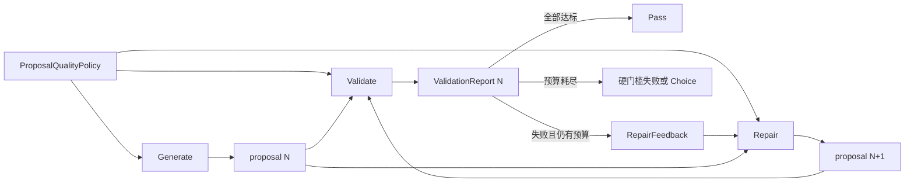

# Generate/Repair 质量目标契约设计

> **日期**：2026-10-16
> **作者**：GPT-5.6 Sol
> **状态**：草案
> **前置文档**：[Pipeline Framework Design](2026-10-13-pipeline-framework-design-opus.md)

---

## 背景

当前 Generate 根据故事证据、即时故事目标、玩家贡献和叙事约束生成 proposal，见 `crates/aise-core/src/pipeline/generate/generate.rs:14-25`。它的 Prompt 变量不包含 Validate 使用的 check criterion 和 score target，见 `crates/aise-core/src/pipeline/generate/generate_prompt.rs:10-22`。因此，Generate 在看不到完整验收标准的情况下创作，只有首次 Validate 之后才能通过 Repair 间接获知失败原因。

`Runtime` 负责有界的 Validate/Repair 循环：验证每个 proposal、提取失败项、在预算允许时调用 Repair，并对返回的新 proposal 进行完整复验。当前 Repair 输入已经包含共享验证上下文、当前 proposal、proposal 版本、失败项与修复轮次，见 `crates/aise-core/src/pipeline/repair/repair.rs:11-18`。但是，Repair 同样看不到完整质量目标，只能根据本轮失败 issue 局部猜测 Validator 的要求。

这形成了一个隐藏目标问题：Validate 按完整标准评估，Generate 和 Repair 却无法在生成文本前看到这些标准。结果是首次生成更容易偏离目标，Repair 也可能修复一个失败项时破坏其他维度，浪费有限的修复预算。

本设计需要明确四个边界：

1. 哪些质量目标应该同时提供给 Generate、Validate 和 Repair。
2. 哪些验证结果只应该作为 Repair 的反馈。
3. Repair 是否需要返回替代 proposal 之外的信息。
4. Prompt 构造和 LLM 调用如何维持证据边界与 Runtime 所有权。

### 约束与假设

- `Runtime::run_turn` 继续作为唯一的 Turn 编排器，并由 Runtime 持有修复预算。
- Generate、Validate 与 Repair 不互相导入；共享契约放在 `pipeline::common`。
- 所有阶段使用同一份不可变质量目标，避免生成标准与验证标准漂移。
- 每个修复后的 proposal 都必须重新执行完整验证。
- Generate、Validate 和 Repair 只能通过注入的 `LlmGateway` 调用模型。
- Turn 内 proposal、report 和 issue 历史的数量上限保持为 `max_repair_rounds + 1`。
- Prompt 资源继续使用 CSI、RC、FTI 三层结构。
- 配置、故事证据、proposal 和 LLM 输出均是不可信数据，必须保持清晰的 Prompt 边界和确定性输出检查。

---

## 设计原则

1. **目标透明**：创作和修复模型在输出文本前必须知道最终验收标准，不能依赖失败后猜测隐藏目标。
2. **目标与结果分离**：质量目标是共享创作契约；验证报告是对某个 proposal 的评估结果。
3. **反馈按需暴露**：Generate 只接收目标；Repair 接收同一目标和当前失败反馈，但不接收完整验证报告。
4. **语义指引优先**：数值 target 必须配合明确的 criterion 描述和目标指引，避免仅凭抽象分数创作。
5. **Runtime 持有控制状态**：proposal 版本、修复轮次、预算耗尽和最终 Choice 排名都是 Runtime 的确定性职责。
6. **Validate 是最终权威**：Generate 和 Repair 不声明达标；Validate 决定 proposal 是否通过。

---

## 方案对比

### 方案 A：保持隐藏目标

- **思路**：只有 Validate 获得完整 criteria；Generate 使用通用写作指令，Repair 只接收失败 issue。
- **优点**：
  - Generate 和 Repair Prompt 较短。
  - 不需要建立跨阶段质量目标契约。
- **缺点**：
  - Generate 无法主动满足自定义标准。
  - Repair 只能从失败信息反推整体目标。
  - 首次验证与后续修复承担了本可避免的试错。
- **风险**：有限修复预算被用于发现隐藏标准，而不是解决真正困难的内容问题。

### 方案 B：向 Repair 传入完整验证报告

- **思路**：Generate 仍不接收目标；Repair 接收所有 check 和 score 结果，包括通过项、分数范围、目标、实际分数和问题描述。
- **优点**：
  - Repair 可以看到每个评估维度及其状态。
  - 已通过项可以作为不得回退的参考。
- **缺点**：
  - 首次 Generate 仍面对隐藏目标。
  - Repair 与完整 `ValidationReport` 表示耦合。
  - 重复传递大量与本轮修改无关的结果数据。
- **风险**：Repair 逐渐承担验证解释与决策职责，模糊阶段边界。

### 方案 C：共享质量目标并按阶段提供反馈

- **思路**：建立共享 `ProposalQualityPolicy`。Generate、Validate 和 Repair 使用同一份 check 要求与 score 目标；Repair 额外接收失败 check 和未达标 score 的反馈。
- **优点**：
  - Generate 可以从首次创作开始主动满足验收标准。
  - Repair 同时看到整体目标与局部失败原因，降低修复回退概率。
  - Validate 仍然独占完整评估结果和通过决策。
  - 质量目标与某一版 proposal 的结果具有清晰的数据边界。
- **缺点**：
  - Generate 和 Repair Prompt 会增加有界的 criteria 内容。
  - 需要把 criterion 定义从 Validate 私有配置投影为共享契约。
- **风险**：模型可能针对表面评分特征优化，而不是真正改善故事质量。

### 选择

**采用方案 C。**

**理由**：质量目标属于创作规格，不是需要对创作者保密的验证实现细节。Generate 应在首次输出前看到完整目标，Repair 应在相同目标基础上获得失败反馈。完整验证报告、通过决策和 Choice 排名仍保留在 Validate 与 Runtime 内部，从而避免阶段职责混合。

---

## 设计

### 1. 目标结构

数据分为三类：

1. **质量目标**：所有阶段共享的稳定创作与验收规格。
2. **故事证据**：当前 Turn 的事实、传闻、角色、叙事方向、约束和玩家贡献。
3. **评估反馈**：某一版 proposal 的失败 check 和未达标 score，仅供 Repair 使用。

### 2. 核心类型与职责

| 类型/模块 | 职责 | 不负责 |
|---|---|---|
| `ProposalQualityPolicy` | 携带全部硬性 check 和 score 目标，供 Generate、Validate、Repair 共享 | 某一版 proposal 的实际评估结果 |
| Check criterion | 定义名称、硬性要求描述 | 数值评分、失败原因 |
| Score criterion | 定义名称、评估维度、分数范围、目标分数和 `target_guidance` | 当前 proposal 的实际分数 |
| `ValidationContext` | 携带 Validate 与 Repair 共享的 Turn 级故事证据 | 质量目标、验证决策、修复预算 |
| `ValidationIssue` | 携带单个失败 criterion 的名称和可执行问题描述；score 失败还携带当前分数 | 已通过结果、聚合决策、完整历史 |
| `ValidationReport` | 保留所有 check 和 score 结果，用于通过判断、Choice 排名、持久化和诊断 | 直接作为 Repair Prompt 输入 |
| `GenerateInput` | 携带首次创作所需的 Turn 级故事证据 | 验证结果和修复反馈 |
| `RepairInput` | 携带当前 proposal、版本、共享故事证据、失败反馈和轮次诊断信息 | 持有历史或消耗预算 |
| `RepairOutput` | 返回一份完整替代 proposal | 成功声明、分数预测、修改摘要 |
| `Runtime` | 分发共享质量目标，消耗修复预算，推进版本，保存有界历史并触发复验 | 生成或评估故事正文 |

`ProposalQualityPolicy` 是 `pipeline::common` 中的共享只读契约。具体配置仍通过 `EngineConfig` 汇总，并在 Runtime 构造阶段形成一个有界、不可变的策略实例，供三个阶段引用。任何阶段都不得导入其他阶段的配置或实现。

由于 `ValidationContext` 同时服务于 Validate 和 Repair，未来可以将其改名为 `ProposalContext` 或 `ProposalEvidence`。该改名不属于本次行为契约的必要部分。

### 3. 质量目标

#### 3.1 硬性 Check

每个 check 向三个阶段公开：

- 稳定且唯一的名称。
- 对必须满足条件的完整描述。

Generate 和 Repair 必须将所有 check 视为硬性要求。Validate 为每项返回通过或失败结果。

#### 3.2 Score 目标

每个 score 向三个阶段公开：

- 稳定且唯一的名称。
- 被评估质量维度的描述。
- `min_score`、`max_score` 和 `target_score`。
- 描述达到目标分数时文本应具备何种特征的 `target_guidance`。

数字只表达阈值，`target_guidance` 才提供可执行的创作目标。例如，“目标分数为 8”不能独立说明如何改进因果连贯性；目标指引应描述达标文本需要具有清晰的行动前因、可见结果，并避免依赖突兀转折或未提供的信息。

### 4. 关键流程

#### 4.1 Generate

1. Runtime 向 Generate 提供共享质量目标和当前 Turn 的故事证据。
2. Generate Prompt 将所有 check 放入硬性要求区，将所有 score 放入质量目标区。
3. CSI 规定证据优先级、玩家控制边界和输出边界，并要求同时满足全部硬性要求。
4. RC 将故事证据和质量目标标记为不可信运行时数据。
5. FTI 要求在不违反故事证据的前提下满足全部 check，并以达到每个 score target 为创作目标。
6. Generate 通过 `LlmGateway` 执行一次 completion，只返回故事正文。

#### 4.2 Validate

1. Validate 使用与 Generate 完全相同的 `ProposalQualityPolicy`。
2. Validate 对每个 check 和 score 独立评估。
3. 完整 `ValidationReport` 保留所有通过项、失败项和数值分数。
4. Runtime 根据 report 决定 Pass、Repair、硬门槛失败或 Choice。

#### 4.3 Repair

1. Runtime 在调用 Repair 前先消耗一轮修复预算。
2. Runtime 从当前 report 提取失败 check 和未达标 score，保持配置顺序。
3. Repair 同时获得完整质量目标、当前 proposal、共享故事证据和本轮失败反馈。
4. 失败 check 反馈包含名称与具体问题；未达标 score 反馈包含名称、当前分数、目标分数和具体问题。
5. CSI 要求解决全部失败反馈，同时继续满足完整质量目标，并尽量保留未受影响内容。
6. RC 包含故事证据、完整质量目标、当前 proposal、proposal 版本、失败反馈和最大字节数，所有区块均标记为不可信内容。
7. FTI 只允许返回一份完整替代故事正文，不允许 JSON 外壳、Markdown 围栏、分析、前言、解释或 issue 列表。
8. 修复轮次和剩余预算不进入 Prompt，因为它们是控制数据，不是故事语义。

#### 4.4 LLM 输出与复验

1. Generate 和 Repair 分别在自己的 pipeline observation 下创建 LLM 子 observation。
2. 所有 completion 只能通过共享 `LlmGateway`。
3. Repair 原始输出在去除首尾空白后为空，或长度超过 `max_proposal_bytes` 时返回错误。
4. 其他 Repair 响应保持原样并作为 `RepairOutput.proposal` 返回。
5. Runtime 将 Repair 输出视为 proposal 版本 `N + 1`，并执行完整 Validate。
6. Repair 不返回成功标记；复验结果是唯一判断依据。

### 5. Prompt 信息边界

Generate Prompt 包含：

- 完整故事证据。
- 全部硬性 check。
- 全部 score 目标、范围与目标指引。
- 不包含任何实际验证结果。

Repair Prompt 包含：

- 与 Generate 等价的完整故事证据。
- 与 Validate 相同的完整质量目标。
- 当前完整 proposal 及其版本。
- 本轮失败 check 和未达标 score 的反馈。
- 未达标 score 的当前分数和目标分数。
- 不包含已通过 criterion 的实际结果，也不包含完整历史 report。

Validate Prompt 包含：

- 与 Generate、Repair 等价的完整故事证据。
- 同一份完整质量目标。
- 当前完整 proposal 及其版本。

### 6. 关键决策

- **Generate 是否接收验证目标？** 是。目标是创作规格，隐藏目标只会制造不必要的试错。
- **Repair 是否接收完整目标？** 是。它必须在修复局部问题时继续维护其他质量维度。
- **Repair 是否接收完整验证报告？** 否。它只接收完整目标与当前失败反馈。
- **Repair 是否接收分数？** 仅接收未达标 score 的当前分数和目标分数；不接收已通过 score 的实际结果。
- **数值 target 是否足够？** 不足。每个 score 必须提供语义化 `target_guidance`。
- **如何保护已通过 criterion？** Repair 始终看到完整质量目标，并被要求最小修改；完整复验负责发现回退。
- **Repair 返回什么？** 只返回一份包装在 `RepairOutput` 中的完整替代 proposal。
- **谁推进 proposal 版本？** Runtime 根据已验证输入版本推导下一版本。
- **谁判断修复是否成功？** 只能由 Validate 判断。
- **轮次计数是否作为 Prompt 变量？** 否。它们只服务于有界控制和诊断。
- **能否自动规范化格式错误的模型输出？** 不能。Repair 只拒绝确定性的边界违规，其余原始替代文本直接交给 Validate。

---

## 影响

- **代码**：`pipeline::common` 增加共享质量目标契约；Generate、Validate 和 Repair 使用同一实例。`ValidationIssue` 为 score 失败携带当前分数，Runtime 负责提取 Repair 反馈。
- **Generate**：输入投影或构造依赖增加质量目标；Prompt 增加硬性要求和 score 目标区块。
- **Validate**：继续产出完整 `ValidationReport`，但 criteria 来源改为共享 `ProposalQualityPolicy`。
- **Repair**：Prompt 同时包含完整目标与当前失败反馈；输出契约保持仅返回 proposal。
- **配置**：score criterion 增加必填 `target_guidance`。这是直接替换，不保留旧配置兼容路径。
- **Prompt 资源**：Generate、Validate 和 Repair 的 RC/FTI 均需要体现共享目标；运行时内容统一标记为不可信。
- **Runtime**：新增共享质量目标的构造与分发；循环拓扑、预算所有权、有界历史、硬门槛行为和 Choice 排名保持不变。
- **数据**：持久化的 `TurnEvaluation` 与存储 schema 保持不变。
- **外部接口**：HTTP、事件和服务 API 均不变。
- **可观测性**：完整数值结果继续通过 Validate 和 Turn evaluation observation 暴露；Generate 不记录不存在的实际分数，Repair 只捕获本轮失败反馈。

---

## 风险与缓解措施

| 风险 | 可能性 | 影响 | 缓解措施 |
|---|---|---|---|
| 模型针对评分措辞做表面优化 | 中 | 中 | 使用语义化、可观察的 `target_guidance`，并要求 Validate 基于故事证据独立判断 |
| 三个阶段使用的目标发生漂移 | 低 | 高 | 构造单一不可变 `ProposalQualityPolicy` 实例并共享引用 |
| criteria 增加 Prompt 长度 | 中 | 中 | 继续使用现有 criterion 数量和字段字节上限，并为 `target_guidance` 设置明确上限 |
| 配置中的 criterion 文本包含 Prompt 注入 | 中 | 高 | 将全部运行时配置放在 RC 中并标记为不可信，治理指令只放在 CSI/FTI |
| Repair 因当前低分而过度重写 | 中 | 中 | 明确要求问题描述优先、分数只表示差距，并保留最小修改原则 |
| Repair 导致此前已通过 criterion 回退 | 中 | 中 | 向 Repair 提供完整质量目标，并在每次修复后执行完整验证 |
| 模型返回封装或解释而不是故事正文 | 中 | 中 | 使用严格 FTI 契约，不自动规范化输出，通过确定性边界和完整验证暴露失败 |
| 多轮修复在不同 criterion 之间振荡 | 中 | 中 | 限制历史与预算，分数项耗尽时继续使用 Runtime Choice 排名 |

---

## 路线图

- **阶段 0**：定义共享 `ProposalQualityPolicy`，为 score criterion 增加 `target_guidance`，并明确配置上限。
- **阶段 1**：让 Generate、Validate 和 Repair 使用同一质量目标，更新三套 Prompt 及对应测试。
- **阶段 2**：扩展 Repair 失败反馈，纳入未达标 score 的当前分数与目标分数。
- **阶段 3**：通过 trace 评估首次通过率、修复回退和多轮振荡，再调整 criterion 与目标指引。
