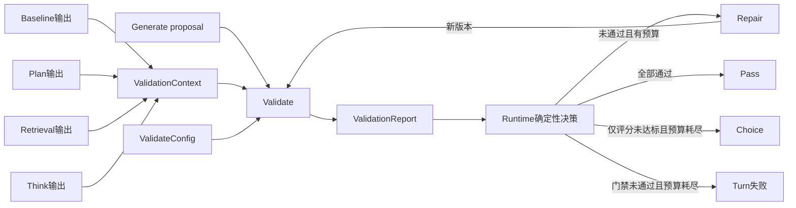

# Validate Pipeline — Design

> **Date**: 2026-10-16
> **Author**: GPT-5.6 Sol
> **Status**: Draft
> **Prior doc**: [Pipeline Framework Design](2026-10-13-pipeline-framework-design-opus.md)

---

## Context

`aise-core` 的 Turn 拓扑已经固定为 `generate → validate ⇄ repair → extract`，并由
`Runtime::run_turn` 统一编排。当前 `ValidatePipeline` 仍是占位实现：它不调用
LLM，始终返回 `Accept`，评分配置在 `Runtime::new` 中也是空列表
（`crates/aise-core/src/pipeline/validate/validate.rs:53`、
`crates/aise-core/src/pipeline/runtime/runtime.rs:70`）。

现有契约只把 proposal、叙事约束和玩家输入传给 Validate。它无法判断 proposal
是否完成本轮目标、是否与已激活或检索到的知识冲突、是否遵循角色定位与角色决策。
与此同时，现有循环没有 Repair 预算，最终 `Reject` 使用原始总分选择历史版本
（`crates/aise-core/src/pipeline/runtime/runtime.rs:190`、
`crates/aise-core/src/pipeline/runtime/runtime.rs:258`）。一旦 Validate 和 Repair
接入真实 LLM，这两处会分别带来无限循环风险和跨量纲错误排序。

本设计补齐 Validate 的评价模型、输入证据、输出契约和 Runtime 决策语义，为后续
Repair pipeline 提供稳定、可操作且有界的问题输入。

### Constraints & assumptions

- `Runtime::run_turn` 仍是唯一 Turn 编排者；Validate 和 Repair 不互相调用。
- 当前 Turn 的跨阶段业务数据只通过类型化 Input/Output 传递。
- 只有 Commit 可以写存储；硬门禁最终失败时不产生 Commit。
- 所有 LLM 调用通过注入的 `LlmGateway`，并处于显式父 Observation 下。
- 评价规则是进程级 pipeline 配置；故事特有目标、方向、约束和知识通过 Input 提供。
- 输入、评分项、问题说明、Repair 次数和观测内容均有明确上限。
- 本设计只验证故事正文，不把 Extract 后的世界状态确定性校验纳入 Validate/Repair 环。

---

## Principles

1. **同证据生成与验证**：Validator 必须获得 Generator 当时使用的本 Turn 证据，不能靠缺失信息猜测。
2. **语义判断与执行策略分离**：LLM 只判断各评价项并说明问题；Rust 决定 Pass、Repair、Choice 或 Turn 失败。
3. **硬门禁不可被分数抵消**：逻辑错误、叙事冲突和约束违规等布尔项不能被其他高分平均掉。
4. **问题必须可修复**：每个未通过项都必须产生具体、定位清楚且有界的 issue，作为 Repair 的唯一任务来源。
5. **循环和上下文有界**：Repair 预算由 Runtime 持有并在调用 Repair 前消费，预算耗尽必须产生确定结果。
6. **跨阶段契约不产生依赖倒置**：Validate 与 Repair 的共享数据放在 `pipeline::common`，阶段模块不互相导入。

---

## Options

### Option A: 仅对 proposal、constraints 和玩家输入评分

- **Idea**：保留现有 `ValidateInput`，只补 LLM evaluator 和评分解析。
- **Pros**：
  - 改动范围最小。
  - Prompt 较短，单次评价成本较低。
- **Cons**：
  - 无法可靠检查 story goal、knowledge、角色和 direction 一致性。
  - Validator 与 Generator 的信息边界不一致，issue 容易包含错误归因。
- **Risk**：系统会把“Validator 不知道”误判为“故事写错了”，Repair 反而引入事实冲突。

### Option B: 使用完整生成证据的布尔门禁与数值评分

- **Idea**：Runtime 把 Generate 使用的本 Turn 证据显式传给 Validate 和 Repair；一次
  LLM 调用同时返回布尔门禁结果、数值评分和 issues，由 Rust 执行确定性决策。
- **Pros**：
  - 可以评价目标完成、知识一致性、角色行为、玩家响应和叙事质量。
  - 硬门禁与可退化的质量分数语义清晰。
  - Validate 和 Repair 使用相同证据与评价标准。
- **Cons**：
  - Prompt 更长，评价延迟和 token 成本增加。
  - 需要扩展 Runtime 数据搬运及共享契约。
- **Risk**：未经边界控制的证据与 issues 会使每轮 Repair 的成本持续膨胀。

### Option C: 只输出自由文本 issues，不使用评分

- **Idea**：Validator 只报告问题及严重程度，Runtime 不比较历史数值结果。
- **Pros**：
  - 输出模型简单，适合直接驱动 Repair。
  - 避免不同评分维度的量纲问题。
- **Cons**：
  - Repair 预算耗尽时无法稳定选择历史最佳版本。
  - 配置无法表达可量化的质量目标。
- **Risk**：历史选版退化为“最后版本”或再次调用 LLM 仲裁，增加不确定性和成本。

### Choice

**Adopt option B.**

**Rationale**：Validate 的目标不仅是发现 constraints 违规，还要判断故事是否完成本轮
目标并正确使用生成证据。完整证据会增加 prompt 成本，但它消除了信息不对称。布尔
门禁负责不可妥协的正确性，数值评分负责允许预算耗尽后进行 Choice 的质量维度；二者
不能互相抵消。

---

## Design

### 1. Target structure



目标模块结构：

```text
pipeline/
  common/
    validation.rs          Validate/Repair 共享上下文、结果与 issue 类型
  validate/
    config.rs              ValidateConfig 与评价项配置
    validate.rs            Pipeline Input/Output 与阶段编排
    validate_prompt.rs     Prompt 变量组装
    validate_llm.rs        LlmGateway 调用和结构化输出解析
    validate_report.rs     配置对齐、边界校验和报告构造
    validate_trace.rs      evaluator observation
    tests/
  repair/
    repair.rs
    repair_prompt.rs
    repair_llm.rs
    repair_trace.rs
    tests/
  runtime/
    runtime.rs             预算、循环、最终结果与历史选版
```

### 2. Core types & responsibilities

| Type / Module | Responsibility | Out of scope |
|---|---|---|
| `ValidationContext` | 持有 Generate 使用的本 Turn 目标、玩家、叙事、知识和角色证据引用 | proposal 文本、评价配置、历史版本 |
| `ValidateCheckConfig` | 定义一个不可被其他项抵消的布尔门禁 | 决定是否调用 Repair |
| `ValidateScoreConfig` | 定义一个数值项的名称、描述、范围和目标值 | 保存模型返回值 |
| `ValidateConfig` | 聚合有界评价项及输出边界 | Repair 次数预算 |
| `ValidationCheckResult` | 表示门禁是否通过及失败 issue | 聚合决策 |
| `ValidationScoreResult` | 表示有限范围内的分数、目标及未达标 issue | 用原始总分跨项比较 |
| `ValidationIssue` | 向 Repair 传递评价项类别、名称和可操作问题 | 携带任意 Prompt 或隐藏状态 |
| `ValidationReport` | 保存一个 proposal 版本的完整门禁与评分结果 | 自行选择下一阶段 |
| `ValidatePipeline` | 渲染 prompt、调用 LLM、严格解析并构造报告 | 决定 Repair 预算或最终版本 |
| `Runtime` | 推导决策、消费 Repair 预算、保存有界历史并选择最终版本 | 生成评分或修改故事 |
| `RepairPipeline` | 根据当前失败 issues 和相同证据输出完整新正文 | 调用 Validate 或写存储 |

### 3. Validation input

`ValidationContext` 包含以下本 Turn 证据：

- `story_goal`
- `player_contribution`
- `directions`
- `constraints`
- activated knowledge
- retrieved facts
- retrieved rumors
- player role
- resolved roles
- character decisions

`ValidateInput` 在此基础上只增加当前 proposal 和 `proposal_version`。Runtime 保存完整
proposal 历史；原始 proposal 不进入 Validate prompt，因为它不是当前版本正确性的
证据，并可能使模型锚定在已知缺陷上。

既有故事摘要、近期正文和开场文本仍通过只读 `StoryContext` 与
`pipeline_prompt` 提供。`StoryContext` 不承载前序 stage 新产生的业务数据。

`RepairInput` 接收当前 proposal、当前报告中的失败 issues、`proposal_version` 和同一
份 `ValidationContext`。Repair 不接收历史所有报告，也不接收原始 proposal，避免
旧问题和旧文本污染当前修复。

Character decisions 在 Validate/Repair prompt 中必须标为角色视角或写作指导，而不是
可提交的世界事实。

### 4. Criteria model

Validate 支持两类配置项。

#### 4.1 Boolean checks

布尔门禁表达不能由其他高分抵消的条件，例如：

- 故事是否存在内部逻辑错误。
- 故事是否违背当前 narrative state 或 direction。
- 故事是否违反显式 constraints。
- 故事是否把角色私有认知当作公共世界事实。

模型必须为每项返回 `passed`。未通过时 `issue` 必填；通过时 `issue` 必须为空。门禁
不参与数值排名。

#### 4.2 Numeric scores

数值评分表达允许逐步优化的质量，例如目标完成度、角色表现、叙事连贯性和文风质量。
每项配置包含：

- 唯一且稳定的 `name`
- 面向 evaluator 的 `description`
- `min_score`
- `max_score`
- `target_score`

模型必须返回范围内的有限 `score`。低于目标时 `issue` 必填；达到目标时 `issue`
必须为空。第一版不支持权重，所有评分项在归一化后等权，避免同一规则同时存在
`target`、`weight` 和聚合阈值三套语义。

配置允许只有门禁或只有评分，但两者不能同时为空。项数、名称长度、描述长度和 issue
长度均受上限约束；名称必须唯一。

### 5. LLM output contract

一次 Validate LLM 调用同时返回与配置一一对应的 check results 和 score results。
模型只返回：

- 评价项名称
- `passed` 或 `score`
- `issue`

配置中的 description、分数范围和目标值不由模型回显，而由 Rust 按名称回填。解析后
必须验证：

1. 返回集合与本次配置完全一致。
2. 每个名称只出现一次，不接受未知项或缺失项。
3. 分数是有限数并处于配置范围内。
4. 所有失败或未达标项都有非空、有界 issue。
5. 所有通过或达标项不携带 issue。

LLM 不返回 `decision`、总分或最终版本。JSON 语法错误、契约不匹配和越界分数属于
Validate stage 输出错误，立即使 Turn 失败；它们不属于“故事质量不佳”，不得进入
Repair。

Prompt 遵循 CSI/RC/FTI：

- CSI：定义 evaluator 角色、证据边界和禁止改写故事。
- RC：以明确分区放入不可信的故事正文、生成证据、历史前文和评价项。
- FTI：要求严格 JSON、逐项判断和可操作 issue。

### 6. Runtime decision flow

每轮 Validate 后，Runtime 按固定优先级处理：

1. 所有门禁通过且所有评分达到目标：当前版本以 `Pass` 结束。
2. 任一门禁未通过或任一评分未达标，且仍有 Repair 预算：Runtime 先消费一次预算，
   再把当前失败 issues 交给 Repair。
3. Repair 输出新 proposal 后，必须重新执行完整 Validate；不能只复查上一轮失败项。
4. 预算耗尽且最后一轮仍有门禁失败：返回可诊断的 validation error，不执行
   Extract、Summary 或 Commit。
5. 预算耗尽、门禁全部通过但仍有评分未达标：在所有门禁通过的历史版本中选择最佳
   版本，以 `Choice` 继续 Extract 和 Commit。

`max_repair_rounds = 0` 表示不允许 Repair。Runtime 在调用 Repair 前消费预算，不能
在 pipeline 或 LLM gateway 中保存第二份 Repair 计数。

### 7. Choice ranking

历史版本不能按平均原始分或总分排序，因为不同评分项可能使用不同范围，而且高分项
会掩盖短板。每个评分项先计算归一化目标缺口：

```text
deficit_i = max(0, (target_i - score_i) / (max_i - min_i))
```

版本的 ranking metric 是所有目标缺口的平方均值：

```text
target_gap_mse = mean(deficit_i ^ 2)
```

`target_gap_mse` 越小，版本越接近全部目标。该指标是相对目标的均方误差，不是原始
分数的统计方差。平方项会放大明显短板，同时归一化消除量纲差异。

Choice 只比较门禁全部通过的历史版本。指标相同时依次选择：

1. 未达标评分项更少的版本。
2. 更新的 proposal 版本。

若没有任何门禁通过的历史版本，则不能产生 Choice，Turn 以 validation error 结束。
只有门禁、没有评分项时，门禁全部通过即为 Pass，不进入 Choice 排名。

### 8. Final outcome and persistence

Validate/Repair 循环产生两个可提交结果：

- `Pass`：当前版本满足全部门禁和评分目标。
- `Choice`：Repair 预算耗尽，最终选中的历史版本通过全部门禁，但至少一个评分项未达标。

循环结果需要携带最终版本、最终报告、Repair 次数、最终 outcome 和 Choice 选版信息。
Commit 将这些内容写入 `TurnEvaluation`，并使 Turn 的持久化状态可以区分 `Pass` 与
`Choice`。硬门禁失败和 Validate 输出错误都不产生 Turn 记录。

现有 `TurnStatus::Accepted | Rejected` 和空 `TurnEvaluation`
（`crates/aise-core/src/core/turn.rs:124`）无法表达该结果。实现 spec 必须选择一次性
迁移到 `Pass | Choice`，并同步调整历史正文过滤、序列化和测试；不得保留双状态路径。

### 9. Observability

Validate stage 的 Chain 仍由 `PipelineRunner` 创建，阶段内部建立稳定名称的 evaluator
Observation。至少记录：

- proposal version
- check/score 项数
- 通过、失败和未达标项数
- 每项结果及目标值
- Repair 已用次数和剩余预算
- 最终 outcome
- Choice ranking metric 与选中版本
- 稳定错误类别

Prompt、proposal 和 issue 原文只按现有 content capture policy 捕获；默认 metadata
只记录有界计数、名称和数值。Repair 使用独立 Chain 与 generation Observation。

### 10. Failure model

以下情况直接使 Turn 失败：

- Validate LLM 或 Repair LLM 调用失败。
- Validate 输出不是合法 JSON 或不满足配置契约。
- Repair 返回空正文或超出正文边界。
- Repair 预算耗尽后仍存在布尔门禁失败。
- Choice 时没有任何门禁通过的候选版本。
- 配置本身非法。

数值评分未达标不是 pipeline error；它触发 Repair，或在预算耗尽后产生 Choice。

---

## Impact

- **Code**：影响 `pipeline/common`、`pipeline/validate`、`pipeline/repair`、
  `pipeline/runtime`、`pipeline/commit`、`core/turn.rs` 及其测试。
- **Config**：`PipelineConfig` 增加 Validate 配置和 Runtime Repair 预算；新增
  Validate/Repair CSI、RC、FTI prompt 资产及 `assets/prompts/index.toml` 注册项。
- **Data**：`TurnEvaluation` 从空结构扩展为有界评价摘要；`TurnStatus` 需要一次性迁移
  为可区分 `Pass` 与 `Choice` 的状态，序列化格式会变化。
- **External interface**：Turn 事件可继续使用稳定 stage 名称；若服务层暴露
  `TurnStatus` 或 `TurnEvaluation`，其响应 schema 会同步变化。

---

## Risks & mitigations

| Risk | Likelihood | Impact | Mitigation |
|---|---|---|---|
| 完整证据使 prompt 过长 | Medium | High | 复用现有有界投影；配置项、角色、知识和 issue 均设上限并记录截断 |
| LLM 分数在轮次间漂移 | High | Medium | 使用明确 rubric、固定范围、低随机性和 Rust 严格校验；历史排序只作预算耗尽兜底 |
| 布尔判断误报导致 Turn 失败 | Medium | High | 门禁描述必须可验证；预算内允许 Repair；记录逐项结果以便诊断 |
| Repair 修好一项却破坏另一项 | High | Medium | 每个新版本都执行完整 Validate，不做增量复查 |
| issue 不可操作或复述 rubric | Medium | Medium | FTI 要求指出具体冲突、位置与期望改法；未达标空 issue 视为非法输出 |
| 目标差距均方偏向个别短板 | Low | Medium | 这是刻意选择；平方缺口防止明显短板被多项小优势抵消 |
| 持久化状态迁移影响旧数据 | Medium | High | spec 明确一次性迁移和反序列化策略，不保留运行时双路径 |
| Validation history 无界增长 | Medium | High | `max_repair_rounds` 同时界定 proposal 与 report 数量，上限为预算加一 |

---

## Roadmap

- **Phase 0**：共享契约、配置、状态与 Runtime 预算语义。
- **Phase 1**：Validate prompt、LLM、严格解析、报告和 evaluator observation。
- **Phase 2**：Repair prompt、LLM、issues 投影和完整复验循环。
- **Phase 3**：Choice 排名、Commit evaluation、状态迁移和端到端测试。

每个 Phase 在实施前生成独立 codegen spec，并引用本文作为 Source Design。

---

## Appendix

### Related constraints

- [`R-AISE-01` 至 `R-AISE-08`](../agents/guardrails/pipeline.md)
- [`R-LAYER-03`](../../AGENTS.md)
- [`R-ARCH-04`](../../AGENTS.md)
- [`R-CONC-04`](../../AGENTS.md)
- [`R-OBS-02`](../../AGENTS.md)

### Terminology

- **Check**：结果为通过或未通过的硬门禁项。
- **Score**：有范围和目标值的数值质量项。
- **Issue**：单个失败评价项给 Repair 的具体问题说明。
- **Report**：某一 proposal 版本的完整 checks 与 scores。
- **Pass**：全部 checks 和 scores 达标。
- **Choice**：预算耗尽后，从 checks 全通过的候选中按目标差距均方选出的版本。
