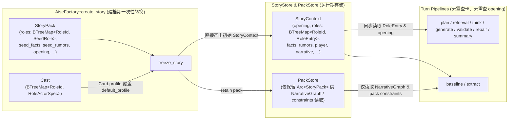

# Seed 与 Runtime 角色及故事上下文解耦 — Design

> **Date**: 2026-10-17
> **Author**: Gemini 4 Argon
> **Status**: Draft
> **Prior doc**: [Pipeline 框架与编排](./2026-10-13-pipeline-framework-design-opus.md)、[Core 资产层消解与职责归位](./2026-10-13-core-asset-dissolution-design-opus.md)、[Character Think Pipeline](./2026-10-14-character-think-pipeline-design-gpt.md)、[Extract Pipeline 与动态知识存储](./2026-10-16-extract-pipeline-design-gemini.md)

---

## Context

### 现状

当前 `crates/aise-core` 的角色（`Role`）与故事上下文（`StoryContext`）模型在“静态剧本种子（Seed）”与“运行时实例状态（Runtime）”之间缺乏清晰边界：

1. **`RoleBody` 与 `RoleEntry` 混杂了静态模板与运行时状态**（[`crates/aise-core/src/core/role/role.rs:9-25`](../../crates/aise-core/src/core/role/role.rs)）：
   - `RoleBody` 同时声明了剧本身份（`name`、`alias`、`backstory`、`retrieval`）、默认人物画像（`default_profile: CharacterProfile`）和初始记忆（`seed_memories: BTreeMap<MemoryId, MemoryBody>`）。
   - 运行时 `RoleEntry { id, actor, body, memories }` 直接内嵌了完整的 `RoleBody`。在 `AiseFactory::freeze_story`（[`crates/aise-core/src/engine/factory.rs:150-180`](../../crates/aise-core/src/engine/factory.rs)）开局时，`body.seed_memories` 已被转化为 `EntryOrigin::Seed` 的 `MemoryEntry` 存入 `RoleEntry.memories`，但 `RoleEntry.body.seed_memories` 仍作为无用副本常驻 `StoryContext`。
   - 当角色绑定 `CharacterCard` 时，`RoleEntry.body.default_profile` 实际上已失效，但仍留在 `RoleEntry` 中；真正生效的 `CharacterCard.profile` 反而在运行时未被合入 `RoleEntry`。
2. **开局已确定的选角覆盖被推迟到每个 Turn 异步解析，引发中间类型膨胀**：
   - 因为 `RoleEntry` 未直接持有生效后的 `profile`，每轮 `plan`（[`crates/aise-core/src/pipeline/plan/plan_roles.rs:41-49`](../../crates/aise-core/src/pipeline/plan/plan_roles.rs)）和 `retrieval`（[`crates/aise-core/src/pipeline/retrieval/retrieval.rs:113-129`](../../crates/aise-core/src/pipeline/retrieval/retrieval.rs)）都必须根据 `RoleActor::Card(card_ref)` 异步查询 `PackStore::get_character_card`。
   - 为了承载解析后的角色数据，额外引入了与 `RoleEntry` 高度重复的 `ResolvedRole`（[`crates/aise-core/src/core/role/character_think.rs:12-20`](../../crates/aise-core/src/core/role/character_think.rs)）和 `PlayerRoleContext`（[`crates/aise-core/src/core/role/player_context.rs:5-11`](../../crates/aise-core/src/core/role/player_context.rs)）。
3. **无法自然表达故事运行中由 LLM 动态创建的角色**：
   - 故事演进过程中，LLM 可能创建新角色并赋予初始设定、画像与初始记忆。这类角色没有“StoryPack 默认画像（`default_profile`）”、没有“开局选角绑卡（`RoleActor`）”，也没有 `Seed` 来源的 `seed_memories`。现有 `RoleEntry` 要求必填 `actor: RoleActor` 和含 `default_profile` / `seed_memories` 的 `RoleBody`，并且缺少与 `FactEntry` / `RumorEntry` / `MemoryEntry` 对齐的来源标记（`Origin`）。
4. **`StoryContext` 与 `StoryPack` / `StoryInstanceSpec` 边界不清**：
   - `pipeline_prompt::load_story_opening`（[`crates/aise-core/src/pipeline/common/pipeline_prompt.rs:59-73`](../../crates/aise-core/src/pipeline/common/pipeline_prompt.rs)）仅为了在尚未生成 `summary` 的前几个 Turn 获取 `opening` 文本，迫使 `generate`、`validate`、`repair`、`summary` 等阶段全部持有 `Arc<Store>` 并异步读取 `PackStore`。
   - `StoryInstanceSpec`（[`crates/aise-core/src/core/story/story_instance.rs:9-18`](../../crates/aise-core/src/core/story/story_instance.rs)）与 `StoryContext`（[`crates/aise-core/src/core/story/story_context.rs:15-27`](../../crates/aise-core/src/core/story/story_context.rs)）字段高度重合，且 `StoryInstanceSpec.player_id` 在 `StoryStoreMem::create`（[`crates/aise-core/src/persistence/story_store_mem.rs:256-290`](../../crates/aise-core/src/persistence/story_store_mem.rs)）中被静默丢弃；同时 `StoryContext::new()`（[`crates/aise-core/src/core/story/story_context.rs:30-48`](../../crates/aise-core/src/core/story/story_context.rs)）包含硬编码的 `"default-*"` 占位数据。

### 为什么现在做

在 `ExtractPipeline` 落地动态知识、角色记忆以及后续支持 LLM 动态创建角色之前，先行厘清 Seed 与 Runtime 的数据边界，可以一次性消除 `RoleEntry` 中的失效字段与重复记忆、移除 `ResolvedRole` / `PlayerRoleContext` / `StoryInstanceSpec` 等冗余中间结构，并解除多数 Pipeline 对 `PackStore` 的异步查询依赖。

### Constraints & assumptions

- 硬重构（`R-REFACTOR-01` / `R-REFACTOR-02`）：一次性替换旧的 `RoleBody` / `RoleActor` / `ResolvedRole` / `PlayerRoleContext` / `StoryInstanceSpec` 路径，不保留兼容垫片或双轨字段。
- 角色卡（`CharacterCard`）绑定仅发生在开局创建故事（`AiseFactory::create_story`）阶段，且只覆盖角色的 `CharacterProfile`，不改变角色在剧本中的 `name`、`alias`、`backstory` 和 `retrieval`。

---

## Principles

1. **Seed 与 Runtime 严格按生命周期切分**：`StoryPack` 中的静态种子类型只表达剧本初始模板，仅在 `AiseFactory::freeze_story` 建档时消费；`StoryContext` 中的运行时类型只保存当前生效的权威状态，绝不携带已失效的 `default_profile` 或重复的 `seed_memories`。
2. **角色作为聚合根按职责正交展开**：角色由“故事身份设定（`RoleSpec`）”、“当前生效人物画像（`CharacterProfile`）”与“私有记忆库（`memories`）”三部分正交组成，不再用夹杂静态字段的 `RoleBody` 半包装。
3. **初始种子角色与 LLM 动态角色在运行时同构**：无论角色源自 `StoryPack`（可选绑定 `CharacterCard`）还是源自某轮 Turn 的 LLM 创建，进入 `StoryContext.roles` 后均使用完全一致的 `RoleEntry` 结构，下游 Pipeline 无感知。
4. **用类型约束消除非法状态**：只有 `Seed` 来源的角色才可能关联 `CharacterCardRef`；`Turn` 动态创建的角色在类型上不可能绑定角色卡。
5. **开局能确定的状态不在 Turn 热路径重复异步解析**：`CharacterCard` 的 `profile` 覆盖与 `opening` 文本挂载在 `freeze_story` 阶段一次性完成，使下游 Pipeline 直接从 `&StoryContext` 同步读取。

---

## Options

### 问题 1：`Role` 的 Seed 与 Runtime 结构划分

#### Option 1A：保持现有 `RoleEntry { id, actor, body: RoleBody, memories }`

- **Idea**：继续让 `StoryPack` 与 `RoleEntry` 共用同一个 `RoleBody`（含 `default_profile` 和 `seed_memories`），运行时通过 `RoleActor` 异步查 `PackStore` 解析 `ResolvedRole`。
- **Pros**：
  - 无需修改现有 `StoryPack` 与 `pipeline` 签名。
- **Cons**：
  - `RoleEntry` 永久携带失效的 `default_profile` 与重复的 `seed_memories`。
  - 每轮 `plan` 和 `retrieval` 仍需异步查询 `PackStore::get_character_card` 并构造冗余的 `ResolvedRole` / `PlayerRoleContext`。
  - LLM 动态创建的角色被迫伪造 `RoleActor::Default` 和空的 `seed_memories`。
- **Risk**：静态种子字段与运行时有效字段混放，极易在后续阶段被误读。

#### Option 1B：保留 `RoleEntry { id, origin, body: RoleBody }` 外壳，将生效 `profile` 与 `memories` 全部塞入 `RoleBody`

- **Idea**：将 `StoryPack` 角色拆为 `SeedRole`；运行时 `RoleEntry` 模仿 `FactEntry` 的 `{ id, origin, body }` 三段式，把 `name`、`alias`、`backstory`、`retrieval`、`profile`、`memories: BTreeMap<MemoryId, MemoryEntry>` 全部放进 `RoleBody`。
- **Pros**：
  - 外层形式与 `FactEntry` / `RumorEntry` 表面对齐。
- **Cons**：
  - `Role` 是包含 `memories` 子集合的聚合根，而非原子叶子节点；把 `memories` 塞进 `RoleBody` 会导致所有字段访问多一层 `.body` 嵌套。
  - LLM 动态创建角色时给出的是无 `EntryOrigin` 的 `MemoryBody`，无法直接复用包含 `MemoryEntry` 的 `RoleBody` 作为 `RoleChangeOp` 载荷。
- **Risk**：为了表面形式一致，仍需为 LLM 角色创建/更新再造一套平行结构体。

#### Option 1C：提炼共享的 `RoleSpec`，将 `RoleEntry` 按 `{ id, origin, spec, profile, memories }` 正交展开

- **Idea**：
  - 将剧本角色身份提炼为 `RoleSpec { name, alias, backstory, retrieval }`。
  - `StoryPack` 中使用 `SeedRole { spec, default_profile, seed_memories }`。
  - LLM 动态创建角色时使用 `NewRole { spec, profile, initial_memories }`（或 `RoleChangeOp`）。
  - 运行时 `StoryContext.roles` 使用拍平的聚合根 `RoleEntry { id, origin: RoleOrigin, spec: RoleSpec, profile: CharacterProfile, memories: BTreeMap<MemoryId, MemoryEntry> }`。
  - 开局 `freeze_story` 时直接将 `CharacterCard.profile` 覆盖进 `RoleEntry.profile`，删除 `ResolvedRole`、`PlayerRoleContext` 与 `RoleActor`。
- **Pros**：
  - 角色卡覆盖语义直观：绑卡只替换 `RoleEntry.profile`，`RoleEntry.spec` 保持不变。
  - `SeedRole`、`NewRole` 与 `RoleEntry` 共享同一个 `RoleSpec`，无任何死字段或重复记忆。
  - `RoleEntry` 本身就是已解析的完整角色，彻底消除 `ResolvedRole`、`PlayerRoleContext` 及运行时异步查卡。
- **Cons**：
  - 需要同步更新 `plan`、`retrieval`、`think`、`generate`、`validate`、`repair` 中读取角色字段的访问路径。
- **Risk**：改动涉及多个 Pipeline 阶段的输入类型签名，需一次性完整迁移。

### 问题 2：`StoryPack` 与 `StoryContext` / `PackStore` 的运行时边界

#### Option 2A：维持现状，各阶段按需从 `PackStore` 异步加载 `StoryPack` 和 `CharacterCard`

- **Idea**：`StoryContext` 不存 `opening`，`PackStore` 继续缓存 `cards`，`generate` / `validate` / `repair` / `summary` / `plan` / `retrieval` 继续持有 `Arc<Store>`。
- **Pros**：
  - 改动范围仅限于 `core/role`。
- **Cons**：
  - `generate`、`validate`、`repair`、`summary` 仅为了在 Turn 0..N 读取 `opening` 就必须依赖 `Store` 做异步查询。
  - `PackStore` 维护了运行时不再需要的 `CharacterCard` 缓存表与容量淘汰逻辑。
  - `StoryInstanceSpec` 与 `StoryContext` 重复定义，且丢失 `player_id`。
- **Risk**：Pipeline 阶段保留了不必要的存储层耦合。

#### Option 2B：在 `freeze_story` 完成一次性实例化，收缩 `PackStore` 职责

- **Idea**：
  - `StoryContext` 直接持有 `opening: BoundedText`，提供同步的先验背景读取，使 `plan`、`retrieval`、`think`、`generate`、`validate`、`repair`、`summary` 不再为 `opening` 或 `CharacterCard` 访问 `PackStore`（同时 `baseline_prompt` 也直接从 `story_ctx.opening` 读取）。
  - 移除 `PackStore` 中的 `CharacterCard` 存储与 `get_character_card` 接口（`StoryAssetSpec` 精简为仅保留 `StoryPack`）。
  - 删除冗余的 `StoryInstanceSpec` 与 `StoryContext::new()` 假数据，`AiseFactory::freeze_story` 直接构造初始 `StoryContext`，并将 `player_id` 存入 `StoryInstanceInfo`。
- **Pros**：
  - 除需要评估 `NarrativeGraph` 的阶段（`baseline`、`extract`）和写存储的 `commit` 外，其余 7 个 Pipeline 阶段（`plan`、`retrieval`、`think`、`generate`、`validate`、`repair`、`summary`）彻底解除 `Arc<Store>` 依赖。
  - `PackStore` 职责收敛为单一的 `StoryPack` 快照管理。
- **Cons**：
  - `StoryContext` 新增 `opening: BoundedText` 字段（每个故事实例持有一份开场白副本）。
- **Risk**：无。

### Choice

**问题 1 采用 Option 1C；问题 2 采用 Option 2B。**

**Rationale**：Option 1C 与 Option 2B 共同把“建档期（Seed + Cast → Runtime 初始化）”与“Turn 运行期”切分干净。角色在建档期完成 `profile` 覆盖和 `seed_memories` 转换后，`RoleEntry` 成为唯一的运行时角色表示，既自然兼容后续 LLM 动态创建角色，又一举消除了 `ResolvedRole`、`PlayerRoleContext`、`RoleActor`、`StoryInstanceSpec` 以及 `PackStore` 的角色卡缓存。

---

## Design

### 1. Target structure

#### 1.1 Seed 实例化与 Turn 运行期数据流对比



#### 1.2 `Role` 模型解耦前后对比

```text
Before:
  StoryPack.roles: BTreeMap<RoleId, RoleBody>
    RoleBody { name, alias, backstory, retrieval, default_profile, seed_memories }
  StoryContext.roles: BTreeMap<RoleId, RoleEntry>
    RoleEntry { id, actor: RoleActor, body: RoleBody (含死字段 default_profile & seed_memories), memories }
  Pipeline 中间态:
    ResolvedRole { role_id, name, aliases, backstory, retrieval_hint, profile, memories }
    PlayerRoleContext { role_id, name, aliases, backstory, profile }

After:
  StoryPack.roles: BTreeMap<RoleId, SeedRole>
    SeedRole { spec: RoleSpec (平铺序列化), default_profile: CharacterProfile, seed_memories: BTreeMap<MemoryId, MemoryBody> }
  StoryContext.roles: BTreeMap<RoleId, RoleEntry>
    RoleEntry { id: RoleId, origin: RoleOrigin, spec: RoleSpec, profile: CharacterProfile, memories: BTreeMap<MemoryId, MemoryEntry> }
  LLM 动态创建载荷:
    NewRole { spec: RoleSpec, profile: CharacterProfile, initial_memories: BTreeMap<MemoryId, MemoryBody> }
  Pipeline 中间态:
    RetrievalOutput.roles: Vec<RoleEntry>；下游 Input 直接借用 &'a RoleEntry / &'a [RoleEntry]（删除 ResolvedRole、PlayerRoleContext、RoleActor）
```

### 2. Core types & responsibilities

#### 2.1 `core/role/` 类型定义

| Type | Fields / Variants | Responsibility | Out of scope |
|---|---|---|---|
| `RoleSpec` | `pub name: BoundedText`<br/>`#[serde(default)] pub alias: Vec<BoundedText>`<br/>`pub backstory: BoundedText`<br/>`pub retrieval: RetrievalHint` | 表达角色在故事中的身份设定与召回提示；在 `SeedRole`、`NewRole` 与 `RoleEntry` 之间 100% 复用 | 人物性格画像（`CharacterProfile`）、记忆（`memories`） |
| `SeedRole` | `pub spec: RoleSpec`<br/>`pub default_profile: CharacterProfile`<br/>`#[serde(default)] pub seed_memories: BTreeMap<MemoryId, MemoryBody>` | 仅用于 `StoryPack.roles` 的静态角色槽位模板；通过自定义平铺序列化/反序列化（避免 `#[serde(flatten)]` 与 `#[serde(deny_unknown_fields)]` 冲突）保持原有 JSON Schema 与未知字段拒绝行为不变 | 运行时状态存储 |
| `RoleOrigin` | `Seed { #[serde(default, skip_serializing_if = "Option::is_none")] card: Option<CharacterCardRef> }`<br/>`Turn(TurnNumber)` | 记录 `RoleEntry` 的创建来源（与 `EntryOrigin` 语义对齐）；若为初始剧本角色则可选记录绑定的 `CharacterCardRef`，若为故事中途由 LLM 创建则记录对应 `TurnNumber` | 运行时查表路由 |
| `RoleEntry` | `pub id: RoleId`<br/>`pub origin: RoleOrigin`<br/>`pub spec: RoleSpec`<br/>`pub profile: CharacterProfile`<br/>`pub memories: BTreeMap<MemoryId, MemoryEntry>` | `StoryContext.roles` 中的唯一运行时角色聚合根；`profile` 始终为当前生效画像，`memories` 包含存活的 Seed 记忆与动态记忆 | 默认画像备份、未转换的 `seed_memories` |
| `RoleChangeOp` | `Add { id: RoleId, spec: RoleSpec, profile: CharacterProfile, #[serde(default)] initial_memories: BTreeMap<MemoryId, MemoryBody> }`<br/>`Update { id: RoleId, spec: RoleSpec, profile: CharacterProfile }` | （Phase 1 供 `KnowledgeChange.roles` 扩展使用）支持 LLM 在故事演进中动态创建角色并设置初始值，或更新既有角色的 `spec` / `profile` | 单条记忆的增改（仍由 `RoleMemoryChangeOp` 负责） |

#### 2.2 `core/story/` 与 `persistence/` 调整类型

| Type | Change | Responsibility | Out of scope |
|---|---|---|---|
| `StoryPack` | `pub roles: BTreeMap<RoleId, SeedRole>` | 静态故事包资产定义 | 运行时实例状态 |
| `StoryContext` | 新增 `pub opening: BoundedText`；移除 `StoryContext::new()` 与 `Default` 硬编码实现 | 运行时权威快照；直接提供 `opening` 与已解析的 `roles: BTreeMap<RoleId, RoleEntry>` | 制造测试用假数据（移交 `tests/fixture.rs`） |
| `StoryInstanceInfo` | 新增 `pub player_id: PlayerId` | 记录故事实例归属玩家、描述、时间戳与生命周期状态 | 故事正文与认知状态 |
| `StoryInstanceSpec` | **删除** | 由 `AiseFactory::freeze_story` 直接构造初始 `StoryContext` 与 `player_id` 传给 `StoryStore::create` | — |
| `PackStore` | 移除 `get_character_card` 与 `cards` 缓存表；`retain` 仅接收 `PackRef` 与 `StoryPack` | 管理运行中故事引用的 `Arc<StoryPack>` 快照 | 缓存 `CharacterCard` |

### 3. Key flows

#### 3.1 开局建档流（`AiseFactory::create_story`）

1. 校验 `StoryPack`（`validate_play`、`validate_narrative`、`validate_roles`）并校验选角 `cast: BTreeMap<RoleId, RoleActorSpec>`（玩家角色必须在 `playable_roles` 中，且 `cast` 中所有 `RoleId` 必须存在于 `StoryPack.roles`）。
2. 遍历 `StoryPack.roles: BTreeMap<RoleId, SeedRole>` 构造 `BTreeMap<RoleId, RoleEntry>`：
   - 若 `cast` 为该角色指定了 `RoleActorSpec::Card(card)`：计算 `card_ref = card.card_ref()?`，令 `origin = RoleOrigin::Seed { card: Some(card_ref) }`，`profile = card.profile`；
   - 若未指定或为 `RoleActorSpec::Default`：令 `origin = RoleOrigin::Seed { card: None }`，`profile = seed_role.default_profile`；
   - 将 `seed_role.seed_memories` 映射为 `EntryOrigin::Seed` 的 `MemoryEntry` 集合；
   - 组装 `RoleEntry { id, origin, spec: seed_role.spec, profile, memories }`。
3. 将 `seed_facts`、`seed_rumors` 映射为 `EntryOrigin::Seed` 的 `FactEntry`、`RumorEntry`。
4. 直接组装初始 `StoryContext`（含 `opening: story_pack.opening.clone()`、`roles`、`facts`、`rumors`、`player: spec.player_role`、`narrative`、`turn_number: 0`）。
5. 调用 `store.pack_store().retain(&story_id, pack_ref, story_pack)` 保留剧本包，随后调用 `store.story_store().create(player_id, initial_context)` 持久化故事实例。

#### 3.2 Turn 内角色消费流（无 `PackStore` 查卡、无中间转换类型）

1. **`baseline`**：从 `story_ctx.roles.get(&story_ctx.player)` 直接读取 `role.spec.name` 构造 `ScanBuffer`；`baseline_prompt` 直接从 `story_ctx.opening` 同步获取开场白，不再接收 `store` 参数。
2. **`plan`**：
   - 玩家角色直接通过 `story_ctx.roles.get(&story_ctx.player)` 获取 `&RoleEntry`，读取 `role.id`、`role.spec` 与 `role.profile` 渲染 Player Role Prompt 区域；
   - AI 角色目录直接遍历 `story_ctx.roles`（排除 `story_ctx.player`），投影 `role.id`、`role.spec.name`、`role.spec.alias`、`role.spec.retrieval`。
   - `PlanOutput` 不再需要向外传递 `player_role: PlayerRoleContext`，且 `PlanPipeline` 移除 `Arc<Store>`。
3. **`retrieval`**：
   - 根据 `PlanOutput` 选出的 `fact_ids`、`rumor_ids`、`role_ids` 从 `story_ctx` 同步校验并克隆提取对应条目，产出 `RetrievalOutput { facts: Vec<FactEntry>, rumors: Vec<RumorEntry>, roles: Vec<RoleEntry> }`；不再调用 `PackStore::get_character_card`，`RetrievalPipeline` 移除 `Arc<Store>`。
4. **`think` / `generate` / `validate` / `repair` / `summary`**：
   - `ThinkInput<'a>` 接收 `resolved_roles: &'a [RoleEntry]`（借用自 `&retrieval_output.roles`），读取目标角色的 `role.spec`、`role.profile` 与 `role.memories`；
   - `GenerateInput<'a>` 与 `ValidationContext<'a>` 统一接收 `player_role: &'a RoleEntry`（直接从 `&story_ctx.roles[&story_ctx.player]` 借用）和 `roles: &'a [RoleEntry]`（从 `&retrieval_output.roles` 借用），读取玩家角色与选中 AI 角色的 `role.spec`、`role.profile`；
   - `think`、`generate`、`validate`、`repair`、`summary` 通过 `pipeline_prompt::story_opening(story_ctx)`（当 `story_ctx.summary` 为空时返回 `story_ctx.opening.as_str()`）同步获取开场白，全部移除 `Arc<Store>` 字段。

#### 3.3 故事运行中 LLM 动态创建/更新角色流（Phase 1：`extract` → `commit`）

1. 当 LLM 在第 $N$ 轮创建或更新角色时，`extract` 阶段产出 `RoleChangeOp::Add { id, spec, profile, initial_memories }` 或 `RoleChangeOp::Update { id, spec, profile }`，并复用 `RoleSpec::validate` 校验字段边界（如 `alias` 数量上限）。
2. `StoryStore::commit` 在原子事务中校验同轮 `RoleId` 无重复冲突、`Add` 目标不存在、`Update` 目标已存在，并校验累计角色数、角色目录字节及单角色记忆上限，然后应用变更：
   - 对 `Add`：构造 `origin = RoleOrigin::Turn(turn_number)`，将 `initial_memories` 映射为 `EntryOrigin::Turn(turn_number)` 的 `MemoryEntry`，插入 `RoleEntry { id, origin, spec, profile, memories }`；
   - 对 `Update`：保留原 `RoleEntry.origin` 与 `memories`，更新 `spec` 与 `profile`。
3. 下一轮 Turn 开始时，动态角色与初始 `Seed` 角色在 `StoryContext.roles` 中完全同构，自动参与 `plan` 角色目录、`retrieval`、`think` 与 `generate`。

### 4. Key decisions

- **将 `RoleBody` 拆解为 `RoleSpec` + `CharacterProfile` + `memories`，并在 `StoryPack` 中使用 `SeedRole`** → `SeedRole` 通过自定义平铺序列化/反序列化保持外部 JSON 格式与 `deny_unknown_fields` 校验不变，同时在 Rust 类型层面把“不可被角色卡替换的剧本身份（`RoleSpec`）”与“可被角色卡替换的画像（`CharacterProfile`）”彻底分开 → 使角色卡覆盖、LLM 动态创建角色与运行时读取拥有最小且正交的公共组件。
- **开局直接将 `CharacterCard.profile` 合入 `RoleEntry.profile`，用 `RoleOrigin` 替代 `RoleActor`** → 删除 `RoleActor`、`ResolvedRole`、`PlayerRoleContext` 以及 `PackStore::get_character_card` → 选角在故事创建后不可变，没有理由在每个 Turn 重复异步查表和转换类型；`RoleOrigin::Seed { card: Option<CharacterCardRef> }` 既保留了卡片溯源摘要，又在类型上禁止了 `RoleOrigin::Turn` 角色绑卡的非法状态。
- **`StoryContext` 直接携带 `opening: BoundedText`** → 将异步 `pipeline_prompt::load_story_opening` 替换为纯同步 `pipeline_prompt::story_opening(story_ctx)` → 让 `plan`、`retrieval`、`think`、`generate`、`validate`、`repair`、`summary` 共 7 个阶段彻底摆脱为读取静态开场白或角色卡而持有的 `Arc<Store>` 依赖。
- **删除 `StoryInstanceSpec` 与 `StoryContext::new()` 默认假数据** → `AiseFactory::freeze_story` 直接构造初始 `StoryContext`，并将 `player_id` 写入 `StoryInstanceInfo` → 消除无意义的平行结构体复制与 `player_id` 丢失问题，避免测试假数据污染生产 `core` 代码。

---

## Impact

- **Code**：
  - `crates/aise-core/src/core/role/`：
    - `role.rs`：定义 `RoleSpec`、`SeedRole`、`RoleOrigin`、`RoleEntry`；
    - 删除 `actor.rs`（`RoleActor`）、`player_context.rs`（`PlayerRoleContext`）以及 `character_think.rs` 中的 `ResolvedRole`；
  - `crates/aise-core/src/core/knowledge/change.rs`：（Phase 1）支持扩展 `RoleChangeOp`。
  - `crates/aise-core/src/core/story/`：
    - `story_pack.rs`：`roles` 类型改为 `BTreeMap<RoleId, SeedRole>`；移除 `StoryAssetSpec` 中的 `cards`（或直接简化 `PackStore::retain` 参数）；
    - `story_context.rs`：新增 `pub opening: BoundedText`，移除 `StoryContext::new()` 与 `Default`；
    - `story_instance.rs`：删除 `StoryInstanceSpec`，在 `StoryInstanceInfo` 中新增 `pub player_id: PlayerId`。
  - `crates/aise-core/src/engine/factory.rs`：`freeze_story` 直接合并 `SeedRole` 与 `CharacterCard.profile` 生成 `RoleEntry`，直接产出初始 `StoryContext`。
  - `crates/aise-core/src/persistence/`：
    - `pack_store.rs` / `pack_store_mem.rs` / `pack_store_sqlite.rs`：移除 `CharacterCard` 存储与 `get_character_card`；
    - `story_store.rs` / `story_store_mem.rs` / `story_store_sqlite.rs`：`create` 直接接收 `PlayerId` 与初始 `StoryContext`。
  - `crates/aise-core/src/pipeline/`：
    - `plan`、`retrieval`、`think`、`generate`、`validate`、`repair`、`summary`：统一使用 `RoleEntry` 替代 `ResolvedRole` / `PlayerRoleContext`，使用同步 `pipeline_prompt::story_opening(story_ctx)` 替代异步 `load_story_opening`（同时更新 `baseline_prompt`），并移除这 7 个阶段中不再需要的 `Arc<Store>` 字段。
- **Config**：`PackStoreConfig` 移除 `max_character_cards` 配置项。
- **Data**：
  - `StoryPack` 的外部 JSON Schema 保持不变（`SeedRole` 通过自定义平铺序列化/反序列化保持字段名与未知字段拒绝行为一致）。
  - `StoryContext` 的内部持久化结构更新为新 `RoleEntry` 格式并包含 `opening`。
- **External interface**：`aise-core` 公开 Rust 类型发生破坏性重构（遵循 `R-REFACTOR-01/02`）。

---

## Risks & mitigations

| Risk | Likelihood | Impact | Mitigation |
|---|---|---|---|
| `SeedRole` 若直接使用派生 `#[serde(flatten)]` 与 `#[serde(deny_unknown_fields)]` 会在 Serde 中冲突 | high | med | 不在 `SeedRole` 上混用派生 `flatten` + `deny_unknown_fields`，改用自定义反序列化或内部平铺辅助结构，并通过 `story_pack_tests.rs` 验证未知字段拒绝行为 |
| 移除 `ResolvedRole` 与 `PlayerRoleContext` 涉及多个 Pipeline 的测试 Fixture 改动 | high | low | 在 `core/tests/fixture.rs` 提供统一的 `RoleEntry` 与 `StoryContext` 构造辅助函数，批量替换各阶段单测 |

---

## Roadmap

- **Phase 0（`Role` 与 `StoryContext` / `PackStore` 解耦重构）**：落地 `RoleSpec`、`SeedRole`、`RoleOrigin`、`RoleEntry`，在 `StoryContext` 中内聚 `opening`，删除 `RoleActor`、`ResolvedRole`、`PlayerRoleContext`、`StoryInstanceSpec` 及 `PackStore` 角色卡缓存，清理 7 个 Pipeline 阶段的 `Store` 依赖 → spec `TBD`
- **Phase 1（动态角色提取扩展）**：在 `KnowledgeChange`、`ExtractPipeline` 与 `StoryStore::commit` 中接入 `RoleChangeOp` 及累计角色容量与字段校验 → spec `TBD`
