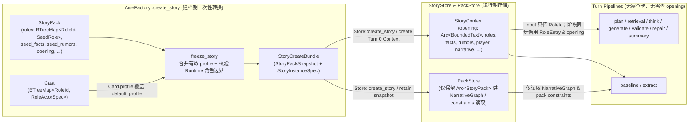

# Seed 与 Runtime 角色及故事上下文解耦 — Design

> **Date**: 2026-10-17
> **Author**: Gemini 4 Argon
> **Revision**: GPT-5.6 Sol
> **Status**: Draft
> **Prior doc**: [Pipeline 框架与编排](./2026-10-13-pipeline-framework-design-opus.md)、[Core 资产层消解与职责归位](./2026-10-13-core-asset-dissolution-design-opus.md)、[Character Think Pipeline](./2026-10-14-character-think-pipeline-design-gpt.md)、[Extract Pipeline 与动态知识存储](./2026-10-16-extract-pipeline-design-gemini.md)

---

## Context

### 现状

当前 `crates/aise-core` 的角色（`Role`）与故事上下文（`StoryContext`）模型在“静态剧本种子（Seed）”与“运行时实例状态（Runtime）”之间缺乏清晰边界：

1. **`RoleBody` 与 `RoleEntry` 混杂了静态模板与运行时状态**（[`crates/aise-core/src/core/role/role.rs:9-25`](../../crates/aise-core/src/core/role/role.rs)）：
   - `RoleBody` 同时声明了剧本身份（`name`、`alias`、`backstory`、`retrieval`）、默认人物画像（`default_profile: CharacterProfile`）和初始记忆（`seed_memories: BTreeMap<MemoryId, MemoryBody>`）。
   - 运行时 `RoleEntry { id, actor, body, memories }` 直接内嵌了完整的 `RoleBody`。在 `AiseFactory::freeze_story`（[`crates/aise-core/src/engine/factory.rs:150-180`](../../crates/aise-core/src/engine/factory.rs)）开局时，`body.seed_memories` 已被转化为 `EntryOrigin::Seed` 的 `MemoryEntry` 存入 `RoleEntry.memories`，但 `RoleEntry.body.seed_memories` 仍作为无用副本常驻 `StoryContext`。
   - 当角色绑定 `CharacterCard` 时，`RoleEntry.body.default_profile` 实际上已失效，但仍留在 `RoleEntry` 中；真正生效的 `CharacterCard.profile` 反而在运行时未被合入 `RoleEntry`。
2. **开局已确定的选角覆盖被推迟到每个 Turn 异步解析，引发中间类型膨胀**：
   - 因为 `RoleEntry` 未直接持有生效后的 `profile`，每轮 `plan`（[`crates/aise-core/src/pipeline/plan/plan_roles.rs:41-49`](../../crates/aise-core/src/pipeline/plan/plan_roles.rs)）和 `retrieval`（[`crates/aise-core/src/pipeline/retrieval/retrieval.rs:113-129`](../../crates/aise-core/src/pipeline/retrieval/retrieval.rs)）都必须根据 `RoleActor::Card(card_ref)` 异步查询 `PackStore::get_character_card`。
   - 为了承载解析后的角色数据，额外引入了与 `RoleEntry` 高度重复的 `ResolvedRole`（[`crates/aise-core/src/core/role/character_think.rs:12-20`](../../crates/aise-core/src/core/role/character_think.rs)）和 `PlayerRoleContext`（[`crates/aise-core/src/core/role/player_context.rs:5-11`](../../crates/aise-core/src/core/role/player_context.rs)）。
3. **无法自然表达故事运行中由 LLM 动态创建的角色**：
   - 故事演进过程中，LLM 可能创建新角色并赋予初始设定、画像与初始记忆。这类角色没有“StoryPack 默认画像（`default_profile`）”、没有“开局选角绑卡（`RoleActor`）”，也没有 `Seed` 来源的 `seed_memories`。现有 `RoleEntry` 要求必填 `actor: RoleActor` 和含 `default_profile` / `seed_memories` 的 `RoleBody`，并且缺少与 `FactEntry` / `RumorEntry` / `MemoryEntry` 对齐的来源标记（`Origin`）。
4. **`StoryContext` 与 `StoryPack` / `StoryInstanceSpec` 边界不清**：
   - `pipeline_prompt::load_story_opening`（[`crates/aise-core/src/pipeline/common/pipeline_prompt.rs:59-73`](../../crates/aise-core/src/pipeline/common/pipeline_prompt.rs)）仅为了在尚未生成 `summary` 的前几个 Turn 获取 `opening` 文本，迫使 `generate`、`validate`、`repair`、`summary` 等阶段全部持有 `Arc<Store>` 并异步读取 `PackStore`。
   - `StoryInstanceSpec`（[`crates/aise-core/src/core/story/story_instance.rs:9-18`](../../crates/aise-core/src/core/story/story_instance.rs)）实际承担“仅允许构造 Turn 0 初始状态”的创建边界，但职责未被明确，且 `player_id` 在 `StoryStoreMem::create`（[`crates/aise-core/src/persistence/story_store_mem.rs:235-269`](../../crates/aise-core/src/persistence/story_store_mem.rs)）中被静默丢弃。
   - `StoryContext::new()`（[`crates/aise-core/src/core/story/story_context.rs:30-48`](../../crates/aise-core/src/core/story/story_context.rs)）包含硬编码的 `"default-*"` 占位数据；若直接用任意 `StoryContext` 替代创建 DTO，又会允许非零 Turn、已有 summary 或非 Active 生命周期等非法初始状态。

### 为什么现在做

在 `ExtractPipeline` 落地动态知识、角色记忆以及后续支持 LLM 动态创建角色之前，先行厘清 Seed 与 Runtime 的数据边界，可以一次性消除 `RoleEntry` 中的失效字段与重复记忆、移除 `ResolvedRole` / `PlayerRoleContext` 等热路径中间结构，并解除多数 Pipeline 对 `PackStore` 的异步查询依赖，同时保留受控的故事实例创建边界。

### Constraints & assumptions

- 硬重构（`R-REFACTOR-01` / `R-REFACTOR-02`）：一次性替换旧的 `RoleBody` / `RoleActor` / `ResolvedRole` / `PlayerRoleContext` / `StoryAssetSpec.cards` 路径，不保留兼容垫片或双轨字段。
- 角色卡（`CharacterCard`）绑定仅发生在开局创建故事（`AiseFactory::create_story`）阶段，且只覆盖角色的 `CharacterProfile`，不改变角色在剧本中的 `name`、`alias`、`backstory` 和 `retrieval`。
- 当前 `StoryStoreSqlite` 仍委托内存实现，没有需要迁移的生产持久化数据；本次内部序列化格式采用硬断，不增加兼容读取。

---

## Principles

1. **Seed 与 Runtime 严格按生命周期切分**：`StoryPack` 中的静态种子类型只表达剧本初始模板，仅在 `AiseFactory::freeze_story` 建档时消费；`StoryContext` 中的运行时类型只保存当前生效的权威状态，绝不携带已失效的 `default_profile` 或重复的 `seed_memories`。
2. **角色作为聚合根按职责正交展开**：角色由“故事身份设定（`RoleSpec`）”、“当前生效人物画像（`CharacterProfile`）”与“私有记忆库（`memories`）”三部分正交组成，不再用夹杂静态字段的 `RoleBody` 半包装。
3. **初始种子角色与 LLM 动态角色在运行时同构**：无论角色源自 `StoryPack`（可选绑定 `CharacterCard`）还是源自某轮 Turn 的 LLM 创建，进入 `StoryContext.roles` 后均使用完全一致的 `RoleEntry` 结构。
4. **阶段契约只携带最小数据**：`RoleEntry` 是权威聚合，不等于阶段间搬运 DTO；消费既有角色的 Turn Input/Output 只传 `RoleId`，阶段从只读 `StoryContext` 借用角色并投影 Prompt 所需字段，避免复制和追踪完整私有记忆。角色创建是例外，只由 `extract → Runtime → commit` 搬运一次有界的 `RoleAddOp` 变更载荷。
5. **开局能确定的状态不在 Turn 热路径重复异步解析**：`CharacterCard.profile` 覆盖与 `opening` 挂载在 `freeze_story` 阶段一次性完成；`opening` 使用共享所有权避免每次 Context clone 复制文本。
6. **创建与提交共用同一组角色边界**：初始有效角色集合和每轮提交后的候选集合必须通过同一套累计数量、目录字节、角色状态字节与单角色记忆上限校验。

---

## Options

### 问题 1：`Role` 的 Seed 与 Runtime 结构划分

#### Option 1A：保持现有 `RoleEntry { id, actor, body: RoleBody, memories }`

- **Idea**：继续让 `StoryPack` 与 `RoleEntry` 共用同一个 `RoleBody`（含 `default_profile` 和 `seed_memories`），运行时通过 `RoleActor` 异步查 `PackStore` 解析 `ResolvedRole`。
- **Pros**：
  - 无需修改现有 `StoryPack` 与 `pipeline` 签名。
- **Cons**：
  - `RoleEntry` 永久携带失效的 `default_profile` 与重复的 `seed_memories`。
  - 每轮 `plan` 和 `retrieval` 仍需异步查询 `PackStore::get_character_card` 并构造冗余的 `ResolvedRole` / `PlayerRoleContext`。
  - LLM 动态创建的角色被迫伪造 `RoleActor::Default` 和空的 `seed_memories`。
- **Risk**：静态种子字段与运行时有效字段混放，极易在后续阶段被误读。

#### Option 1B：保留 `RoleEntry { id, origin, body: RoleBody }` 外壳，将生效 `profile` 与 `memories` 全部塞入 `RoleBody`

- **Idea**：将 `StoryPack` 角色拆为 `SeedRole`；运行时 `RoleEntry` 模仿 `FactEntry` 的 `{ id, origin, body }` 三段式，把 `name`、`alias`、`backstory`、`retrieval`、`profile`、`memories: BTreeMap<MemoryId, MemoryEntry>` 全部放进 `RoleBody`。
- **Pros**：
  - 外层形式与 `FactEntry` / `RumorEntry` 表面对齐。
- **Cons**：
  - `Role` 是包含 `memories` 子集合的聚合根，而非原子叶子节点；把 `memories` 塞进 `RoleBody` 会导致所有字段访问多一层 `.body` 嵌套。
  - LLM 动态创建角色时给出的是无 `EntryOrigin` 的 `MemoryBody`，无法直接复用包含 `MemoryEntry` 的 `RoleBody` 作为 `RoleAddOp` 载荷。
- **Risk**：为了表面形式一致，仍需为 LLM 角色创建再造一套平行结构体。

#### Option 1C：提炼共享的 `RoleSpec`，将 `RoleEntry` 按 `{ id, origin, spec, profile, memories }` 正交展开

- **Idea**：
  - 将剧本角色身份提炼为 `RoleSpec { name, alias, backstory, retrieval }`。
  - `StoryPack` 中使用 `SeedRole { spec, default_profile, seed_memories }`。
  - LLM 先产出无 ID、无私有记忆的 `NewRoleProposal { spec, profile }`；Rust 分配角色 ID 后，再通过隔离的单角色记忆提取生成初始记忆并组装 `RoleAddOp`。
  - 运行时 `StoryContext.roles` 使用拍平的聚合根 `RoleEntry { id, origin: EntryOrigin, spec: RoleSpec, profile: CharacterProfile, memories: BTreeMap<MemoryId, MemoryEntry> }`。
  - 开局 `freeze_story` 时直接将 `CharacterCard.profile` 覆盖进 `RoleEntry.profile`，随后丢弃角色卡，只保留有效 profile；删除 `ResolvedRole`、`PlayerRoleContext`、`RoleActor` 与无消费者的 `CharacterCardRef`。
- **Pros**：
  - 角色卡覆盖语义直观：绑卡只替换 `RoleEntry.profile`，`RoleEntry.spec` 保持不变。
  - `SeedRole`、`NewRoleProposal` 与 `RoleEntry` 共享同一个 `RoleSpec`，无任何死字段或重复记忆。
  - `RoleEntry` 本身就是已解析的完整角色；既有角色消费阶段只传 `RoleId`，彻底消除 `ResolvedRole`、`PlayerRoleContext`、运行时异步查卡和角色聚合 clone。
- **Cons**：
  - 需要同步更新 `plan`、`retrieval`、`think`、`generate`、`validate`、`repair` 中读取角色字段的访问路径。
- **Risk**：改动涉及多个 Pipeline 阶段的输入类型签名，需一次性完整迁移。

### 问题 2：`StoryPack` 与 `StoryContext` / `PackStore` 的运行时边界

#### Option 2A：维持现状，各阶段按需从 `PackStore` 异步加载 `StoryPack` 和 `CharacterCard`

- **Idea**：`StoryContext` 不存 `opening`，`PackStore` 继续缓存 `cards`，`generate` / `validate` / `repair` / `summary` / `plan` / `retrieval` 继续持有 `Arc<Store>`。
- **Pros**：
  - 改动范围仅限于 `core/role`。
- **Cons**：
  - `generate`、`validate`、`repair`、`summary` 仅为了在 Turn 0..N 读取 `opening` 就必须依赖 `Store` 做异步查询。
  - `PackStore` 维护了运行时不再需要的 `CharacterCard` 缓存表与容量淘汰逻辑。
  - `StoryInstanceSpec` 的创建边界没有被明确，且 `player_id` 在 create 中丢失。
- **Risk**：Pipeline 阶段保留了不必要的存储层耦合。

#### Option 2B：在 `freeze_story` 完成一次性实例化，收缩 `PackStore` 职责

- **Idea**：
  - `StoryContext` 直接持有 `opening: Arc<BoundedText>`，提供同步的先验背景读取，使 `plan`、`retrieval`、`think`、`generate`、`validate`、`repair`、`summary` 不再为 `opening` 或 `CharacterCard` 访问 `PackStore`（同时 `baseline_prompt` 也直接从 `story_ctx.opening` 读取）。
  - 移除 `PackStore` 中的 `CharacterCard` 存储与 `get_character_card` 接口；以构造时校验引用和内容一致性的 `StoryPackSnapshot` 替代 `StoryAssetSpec`。
  - 保留 `StoryInstanceSpec` 作为只包含初始字段的建档 DTO，由 `StoryStore::create` 构造 Turn 0 的 `StoryContext` 与 `StoryInstanceInfo`；删除 `StoryContext::new()` / `Default` 假数据。
- **Pros**：
  - 除需要评估 `NarrativeGraph` 的阶段（`baseline`、`extract`）和写存储的 `commit` 外，其余 7 个 Pipeline 阶段（`plan`、`retrieval`、`think`、`generate`、`validate`、`repair`、`summary`）彻底解除 `Arc<Store>` 依赖。
  - `PackStore` 职责收敛为单一的 `StoryPack` 快照管理。
- **Cons**：
  - `StoryContext` 为每个故事实例额外持有一份开场白，与 `PackStore` 中的 `StoryPack.opening` 重复。
- **Risk**：若 opening 无上限或 Context 深拷贝，会增加常驻与 Turn commit 成本；通过固定字节上限和 `Arc` clone 控制。

### Choice

**问题 1 采用 Option 1C；问题 2 采用 Option 2B。**

**Rationale**：Option 1C 与 Option 2B 共同把“建档期（Seed + Cast → Runtime 初始化）”与“Turn 运行期”切分干净。角色在建档期完成 `profile` 覆盖和 `seed_memories` 转换后，`RoleEntry` 成为唯一的运行时角色表示；既有角色选择只搬运角色 ID。`StoryInstanceSpec` 不再被误判为冗余快照，而是保留为阻止非法初始状态的创建命令；`PackStore` 则只管理经过校验的故事包快照。

---

## Design

### 1. Target structure

#### 1.1 Seed 实例化与 Turn 运行期数据流对比



#### 1.2 `Role` 模型解耦前后对比

```text
Before:
  StoryPack.roles: BTreeMap<RoleId, RoleBody>
    RoleBody { name, alias, backstory, retrieval, default_profile, seed_memories }
  StoryContext.roles: BTreeMap<RoleId, RoleEntry>
    RoleEntry { id, actor: RoleActor, body: RoleBody (含死字段 default_profile & seed_memories), memories }
  Pipeline 中间态:
    ResolvedRole { role_id, name, aliases, backstory, retrieval_hint, profile, memories }
    PlayerRoleContext { role_id, name, aliases, backstory, profile }

After:
  StoryPack.roles: BTreeMap<RoleId, SeedRole>
    SeedRole { spec: RoleSpec (平铺序列化), default_profile: CharacterProfile, seed_memories: BTreeMap<MemoryId, MemoryBody> }
  StoryContext.roles: BTreeMap<RoleId, RoleEntry>
    RoleEntry { id: RoleId, origin: EntryOrigin, spec: RoleSpec, profile: CharacterProfile, memories: BTreeMap<MemoryId, MemoryEntry> }
  LLM 动态创建提案:
    NewRoleProposal { spec: RoleSpec, profile: CharacterProfile }
  确定性提交载荷:
    RoleAddOp { id: RoleId, spec: RoleSpec, profile: CharacterProfile, initial_memories: BTreeMap<MemoryId, MemoryBody> }
    StoryCommit.role_additions: Vec<RoleAddOp>
  Pipeline 数据:
    PlanOutput / GenerateInput / ValidationContext 仅携带 RoleId；
    各阶段从 &StoryContext 借用 RoleEntry 并生成窄 Prompt 投影
```

### 2. Core types & responsibilities

#### 2.1 `core/role/` 类型定义

| Type | Fields / Variants | Responsibility | Out of scope |
|---|---|---|---|
| `RoleSpec` | `name`、`alias`、`backstory`、`retrieval` | 表达角色身份设定与召回提示；在 `SeedRole`、`NewRoleProposal` 与 `RoleEntry` 之间复用；负责单角色字段边界校验 | 人物画像、记忆 |
| `SeedRole` | `spec`、`default_profile`、`seed_memories` | 仅用于 `StoryPack.roles`；通过自定义平铺 Serde 保持原有角色 JSON 字段、顺序、缺省行为与未知字段拒绝行为 | 运行时状态 |
| `RoleEntry` | `id`、`origin: EntryOrigin`、`spec`、`profile`、`memories` | `StoryContext.roles` 中唯一的运行时角色聚合根；`profile` 始终为当前有效画像 | 默认画像备份、卡片引用、未转换的 seed memories |
| `RoleAddOp` | `id`、`spec`、`profile`、`initial_memories: BTreeMap<MemoryId, MemoryBody>` | `core/role/role_change.rs` 中经过 Rust 分配 ID 与确定性校验的新增操作；由 `StoryCommit.role_additions` 独立承载 | Fact / Rumor / Memory 知识变化，更新或删除既有角色 |

`NewRoleProposal { spec, profile }` 是 `pipeline/extract` 私有的 LLM 响应 DTO，只在单个 extract 阶段内部从世界提取流向 ID 分配与初始记忆提取；它不进入 `core`，也不作为 `ExtractOutput` 跨阶段传递。

`RoleOrigin` 不再新增；角色直接复用 `EntryOrigin::Seed` / `EntryOrigin::Turn(turn_number)`。角色卡在建档时被消费后没有运行时读取或审计消费者，因此删除 `CharacterCardRef` 与 `CharacterCard::card_ref()`，不保存悬空来源引用。

`RoleAddOp` 不进入 `KnowledgeChange` 或 `Turn`：角色创建是故事实例结构变化，不是 Fact / Rumor / Memory 认知变化；由 `StoryCommit` 承载既避免 `knowledge::change` 反向依赖 `role`，也避免 `turn → role → knowledge → turn` 的内部依赖环。

#### 2.2 Runtime 角色与 opening 边界

边界常量统一归 `core` 所有，不复制到 `ExtractConfig` 或 persistence：

| Boundary | Value | Applied at |
|---|---:|---|
| `MAX_ROLES_PER_STORY` | 64 | `StoryPack::validate_roles`、`StoryStore::create`、`StoryStore::commit` |
| `MAX_ALIASES_PER_ROLE` | 8 | `RoleSpec::validate` |
| `MAX_ROLE_CATALOG_BYTES` | 32 KiB | 初始有效角色集合与 commit 后候选集合 |
| `MAX_MEMORIES_PER_ROLE` | 32 | Seed、角色新增初始记忆、后续 `RoleMemoryChangeOp` |
| `MAX_ROLE_STATE_BYTES` | 2 MiB | 完整 Runtime roles 集合，包含有效 profile 与 memories |
| `MAX_OPENING_BYTES` | 16 KiB | `AiseFactory::freeze_story` 与 `StoryStore::create` |

累计校验对“应用全部变更后的候选集合”执行；失败拒绝整个 create/commit。角色与记忆不做局部淘汰，故事删除时整体清理；到达上限后新增失败并返回可诊断约束错误。`ExtractConfig.max_role_additions_per_turn` 只限制单轮 LLM 输出扇出，不替代累计状态边界。总状态字节使用带上限的 counting writer 流式计算，超过 `MAX_ROLE_STATE_BYTES` 立即停止，不得先 `serde_json::to_vec` 分配一个可能超限的临时缓冲。

#### 2.3 `core/story/` 与 `persistence/` 调整类型

| Type | Change | Responsibility | Out of scope |
|---|---|---|---|
| `StoryPack` | `pub roles: BTreeMap<RoleId, SeedRole>` | 静态故事包资产定义 | 运行时实例状态 |
| `StoryContext` | 新增 `pub opening: Arc<BoundedText>`；移除 `StoryContext::new()` 与 `Default` | 运行时权威快照；Context clone 只增加 opening 引用计数 | 制造测试假数据（移交 `core/tests/fixture.rs`） |
| `StoryInstanceSpec` | 改为 `pub(crate)` 且字段私有，新增 `opening` 与仅供后端消费的 `pub(crate) into_parts()` | Store 后端使用的创建命令；只能由同模块的 `StoryCreateBundle` 构造并表达 Turn 0 所需字段 | 任意运行时快照、外部或其他模块直接构造 |
| `StoryInstanceInfo` | 新增 `pub player_id: PlayerId` | 记录故事实例归属玩家、描述、时间戳与生命周期状态 | 故事正文与认知状态 |
| `StoryPackSnapshot` | `pub(crate)`，从单个 `StoryPack` 计算并私有封装匹配的 `PackRef` 与内容 | 防止 `retain(pack_ref, pack)` 接收不一致的独立值；其 `pack_ref` 是 `StoryInstanceSpec.pack_ref` 的唯一来源；替代 `StoryAssetSpec` | 角色卡 |
| `StoryCreateBundle` | `pub(crate)` 且字段私有；构造器接收 snapshot 与其余 Turn 0 字段，在同模块内部生成 `StoryInstanceSpec` | `engine` 到 persistence 的唯一建档载荷；两个部分只能由 `Store::create_story` 在 crate 内拆分 | Turn 运行状态、接收调用方预制的 `StoryInstanceSpec` |
| `PackStore` | 收窄为 crate-private；`retain` 接收 `StoryPackSnapshot`；移除 `get_character_card` 与 cards 表 | 管理运行中故事引用的 `Arc<StoryPack>` 快照；每个 `StoryId` 最多关联一个 pack holder | 缓存 `CharacterCard` |

`StoryStore`、内存/SQLite backend 类型及 `Store::story_store` / `Store::pack_store` 原始访问器同步收窄为 crate-private；外部调用只经过 `Engine`。这样私有创建命令不会出现在一个外部可实现却无法读取参数的 public trait 中。

### 3. Key flows

#### 3.1 开局建档流（`AiseFactory::create_story`）

1. 校验 `StoryPack`（`validate_play`、`validate_narrative`、`validate_roles`）并校验选角 `cast: BTreeMap<RoleId, RoleActorSpec>`（玩家角色必须在 `playable_roles` 中，且 `cast` 中所有 `RoleId` 必须存在于 `StoryPack.roles`）。
2. 遍历 `StoryPack.roles: BTreeMap<RoleId, SeedRole>` 构造 `BTreeMap<RoleId, RoleEntry>`：
   - 若 `cast` 为该角色指定了 `RoleActorSpec::Card(card)`：移动 `card.profile` 作为有效 profile，卡片其余字段在建档后释放；
   - 若未指定或为 `RoleActorSpec::Default`：使用 `seed_role.default_profile`；
   - 将 `seed_role.seed_memories` 映射为 `EntryOrigin::Seed` 的 `MemoryEntry` 集合；
   - 组装 `RoleEntry { id, origin: EntryOrigin::Seed, spec, profile, memories }`。
3. 对合并角色卡后的完整 Runtime roles 执行累计角色校验；单张卡 profile 或整体状态超限均在建档期失败。
4. 将 `seed_facts`、`seed_rumors` 映射为 `EntryOrigin::Seed` 的 `FactEntry`、`RumorEntry`；校验 opening 字节后用 `Arc` 挂入初始字段。
5. 从 `StoryPack` 构造 `StoryPackSnapshot`，再由 engine 调用 crate-private bundle 构造器并传入其余 Turn 0 字段；构造器在 `core/story/story_instance.rs` 内部生成 `StoryInstanceSpec`，从 snapshot 写入唯一 `pack_ref`。调用方既不能预制 spec，也不能独立传入或再次计算该引用。
6. `Store::create_story(bundle)` 在 persistence 层拆分 bundle，先执行 `PackStore::retain`，再执行 `StoryStore::create`。`retain` 在同一写锁内先校验该 `story_id` 尚未绑定任何 snapshot 及容量约束，再一次性写入 holder；不得让同一故事同时关联多个 digest。`StoryStore::create` 同样保证失败不留下可见的部分插入，并再次校验 opening 与 Runtime roles，只从初始字段构造 `turn_number = 0`、`summary = None`、空 `recent_turns`、`life_cycle = Active` 的 `StoryContext`，同时把 `player_id` 写入 `StoryInstanceInfo`。
7. 若 `StoryStore::create` 失败且 release 补偿成功，返回原 create 错误；若补偿也失败，返回携带 `story_id`、`Box<PersistenceError>` create source 与 `Box<PersistenceError>` cleanup source 的 typed `PersistenceError::CreateCompensationFailed`，以打断递归 enum 的无限大小。该错误经 `EngineError::Persistence` 原样保留，使外部调用方可取得 `story_id` 并调用幂等 `Engine::remove_story`；内部清理路径调用 `Store::remove_story`。不得只记录日志后丢失清理句柄。

#### 3.2 Turn 内角色消费流（无 `PackStore` 查卡、无角色聚合搬运）

1. **`baseline`**：从 `story_ctx.roles.get(&story_ctx.player)` 直接读取 `role.spec.name` 构造 `ScanBuffer`；`baseline_prompt` 直接从 `story_ctx.opening` 同步获取开场白，不再接收 `store` 参数。
2. **`plan`**：
   - 玩家角色直接通过 `story_ctx.roles.get(&story_ctx.player)` 获取 `&RoleEntry`，读取 `role.id`、`role.spec` 与 `role.profile` 渲染 Player Role Prompt 区域；
   - AI 角色目录直接遍历 `story_ctx.roles`（排除 `story_ctx.player`），投影 `role.id`、`role.spec.name`、`role.spec.alias`、`role.spec.retrieval`。
   - `PlanOutput` 不再携带 `PlayerRoleContext`，只输出选中的 `RoleId` 与 `CharacterThinkRequest`；`PlanPromptContext.story_pack` 和 `PlanPipeline` 的 `Arc<Store>` 一并删除。
3. **`retrieval`**：
   - 只根据 `fact_ids`、`rumor_ids` 从 `story_ctx` 校验并克隆知识条目，产出 `RetrievalOutput { facts, rumors }`；角色 ID 已由 plan 对角色目录校验，不再进入 retrieval，也不再 clone `RoleEntry.memories`。
   - `PlanOutput::requires_retrieval` 只检查 fact / rumor 请求；`RetrievalPipeline` 不再持有 `Arc<Store>`。
4. **`think` / `generate` / `validate` / `repair` / `summary`**：
   - `ThinkInput` 只携带 thinking requests；`ThinkPipeline` 按 `request.role_id` 从 `story_ctx.roles` 借用角色，并仅在 think Prompt 投影中读取该角色的 profile、backstory 与 memories。
   - Runtime 保留 `effective_role_ids` 规则：按 `roles_for_generation` 在前、thinking request 角色在后的顺序做稳定去重并集。`GenerateInput` 与 `ValidationContext` 携带该并集，确保 think-only 角色产生的 decision 仍有对应角色上下文。
   - 玩家角色由各阶段使用 `story_ctx.player` 获取。Prompt projector 只序列化身份与 profile，不把 memories 放入 generate / validate / repair 的阶段 Input 或 trace。
   - `think`、`generate`、`validate`、`repair`、`summary` 通过 `pipeline_prompt::story_opening(story_ctx)`（当 `story_ctx.summary` 为空时返回 `story_ctx.opening.as_str()`）同步获取开场白，全部移除 `Arc<Store>` 字段。
   - 任何 ID 在只读快照中缺失都返回带 stage 和 code 的 `PipelineError::InconsistentData`，不静默跳过。

`PipelineRunner` 会序列化阶段 Input/Output，因此上述 ID-only 契约同时是热路径与私有记忆 trace 边界；`RoleEntry` 是权威聚合，但不是跨阶段 DTO。

#### 3.3 故事运行中 LLM 动态创建角色流（Phase 1：`extract` → `commit`）

1. `extract_world_knowledge` 的结构化结果新增 `new_roles: Vec<NewRoleProposal>`；proposal 只含 `RoleSpec` 与 profile，不含 `RoleId`、`MemoryId` 或任何私有记忆。现有 `roles_for_memory` 仍只允许引用快照中已存在的角色。
2. `extract_knowledge` 校验单轮新增数、`RoleSpec` 与 profile，再按提案顺序从当前快照及本批次已保留 ID 中选择首个未占用的 `role_t{turn}_{seq}`。同一快照与同一输出产生相同角色 ID，批内提案不会碰撞。
3. `ExtractConfig::validate` 要求 `max_role_additions_per_turn <= max_roles_for_memory <= MAX_ROLES_PER_STORY`，并要求 `max_memory_changes_per_role <= MAX_MEMORIES_PER_ROLE`，避免配置放大无意义的 LLM 调用扇出。世界知识 Prompt 同时接收两个角色上限，并要求 `new_roles.len() <= max_role_additions_per_turn` 且 `new_roles.len() + roles_for_memory.len() <= max_roles_for_memory`；Rust 对两条输出规则再次校验。
4. 现有角色与新角色的记忆工作共享 `max_memory_concurrency`。每个新角色使用已分配的 `RoleId`、自身 spec/profile、空当前记忆与本轮定稿正文，复用隔离的单角色记忆提取规则，只允许输出新增 `MemoryBody` 提案，不允许 Update。世界知识 Prompt 始终不生成或接收角色私有记忆。
5. `extract_knowledge` 为通过校验的新角色初始记忆按角色内作用域分配与现有约定一致的 `mem_t{turn}_{memory_seq}`，组装 `RoleAddOp`；`ExtractOutput.role_additions` 与 `knowledge_change` 分开返回。Runtime 将前者传入 `CommitInput`，最终写入 `StoryCommit.role_additions`。LLM 永远不直接选择持久化 ID。
6. `StoryStore::commit` 先按 Turn 开始前的原始 Context 校验：所有 `RoleAddOp.id` 必须不存在且无重复；所有 `RoleMemoryChangeOp.role_id` 必须属于原始 Context，禁止指向本轮新增角色。新角色的记忆只能来自对应 `RoleAddOp.initial_memories`。
7. 通过引用校验后，在 `next_context` 副本中应用 role additions 与 knowledge changes，再对候选 roles 执行 `RoleSpec`、累计角色数、目录字节、单角色记忆数和总角色状态字节校验；任何失败拒绝整个 commit。
8. 应用 `RoleAddOp` 时使用 `EntryOrigin::Turn(turn_number)` 构造角色与全部 initial `MemoryEntry`。下一轮开始后，动态角色与 Seed 角色完全同构并自动进入角色目录。

Phase 1 不支持修改或删除既有角色，也不允许将动态角色切换成玩家角色。既有角色的成长和认知变化继续由 `RoleMemoryChangeOp` 表达；这样避免 LLM 用一次全量 profile/spec 覆盖破坏玩家角色或 Seed 身份。

#### 3.4 删除故事与 Pack 生命周期

1. `Store::remove_story` 统一协调两个后端，保持“先删除 StoryStore，再 release PackStore holder”的顺序，避免仍可运行的故事失去 pack。
2. `StoryStore::remove` 与 `PackStore::release` 都采用幂等删除语义：目标不存在也返回成功。Story 删除返回其他错误时立即停止且不 release pack；重试时即使 Story 已在上一次调用中删除，仍会继续执行 release。
3. `PackStore::release` 失败时返回可重试错误并记录结构化日志；此时允许 pack 暂时泄漏，但不会出现可运行故事缺包。再次调用 `remove_story` 可完成清理。
4. `PackStore` 的 holder 集合继续提供按 story 生命周期清理；移除 card 表与 `max_character_cards` 不改变 pack 的容量和引用计数语义。

### 4. Key decisions

- **将 `RoleBody` 拆解为 `RoleSpec` + `CharacterProfile` + `memories`，并在 `StoryPack` 中使用 `SeedRole`** → `SeedRole` 通过自定义平铺序列化/反序列化保持外部 JSON 格式与 `deny_unknown_fields` 校验不变，同时在 Rust 类型层面把“不可被角色卡替换的剧本身份（`RoleSpec`）”与“可被角色卡替换的画像（`CharacterProfile`）”彻底分开 → 使角色卡覆盖、LLM 动态创建角色与运行时读取拥有最小且正交的公共组件。
- **开局直接将 `CharacterCard.profile` 合入 `RoleEntry.profile`，角色来源复用 `EntryOrigin`** → 删除 `RoleActor`、`CharacterCardRef`、`ResolvedRole`、`PlayerRoleContext` 与 `PackStore::get_character_card` → 角色卡只是一种建档输入，没有运行时消费者；不保留无法解引用的卡片摘要。
- **既有角色消费阶段间只传 `RoleId`** → retrieval 不再 clone 完整角色，generate / validate / repair 的 Input 与 trace 不包含完整私有 memories；动态创建只传一次有界 `RoleAddOp` → `RoleEntry` 保持权威聚合，同时满足热路径和最小数据暴露要求。
- **`StoryContext` 携带有界的 `Arc<BoundedText>` opening** → 将异步 `load_story_opening` 替换为同步 `story_opening`，并让 Context clone 只复制 Arc → `plan`、`retrieval`、`think`、`generate`、`validate`、`repair`、`summary` 共 7 个阶段移除不再需要的 `Arc<Store>`。
- **保留 `StoryInstanceSpec`，删除 `StoryContext::new()` 假数据** → 创建 DTO 只含初始字段，Store 统一构造固定 Turn 0 状态并保存 `player_id` → 消除非法初始快照，而不是为了减少一个类型放宽 Store 接口。
- **动态角色第一期只支持 Add，初始记忆仍按角色隔离提取** → 世界提取只生成 spec/profile，Rust 分配 RoleId 后复用单角色记忆规则 → 避免世界知识 Prompt 混入私有认知，同时避免模型覆盖既有角色或玩家角色。
- **`StoryCreateBundle` 原子绑定 snapshot 与 instance spec** → bundle 构造时从 snapshot 写入唯一 `PackRef`，`Store::create_story` 统一执行跨后端建档与补偿 → 避免公开字段绕过引用一致性，并在补偿失败时返回可清理的 story ID。
- **故事删除跨 Store 幂等** → Story 不存在仍继续 release，release 不存在 holder 也成功 → 删除第二步失败后能够安全重试。

---

## Impact

- **Code**：
  - `crates/aise-core/src/core/role/`：
    - `role.rs`：定义 `RoleSpec`、`SeedRole`、`RoleEntry`，并抽出 Runtime 角色边界校验；
    - `role_change.rs`：Phase 1 定义 `RoleAddOp`；
    - 删除 `actor.rs`、`player_context.rs`、`character_think.rs` 中的 `ResolvedRole`，以及 `character_card.rs` 中的 `CharacterCardRef` / `card_ref()`。
  - `crates/aise-core/src/core/story/`：
    - `story_pack.rs`：`roles` 改为 `BTreeMap<RoleId, SeedRole>`；用 `StoryPackSnapshot` 替代 `StoryAssetSpec`；
    - `story_context.rs`：新增 `opening: Arc<BoundedText>`，删除生产用 `new()` / `Default`；
    - `story_instance.rs`：crate-private `StoryInstanceSpec` 新增 opening 且字段私有，只能由新增的 crate-private `StoryCreateBundle` 构造；`StoryInstanceInfo` 新增 `player_id`；
    - `story_commit.rs`：Phase 1 新增 `role_additions: Vec<RoleAddOp>`；`KnowledgeChange` 与 `Turn` 继续只承载 facts / rumors / memories 及既有 Turn 数据，避免内部模块依赖环。
  - `crates/aise-core/src/engine/factory.rs`：合并有效 profile、验证 opening 与 Runtime roles并构造 `StoryCreateBundle`；跨 Store 写入与补偿移交 `Store`。
  - `crates/aise-core/src/persistence/`：
    - `mod.rs` / `store.rs`：`StoryStore`、`PackStore`、具体 backend 及 Store 原始 backend 访问器收窄为 crate-private；
    - `pack_store.rs` / `pack_store_mem.rs` / `pack_store_sqlite.rs`：移除 cards 表与 `get_character_card`，`retain` 改收 `StoryPackSnapshot`，并维护唯一 `StoryId → digest` holder 索引；
    - `story_store_mem.rs` / `story_store_sqlite.rs`：create 保存 `player_id`；commit 在候选副本上应用并校验角色与记忆累计边界；remove 改为幂等。
    - `store.rs`：新增 crate-private `create_story(bundle)` 与幂等 `remove_story(story_id)` 跨后端协调；补偿失败返回同时携带 story ID 和两个 boxed 错误的 typed persistence error。
  - `crates/aise-core/src/pipeline/`：
    - `plan`：删除 `PlanOutput.player_role`、`PlanPromptContext.story_pack` 和 Store 查询；
    - `retrieval`：删除角色输入/输出与 Store 字段；
    - `think` / `generate` / `validate` / `repair`：输入改传 `RoleId`，从 `StoryContext` 借用角色并投影；
    - `runtime/runtime.rs`、`runtime/runtime_validation.rs`、`common/validation.rs`：同步改为 ID-only 角色契约，保留 `effective_role_ids` 稳定去重并集规则，并独立搬运 `role_additions`；
    - `common/pipeline_prompt.rs` 与各阶段 prompt：使用同步 opening；将误导性的 `TARGET_SEED_MEMORIES_VAR` 改为 runtime memories 语义；
    - `extract`：Phase 1 扩展 new-role Prompt DTO、角色 ID 分配、隔离的初始记忆提取、记忆 ID 分配和单轮校验，输出独立 `role_additions`；
    - `commit`：`CommitInput` 携带 `role_additions` 并写入 `StoryCommit`，不塞入 `Turn` 或 `KnowledgeChange`。
- **Config**：`PackStoreConfig` 移除 `max_character_cards`；`ExtractConfig` 新增 `max_role_additions_per_turn`，并校验 `max_role_additions_per_turn <= max_roles_for_memory <= MAX_ROLES_PER_STORY` 及 `max_memory_changes_per_role <= MAX_MEMORIES_PER_ROLE`。累计角色与 opening 边界使用 core 常量，不复制到配置。
- **Data**：
  - `StoryPack` 外部 JSON Schema 与规范化 digest 必须保持不变；`SeedRole` 序列化字节顺序与旧 `RoleBody` 一致。
  - `StoryContext` 内部格式破坏性更新为新 `RoleEntry` 并包含 opening；`StoryCommit` 新增独立 `role_additions`。当前无真实 SQLite 持久化，直接更新/清空测试 fixture，不提供旧格式兼容读取。
- **Tests**：迁移 runtime、common validation、factory、store 与各 stage fixture；增加 card profile 合并、ID-only trace、effective-role 稳定并集、create rollback 与双错误保留、重复 story holder 拒绝、幂等 remove 重试、bundle 引用一致性、角色累计边界与流式超限、合并记忆角色预算、新角色记忆隔离、禁止 memory op 指向同轮新角色、new-role ID 分配、Serde round-trip 与 golden digest 测试。
- **External interface**：`aise-core` 公开 Rust 类型发生破坏性重构；raw persistence traits/backends 与创建 DTO 不再公开，外部故事操作统一经过 `Engine`。`StoryPack` JSON 和 `PackRef` 保持稳定。

---

## Risks & mitigations

| Risk | Likelihood | Impact | Mitigation |
|---|---|---|---|
| `SeedRole` 自定义 Serde 改变字段顺序、缺省行为或未知字段处理，导致 `PackRef.digest` 变化 | high | high | 使用内部平铺辅助结构；增加旧/新角色序列化字节等价、round-trip、duplicate/unknown field 与固定 fixture golden digest 测试 |
| Runtime roles 复制或进入 trace，暴露私有记忆并放大热路径成本 | med | high | 阶段 Input/Output 只携带 `RoleId`；测试 trace 序列化结果不含 memories |
| 世界知识提取同时生成新角色私有记忆，造成认知边界混淆 | med | high | `NewRoleProposal` 不含 memories；分配 RoleId 后通过单角色、空历史上下文独立提取初始记忆 |
| 动态角色或记忆持续增长 | high | high | create 与 commit 共用 core 累计边界；Extract 另有单轮新增数；达到上限原子拒绝，故事删除整体清理 |
| opening 在 Pack 与 Context 中重复常驻 | high | low | 16 KiB 固定上限；Context 使用 `Arc`，避免 load/commit clone 再复制文本 |
| `retain` 成功而 create 失败，随后 release 补偿也失败 | low | high | `Store::create_story` 返回含 story ID、create 错误和 cleanup 错误的 typed 错误；内部可重试 `Store::remove_story`，外部可重试 `Engine::remove_story` |
| 重复 `StoryId` 的建档先 retain 新 pack，随后 create 冲突并错误释放旧故事 pack | low | high | `PackStore::retain` 在写入前通过唯一 holder 索引拒绝已绑定的 story ID；retain/create 各自保证失败无部分写入 |
| Story 已删除而 Pack release 失败，普通重试被 `NotFound` 阻断 | low | med | Story remove 与 Pack release 均幂等；remove_story 在 Story 已不存在时仍继续 release |
| 内部 `StoryContext` 序列化形状不兼容旧 fixture | high | low | 当前无持久 SQLite 数据；硬断并一次性更新 fixture，不保留兼容分支 |
| 移除 `ResolvedRole` 与 `PlayerRoleContext` 涉及多个 Pipeline 的测试 Fixture 改动 | high | low | 在 `core/tests/fixture.rs` 提供统一的 `RoleEntry` 与 `StoryContext` 构造辅助函数，批量替换各阶段单测 |

---

## Roadmap

- **Phase 0（`Role` 与 `StoryContext` / `PackStore` 解耦重构）**：落地 `RoleSpec`、`SeedRole`、`RoleEntry`、`StoryPackSnapshot` 与统一 Runtime 角色/opening 边界；保留并封装 `StoryInstanceSpec`；删除 `RoleActor`、`CharacterCardRef`、`ResolvedRole`、`PlayerRoleContext` 及 PackStore card 缓存；将角色消费改为 ID-only 契约，并从 `plan`、`retrieval`、`think`、`generate`、`validate`、`repair`、`summary` 7 个阶段移除 Store 依赖 → spec `TBD`
- **Phase 1（动态角色新增闭环）**：扩展 Extract Prompt 与 `StoryCommit.role_additions`，世界提取只生成 spec/profile，随后隔离提取新角色初始记忆；由 Rust 分配角色/记忆 ID，在 `StoryStore::commit` 中与 `KnowledgeChange` 原子应用并执行累计校验；不支持 Update / Remove → spec `TBD`
